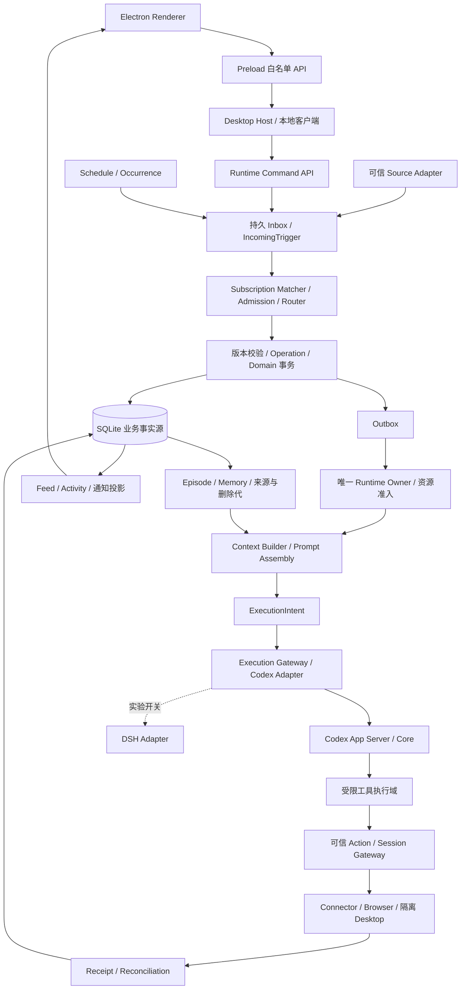
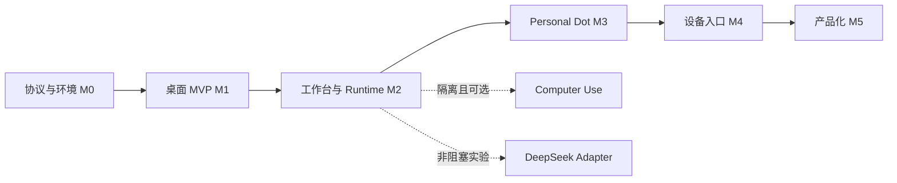

# Personal Agent 总体架构与开发规划

更新日期：2026-11-02  
范围：本地单用户桌面 Codex、Personal Dot、可选 Computer Use 与多设备入口。  
状态：当前设计基线；功能可用性由各阶段实际验收结果确认。

## 1. 文档导航与职责

本文件是项目规划入口，确定产品范围、模块边界、开发顺序、工作包与阶段 Gate。专题文档给出特定技术点的实施方案、前置条件、交接产物和验证要求。所有文档只描述当前设计，不保留多版本覆盖章节。

| 文档 | 适用阶段 | 技术职责 |
|---|---|---|
| [总体架构与开发规划](00_总体架构与开发规划.md) | M0–M5 | 产品范围、总体拓扑、阶段、工作包与质量门槛 |
| [Codex 接入与桌面交互](01_M0_M1_Codex接入与桌面交互.md) | M0–M1 | 协议锁定、RPC、流式 UI、审批交互、最小执行日志与完成验证 |
| [工作台与持久执行](02_M2_工作台与持久执行.md) | M2 | 领域状态、Owner、Lease/Fence、提交对账、Workspace 与数据恢复 |
| [单主聊天、上下文与个人记忆](03_M3_单主聊天_上下文与个人记忆.md) | M3 | 路由、Focus、Operation、Prompt、Episode、Memory 与遗忘 |
| [事件调度与长期自治](04_M2_M3_事件调度与长期自治.md) | M2–M3 | M2 基础调度；M3 Source/Subscription、Goal、预算与通知 |
| [可信执行与 Computer Use](05_M2_M3_可信执行与ComputerUse.md) | M2–M3 可选能力 | 可信 Gateway、回执、撤销、Browser/Desktop 驱动与能力开放 Gate |
| [多设备与产品化](06_M4_M5_多设备与产品化.md) | M4–M5 | 设备配对、ContextEvent、ACK、身份切换、发布与可选云端 |
| [DeepSeek 执行器适配](07_可选_DeepSeek执行器适配.md) | 可选实验 | 隔离适配、事件链、能力差异和与 Codex 的对照验证 |

### 1.1 共用合同与证据

| 文件 | 职责 |
|---|---|
| [schema.sql](contracts/schema.sql) | 唯一空库初始化结构、外键、索引与状态存储值 |
| [domain.ts](contracts/domain.ts) | ID、状态、转换、执行、事件、GUI 与验证 DTO |
| [protocol-capabilities.json](contracts/protocol-capabilities.json) | 锁版协议的 Schema 观察、必要/可选能力与实际运行验证状态 |
| [validate_contracts.py](contracts/validate_contracts.py) | 存储/接口一致性、文档导航与用例规范的本地静态检查 |

总体规划定义阶段与归属，专题定义领域规则，结构化合同定义具体形状。冲突必须同步修订并通过检查，不靠章节先后覆盖。专题可以引用其他专题的接口，不重新定义其状态机或批准规则。TypeScript 类型和 SQL 约束不能替代运行时身份、权限或外部副作用验证。

## 2. 核心技术决策

核心决策：

1. 使用 **Electron + React + TypeScript**，通过 **Codex App Server** 驱动开源 Codex Core，保留上游 Agent Loop、工具执行、Compaction 与 Sandbox。
2. **Dot Control Plane** 自行维护 Goal、Task、Run、Schedule、Memory、Source、操作与审批；执行器通过 Gateway 接入。
3. 单主聊天对应多个隔离的 Task Context；业务状态进入 SQLite，完整历史与摘要分开保存。
4. 长期任务以持久等待与事件唤醒推进，执行中断和外部写入不确定性通过独立账本恢复。
5. Codex 是默认执行器。DeepSeek Harness 作为可选实验适配器，DSH Super-Agent 的领域概念用于事件与任务建模。
6. 先完成桌面代码任务，再实现 Dot 长期自治，然后接入设备；正式产品账号、计费和多租户最后实现。
7. 任何阶段开放真实工具能力前，都必须具备与该能力匹配的文件、网络、进程、身份与审批边界。

## 3. 产品范围与开发阶段

### 3.1 开发阶段

| 阶段 | 必须交付 | 验收边界 |
|---|---|---|
| M0 协议与环境 | 工具版本锁、生成协议、客户端握手、真实非破坏性请求 | 取得可追溯 Thread/Turn 与实际结果，必要接口可用 |
| M1 桌面 Codex MVP | 项目选择、Thread、流式消息、工具展示、审批、中断、历史恢复、Diff | 在隔离测试仓库完成真实代码任务；拒绝和停止有效 |
| M2 Coding 工作台 | Worktree、Git、终端、子 Agent 展示、Skills/MCP、Task Store、单一后台 Runtime、Scheduler | 并行工作隔离、退出语义明确、崩溃恢复与计划实例去重 |
| M3 Personal Dot | 单主聊天、Router、Goal、Task、操作账本、Context、Episode、Memory、Source/Subscription、长期自治 | 多任务交替、长期等待/唤醒、计划修改、取消、遗忘与验证闭环 |
| M4 设备入口 | 手机/眼镜 ContextEvent、配对、弱网续传、结果与审批同步 | 设备是既有 Dot 的入口；不形成第二套任务权威 |
| M5 产品化 | 正式账号授权、数据隔离、跨用户切换、签名更新、发布、可选云托管与计费 | 通过相应身份、安全、数据、授权与发布验收 |

M1 不以 Browser、Linux GUI、Prompt 管理 UI、DSH 或第三方 OAuth 为前置条件。M2 的 Browser 只作为可选实验，使用无真实账号的专用 Profile 和测试站点。真实登录态与桌面控制的开放时间由安全验收决定，不能因阶段编号到了就自动启用。

本地开发使用受支持的 Codex 开发者授权方式；不复制私有 Token。设备配对、本地 IPC 身份校验、Webhook 验签等是能力接入的必要条件，独立于 M5 的正式产品账号体系。

### 3.2 必须支持的用户流程

- 桌面代码任务：选择项目与工作区 → 创建 Thread → 输入要求 → 展示流事件和工具 → 可信审批 → 修改/测试 → 验证结果 → 检视 Diff → 重启后继续。
- Dot 长期目标：主聊天输入 → Router 提案 → 持久化 Goal/Task/Operation → 派发 Run → 保存证据与 Checkpoint → 等待或创建 Schedule → 后续唤醒 → 验证与更新计划。
- 多任务交替：讨论研究 A、开发 B、监控 C；“继续 B”只注入 B 的状态与相关来源；C 后台完成不改变前台 Focus。
- 用户纠正：修改预算或截止时间后提升任务/计划版本，过期执行在派发边界失效；误路由造成的既有副作用保留并复核。
- 停止与遗忘：停止后续派发、处理在途结果；记忆删除覆盖派生内容、执行上下文与恢复路径。

## 4. 总体架构与模块边界



M1 以模块化单进程 Host 起步；M2 将执行与调度归一到唯一后台 Runtime Owner。本机模式由独立于 Renderer 的 Electron Main 承担，窗口可销毁/重建；独立常驻进程模式需另行开放受保护通道并验收。组件是逻辑模块，不要求每个模块成为独立服务。SQLite 事务、事件与 Outbox 足以承载本地单用户；Temporal、Kafka、多租户 VM 只在明确的新需求和测量证据支持时引入。

推荐代码边界：`apps/desktop/{main,preload,renderer}`、`packages/{contracts,codex-adapter,domain,store,runtime,context,policy,observability}`。Browser/Desktop 驱动独立进程；敏感 Connector/凭据服务位于工具执行域之外。初期保留少量清晰模块，按规模拆包。

依赖方向：`UI → Typed IPC → Command API → Domain/Runtime → Executor Adapter`。Domain 不依赖 Electron；Renderer 不接收通用 Shell、原始 RPC 转发、数据库写权限或 Driver Endpoint。

## 5. 阶段依赖、交接与范围控制



| 交接点 | 上游必须提供 | 下游可依赖的边界 |
|---|---|---|
| M0 → M1 | 固定二进制/协议、双向 RPC、真实 Thread/Turn 与故障状态 | UI 消费实际事件，不能按模型文本推测工具或 Agent |
| M1 → M2 | 最小执行账本、审批映射、完成收据、历史/中断与丢响应恢复 | 扩展持久执行，GUI 与唯一 Runtime 通过固定命令/事件接口协作 |
| M2 → M3 | 唯一 Runtime Owner、Domain/Operation/Intent/Action、Outbox、基础调度与资源准入 | Dot 只通过受控接口派工，不重新建设执行循环或第二套 Task Store |
| M3 → M4 | 固定 Task/Message/Source ID、可靠投递/ACK、取消、隐私与结果状态 | 设备是输入/反馈通道，未持久化或 Unknown 不能宣称完成 |
| M4 → M5 | 设备配对与撤销、Profile 数据边界、备份恢复和集成证据 | 正式账号、多租户、发布/升级分别通过对应 Gate |

**M1 的前置存储范围**：为持久保存 ExecutionIntent 与结果，M1 已需最小 Profile/Dot/Project/Workspace/Task/Run/ThreadBinding、审批映射和 VerificationSpec。它们是前台代码任务的内部账本，不开放 Dot Goal/Router UI。M2 再扩展完整派工、后台 Owner、Outbox 和计划执行，避免“恢复依赖 M2、M1 却要先验收恢复”的依赖环。

当前M0–M3已在记录的macOS arm64/锁版CLI0.163.0/本机Electron Main后台范围验收，M3复用Schema6与63项固定API；真实链、Unknown边界与未启用能力以阶段进展记录和[Gate](../progress/evidence/M3-gate.json)为准。M4未启动，正式身份/权限保持M5。

M3 内按“显式路由与 Context → Goal/事件计划 → Memory/遗忘 → 长期集成验证”分切片。接口冻结后可独立开发，但进入 M3 Gate 前必须打通同一真实执行链。Browser、DSH 和向量检索均不作为基础桌面阶段的隐式前置条件。

### 5.1 横向能力的阶段归属

| 能力 | 最早落实阶段 | 后续扩展 |
|---|---|---|
| IPC/路径/Sandbox、密钥不进日志 | M0/M1 | 每次增加实际执行能力时重验 |
| 固定协议、真实模型/认证可用性 | M0 | 升级时复测；正式产品登录仍属 M5 |
| Trace ID 与当前执行证据 | M0/M1 | M2 完整事件/恢复，M3 来源与删除代 |
| 最小执行日志与 VerificationSpec | M1 | M2 完整 Runtime，M3 Goal 完成判定 |
| DB/Artifact 一致性与备份 | M1 最小持久化，M2 完整恢复 | M3 合并删除/撤销水位，M5 升级恢复 |
| 配额、计划实例、Misfire | M2 | M3 跨 Goal/子任务预算和通知 |
| 来源身份、订阅与私人记忆 | 接入对应 Source/数据时 | M3 必须闭环，不后置到设备或商业化 |
| 设备配对、防重放和隐私分类 | M4 | M5 可扩展正式账户；两者不可相互替代 |
| 真实账号 Browser/敏感外部写入 | 能力开放前 | 专项验收，不能用 M 编号代替授权 |

### 5.2 规划中的验证前提

各专题只规定开发验证范围、验收底线与证据要求。完整用例、Fixture 与 Runner 在真实开发时与对应功能并行规划和实现，当前不预设完整测试库。协议真实运行、桌面驱动/硬件差异、跨进程撤销、外部 Provider 回执与数据迁移都必须取得实际证据；当前静态合同检查不关闭这些运行风险。性能先记录基线与样本量，再确定可重复的门槛；不能提前编造延迟/成功率 SLO。


## 6. 实施工作包与验收

工作包 ID 在整个项目唯一。`DESK-` 为桌面与协议，`RUNTIME-` 为持久执行，`DOT-` 为业务，`PROMPT-` 为指令，`CU-` 为驱动，`DSH-` 为实验，`DEVICE-` 为设备，`RELEASE-` 为产品化。

| 阶段 / 工作包 | 交付 | 必须验证 |
|---|---|---|
| M0 / DESK-001 | 最小工程与安全窗口、版本/二进制/协议锁 | 确定可执行路径，Renderer 无通用 OS 能力 |
| M0 / DESK-002 | 类型化双向 RPC、Supervisor、能力矩阵 | 握手、必要方法、错误帧/退出/未知版本处理 |
| M0 / DESK-003 | 隔离 Fixture 中的真实 Thread/Turn | 实际结果与 ID 可追溯；协议生成不代替运行测试 |
| M1 / DESK-004 | 项目导入、聊天/工具流、历史分页与 Reducer | 相同 Delta 不丢、终态校准、重连不拼错历史 |
| M1 / DESK-005 | 服务端请求、审批、中断/Steer | 拒绝真实阻断；断线不默认允许；旧 RPC ID 不复用 |
| M1 / RUNTIME-001 | 最小前台执行账本、Intent、审批映射与当前验证证据 | 重启/丢响应有据可查，Unknown 不自动重发 |
| M1 / DESK-006 | 只读 Diff、VerificationSpec、基本恢复 | 真实代码修复通过必要验证；丢响应有安全处理 |
| M2 / DESK-007 | Worktree/Git/编辑预览/PTY | 无越界写入、不丢用户改动、并行项目隔离 |
| M2 / DESK-008 | Skills/MCP/子 Agent 状态 | 实际目录与事件，不制造不存在的工具或子 Agent |
| M2 / RUNTIME-002 | 唯一 Store、状态/CAS/Fence/Outbox/Operation | 外键、活动 Run 唯一、旧 Fence 拒绝、逐项恢复 |
| M2 / RUNTIME-003 | 唯一后台 Owner、IPC、Intent/Action 对账 | 双启动、退出、升级、提交响应丢失均不盲重跑 |
| M2 / RUNTIME-004 | Schedule/Occurrence、Misfire、资源准入 | DST/休眠/重叠/改期、实例去重与有界补偿 |
| M3 / DOT-001 | 主聊天、Focus/Pending、规则与模型 Router | 显式 ID、歧义、查询、多动作与纠错回归 |
| M3 / DOT-002 | Context、Episode、Checkpoint、Rollover | 长历史有限 Context，来源可追溯、恢复不串任务 |
| M3 / DOT-003 | Goal/Plan Diff、Source、Subscription/Mandate | 可信来源、投递恢复、取消联动、无回声循环 |
| M3 / DOT-004 | Memory/删除代/派生关系与运行时隔离 | 并发遗忘不复活、旧 Thread 不恢复私密来源 |
| M3 / DOT-005 | 主动执行、通知、预算与完成评估 | 长期 Goal 唤醒/修改/停止/验证闭环 |
| M2–M3 / PROMPT-001 | 模块选择、Manifest 与 Role 合同 | 确定性装配、缺工具/冲突失败、实际权限有效 |
| 可选 / CU-001 | 测试 Profile Browser、Ref/Frame、受控下载 | 无真实账号，变化后重新观察、未知点击不重放 |
| 可选 / CU-002 | 隔离 X11 Fixture、Wayland 能力探测 | 坐标/窗口/权限/锁屏与接管屏障 |
| 能力开放前 / CU-003 | Action/回执/执行端撤销、凭据与出口 | Shell/Socket/URL 旁路拒绝、单次消费、在途结果准确 |
| 可选 / DSH-001 | 固定版本、许可与事件链实验 | 相同 Fixture 下对照质量/成本/恢复/安全，非桌面 Gate |
| M4 / DEVICE-001 | 配对、ContextEvent、ACK/续传与结果同步 | 来源可信、隐私类别有效、重传不重复创建 |
| M5 / RELEASE-001 | 正式 Auth、用户切换、分发签名/更新 | 身份/数据/Keychain 隔离、安装/升级/回滚 |
| M5 / RELEASE-002 | 可选云端/多租户/计费/灾备 | 租户边界、外部服务许可、运营与恢复验收 |

当前 M2 Gate 按专题既定的 macOS arm64 本机后台窗口模式验收：Main 唯一 Owner，窗口/Renderer 可重建，显式退出停止，暂停/唤醒后按 UTC 补偿。独立常驻进程、外部控制 Socket 和正式身份/权限管理按用户阶段安排在 M5 或对应能力开放前独立验收，不能宣称本机 Gate 已验证这些能力。可写 IDE、全局 Skill/远端 MCP 清单和实际子 Agent 未启用；其“不适用/未加载”状态不算功能测试通过。

Browser/GUI 并不因出现在表中而成为 M1 前置依赖。M3 Goal 的订阅清理、遗忘和停止属于同一阶段必要能力；M4 复用它们。实验执行器、模型和向量库不进入主线关键路径。

### 6.1 跨阶段必须覆盖的验证风险

| 验证要点 | 验收要求 |
|---|---|
| 同 Item 输出 `a/a/b`，随后完成和重连 | 最终内容 `aab`，快照校准无重复 |
| 服务端接受 Thread/Turn 后客户端丢失响应 | 对账或保持 Unknown，无依据时不重提 |
| 双 Owner/双 Worker 与过期 Lease | 唯一有效执行权，旧进程不能新增派发 |
| 授权检查后立即接管、取消或撤销 | 执行端确认后无旧 Epoch 新输入，在途结果真实记录 |
| 同 Receipt 两次并发消费 | 一次原子预占，未知结果不回填消费次数 |
| Shell、绝对路径程序、Socket、浏览器 URL 尝试绕过 | 实际访问控制阻断，模型是否口头拒绝不影响结果 |
| 非法 Actor、Bot 回声、多 Task 同时命中 | 不扩大权限，逐项可靠投递且有界 |
| DST、休眠、改期后旧实例及慢任务重叠 | 固定补偿策略、当前版本生效、次数有界 |
| 多动作第一项后断电 | 返回各项状态，仅续接安全且未完成的步骤 |
| 遗忘与抽取并发、恢复旧 Thread/旧备份 | 最新墓碑与撤销生效，派生记忆不复活 |
| 零测试/全 Skip/错误 Target/陈旧结果 | 不生成虚假 Completion Receipt |
| 真实外部提交后超时 | 对账优先，无重复发送/购买/发布 |
| Artifact 发布与 DB 引用提交之间断电 | 无损坏可见引用，孤儿可安全回收 |
| 预算竞争、Usage 超额或失联 | 不双重分配余额，如实记录费用并停止新工作 |
| 设备重传、乱序、断线与审批消息重放 | 稳定 ID 去重、可信 ACK，旧批准无效 |

本地合同检查与上表的真实执行测试分开报告。Schema 成功初始化、类型语法有效，不代表浏览器安全、模型效果、跨进程原子性或整套应用已通过。

## 7. 开发、验证与交付规则

首个支持平台 Linux x86_64；跨平台路径、Sandbox、PTY、Keychain、通知和 Driver 通过 Adapter 隔离。开发工程建立包管理锁、Node/Electron/Playwright/原生模块版本；依赖默认冻结安装。应用私有数据位于平台 `userData`，与上游 Codex 自有状态分开管理。

每项变更给出范围、输入输出、失败行为、验收、Schema 影响和证据。持续集成覆盖类型/接口、存储约束、协议、Reducer、恢复、权限和相关 E2E。敏感场景只用隔离 Fixture 与模拟外部服务，打开真实账号能力前单独验收。

当前可执行的文档合同验证：

```bash
python3 docs/design/contracts/validate_contracts.py
node --experimental-strip-types docs/design/contracts/domain.ts
```

Node 命令仅检查类型文件可解析，不替代正式 TypeScript typecheck。应用工程建立后加入 `typecheck/test:protocol/test:recovery/test:e2e` 等实际脚本；没有实现的脚本不宣称已通过。

升级 Codex 时重新生成协议、比较必要/实验方法与字段、验证审批/历史/恢复，再更新二进制与协议锁。数据库升级使用明确 Schema Revision 的迁移 Runner；初始化 SQL 只用于空库，不能用 `IF NOT EXISTS` 掩盖已有结构不一致。发布签名、更新通道、许可证/SBOM 与品牌核查属于正式分发 Gate。

## 8. 开发验证与用例规划方式

当前阶段确定“验证什么、由哪个阶段负责、以什么证据验收”；不在文档拆分阶段展开完整测试用例、测试夹具和自动化脚本。具体用例在真实开发时，与对应工作包的接口和实现并行设计。

每个工作包开始开发时，开发者同步细化：正常路径、失败/拒绝路径、状态前置条件、并发/恢复边界、Fixture、可观察断言和证据。数据与协议变化时同步检查相关用例，不能在全部功能完成后才补规划，也不能为让用例通过而放松批准或 Unknown 处理。

| 层次 | 规划要求 | 实际开发时的交付 |
|---|---|---|
| 合同/单模块 | ID/状态/Schema/运行时校验与确定性规则 | 最小可复现输入、负例及真实断言 |
| 集成 | UI/Host/Runtime/Adapter/Store 的接口和交接 | 使用真实边界的集成记录，必要 Stub 单独标明 |
| 故障与并发 | 提交丢响应、租约过期、部分完成、撤销/接管 | 明确故障注入点与恢复后的状态、动作计数 |
| 端到端 | 每阶段必须支持的用户闭环与对应权限 | 固定目标、当前 Run、实际验证命令/结果和产物 |
| 平台/发布 | Linux/桌面协议/硬件、身份与安装升级差异 | 环境、版本、真实设备或模拟器标记及恢复证据 |

用例实现采用实际工作包和目标工程的测试框架，避免为了尚未确定的 API 先建设庞大测试基础设施。优先用隔离环境与模拟敏感外部服务，覆盖拒绝和未知结果；需要真实模型、驱动或硬件的验证不得用静态检查替代。

结果区分：仅有验证要求、用例已细化、未运行、通过、失败、跳过、被外部条件阻塞。运行记录包含二进制/协议/模型/配置、目标工作包、环境、命令与退出码、测试发现/执行/跳过数量、Task/Run/相关事件 ID 以及脱敏证据引用。没有这些记录不宣称阶段 Gate 已通过。

## 9. 公开接口与研究入口

下列资料用于协议、驱动或领域参考；产品内部实现与特定模型能力不作为本项目必须可调用的接口。

- [Codex 开源仓库](https://github.com/openai/codex)、[App Server 公开文档](https://developers.openai.com/codex/app-server)。实施以锁定二进制生成类型与实测结果为准。
- [DSH Prototype 领域模型](https://github.com/deepseek-ai/dsh-superagent-prototype/blob/6337fc823ce20251c8de8085948165c81aaa701e/docs/001-domain.md)、[授权](https://github.com/deepseek-ai/dsh-superagent-prototype/blob/6337fc823ce20251c8de8085948165c81aaa701e/docs/002-authorization.md)、[执行](https://github.com/deepseek-ai/dsh-superagent-prototype/blob/6337fc823ce20251c8de8085948165c81aaa701e/docs/003-execution.md)。
- [DeepSeek Harness](https://github.com/deepseek-ai/deepseek-harness/tree/ce7073d51254c26cd63b22a60835b8f948deb447)，用于可选适配研究。
- [Microsoft Playwright MCP](https://github.com/microsoft/playwright-mcp)，集成时另行固定版本并包裹受管边界。
- [RemoteDesktop Portal](https://flatpak.github.io/xdg-desktop-portal/docs/doc-org.freedesktop.portal.RemoteDesktop.html)、[ScreenCast Portal](https://flatpak.github.io/xdg-desktop-portal/docs/doc-org.freedesktop.portal.ScreenCast.html)，以目标桌面实现验收。
- [OpenMuse](https://github.com/CopilotKit/OpenMuse)、[OpenDots](https://github.com/CopilotKit/OpenDots)，用于产品交互、Task Worker、受管动作与 Workspace 思路对照，不作为并列必需主运行时。
