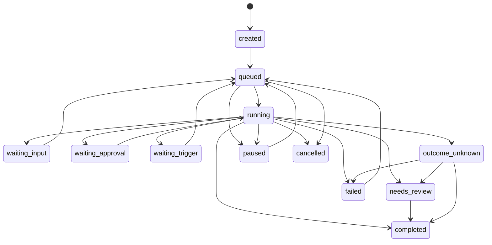
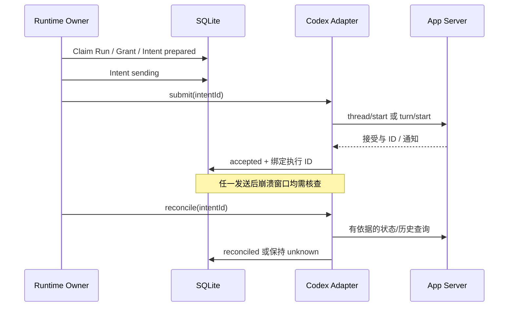

# M2：工作台与持久执行技术方案

适用阶段：M2；最小执行日志在 M1 落地  
实施状态：只读工作区/Git、持久命令、任务队列/Outbox 与 Token/单前台准入与多项任务控制 DAG 已实现；Daemon、PTY、完整资源/调度与阶段 Gate 仍待完成。实际执行与验收见 [M2 进展](../progress/M2.md)。
总体入口：[总体架构与开发规划](00_总体架构与开发规划.md)

## 1. 实施边界与输入

**目标**：在可靠桌面交互上建立单一后台 Runtime、隔离工作区、持久派工和故障恢复。

**前置条件**：M1 Gate 通过，最小账本与协议合同可用；M1 与 M2 共享相同领域状态。

**对应工作包**：`DESK-007`、`DESK-008`、`RUNTIME-002`、`RUNTIME-003`。工作包的定义与阶段 Gate 统一见总体规划。

**共用合同**：[领域接口](contracts/domain.ts)、[数据库结构](contracts/schema.sql)、[协议能力矩阵](contracts/protocol-capabilities.json)。本专题定义所属领域的语义，直接引用共用合同，不复制第二套 Schema。

**协作边界**：时间/事件与资源准入由[调度自治方案](04_M2_M3_事件调度与长期自治.md)定义；逐操作路由由[M3 方案](03_M3_单主聊天_上下文与个人记忆.md)定义，M2 可先接确定性的 UI 命令。

## 2. 领域对象、状态与唯一事实源

### 2.1 对象定义

| 对象 | 职责与生命周期 | 唯一事实源 |
|---|---|---|
| Profile / Dot | 本地数据域、个人 Agent、策略代与删除代 | 自有 SQLite；Profile 是本地身份，不要求账号注册 |
| Project / Workspace | 仓库与实际代码目录/Worktree | 业务元数据与真实 Git/文件系统共同核对 |
| Main Conversation / Message | 统一交互历史；一条原文可关联多个任务 | Message Log |
| Goal | 长期目标、约束、成功条件、计划及复审 | Goal Store，`version` 与 `plan_version` 分开 |
| Task | 长期稳定工作单元 | `tasks`；允许多个历史 Run 与 Thread |
| Run | 一次派工执行窗口，直到执行结束、失败或确认取消 | `task_runs` |
| Thread / Turn / Item | 实际执行上下文、轮次与展示单元 | Codex Runtime；自有库只存映射 |
| Operation | 用户命令的一项可恢复执行 | `operations`，按决策内顺序唯一 |
| ExecutionIntent | 向执行器提交的请求及其接收不确定性 | `execution_intents` |
| Action / Approval / Receipt | 有副作用的动作、精确批准与真实结果 | 可信执行器账本及 Provider 证据 |
| Schedule / Occurrence | 可修改计划与某个确定的计划实例 | Scheduler Store |
| IncomingTrigger / Delivery | 不可变来源事件与对 Task 的投递 | Inbox / Delivery Store |
| Episode / Claim / Checkpoint | 历史检索、带证据事实、任务恢复快照 | 各自来源化存储；均不签发权限 |

`Ticket` 在本项目是 Task 的领域别名，`Assignment` 是 Run 的接口别名；不建立第二套 `tickets/assignments` 权威表。DSH 自身的 Assignment 生命周期由实验 Adapter 映射，不影响本项目合同。

### 2.2 Task 与 Run 状态

Task 使用 `domain.ts` 中 `taskStatuses/taskTransitions`；数据库 CHECK 与其保持一致。主要路径：

图展示主要路径，完整合法边以 `taskTransitions` 为准；每条边都要执行以下 Guard：

- 恢复是命令及状态转换，不设置额外 `resuming` 状态。用户回答后，原 Turn 仍有效时可继续原 Run；已结束则排队创建新 Run。
- `completed/cancelled` 作为当前 Task 的终态，后续工作创建关联 Task，并可引用原成果。持续监控的 Run 可完成，但 Task 保持 `waiting_trigger`，不能每次检查都关闭 Task。
- `Run completed` 仅表示执行窗口结束，不能直接把 Task/Goal 置为完成。业务完成要经过 VerificationSpec。
- `outcome_unknown` 禁止普通重试和新派工；可信 Reconciliation 确认事实后才转移。需要读取外部记录时使用受限对账能力。
- 完成、暂停、取消、更新约束和恢复均记录 Task 版本；状态边、当前版本、Scope、权限和依赖均必须满足。

活跃 Task 的暂停/取消先持久化 Operation、设置 `dispatch_blocked=1` 并使旧 Grant 失效，UI 显示“正在停止”。所有新 Run 领取都要求 `dispatch_blocked=0`。执行端确认停止后才进入 `paused/cancelled`；存在未解决外部结果时保持 `outcome_unknown` 与阻止标记，分别显示“后续已停止”和“现有结果待核对”。对账后经 `needs_review` 完成取消，不自动重新排队。恢复暂停任务需要新的可信命令重新校验并解除阻止。

Run 的非终态是 `preparing/submitting/running/waiting_input/waiting_approval/outcome_unknown`；终态是 `completed/failed/cancelled`。SQL 限制每 Task 至多一条非终态 Run。需要并行的子问题拆为子 Task、独立上下文和必要的 Worktree，不并行写同一个 Task 的状态。

### 2.3 并发、租约与事务

领取 Run 必须在 `BEGIN IMMEDIATE` 短事务内：校验 Task/Goal/Policy/Privacy、`dispatch_blocked=0` 与预算 → 将 Task 的 `write_fence` 递增 → 创建带相同 Fence 的 Run → 记录事件与 Outbox → 提交。业务 `version` 与执行 Fence 分开，Heartbeat 不应反复改变用户约束版本。

更新进度要求 Task 当前 Fence、Run ID、Runtime Epoch、Lease 有效且状态允许。Fence 在 Task 上单调递增，不能在每个新 Run 中重新从零开始。租约过期只表示待核查，不能直接把未知执行标失败；确认旧执行已停止且外部 Action 已对账后才能释放活动 Run。

写 Workspace 还需原子领取 Workspace 级写租约和单调 Fence，防止不同 Task 对同一个目录并发写。数据库 CAS 约束进度提交，实际 Shell/Driver/Connector 仍需在执行端核验 Grant；数据库租约不能阻止持有旧权限的进程继续产生副作用。

业务变更、Task 事件序号递增和 Outbox 写入属于同一事务。`task_events.sequence` 只在单 Task 中单调；Outbox 至少一次投递，消费者使用稳定键和条件更新实现幂等，有 Claim Lease、退避与 Dead Letter。事件日志用于审计与恢复，不承诺仅靠日志就能重建所有状态。

### 2.4 数据约束的执行位置

SQL 提供外键、同 Dot 的核心引用、状态集合、活动 Run/Thread 唯一性、Fence 不复用、事件序号和幂等键唯一性。状态转换边、当前 Task/Goal 版本、租约时间、Mandate 有效性、Operation 依赖 DAG、Frame 新鲜度、Payload Hash、对象可见性与删除代由可信 Domain/Gateway 的事务和派发 Guard 执行；不能把初始化 SQL 当成这些规则的完整实现。

`active_run` 从唯一非终态 Run 查询，当前 Thread 从唯一活动 Binding 查询，避免在 Task 行再保存第二套可独立写入的指针。需要缓存时作为可重建投影并在同一事务内维护。生成运行时 Schema 时验证 UUID/ID、枚举、整数时间/计数、JSON 形状、长度上限和来源范围；JSON1 的 `json_valid` 只能证明语法合法。

目标初始化 Schema 中包含后续阶段的空表，不要求 M0/M1 实现所有对应服务。初始化仅应用于空库，功能按里程碑与能力开关开放；未实现的外部执行能力保持关闭。

当前 Domain 使用同一 `ExecutionLedger` 的短事务：显式命令经固定 `desktop-command-v1` 映射到 Message/Decision/Operation，保存输入 Hash、对象与预期版本；相同 Key/Hash 返回已有结果，不同输入拒绝。支持创建排队任务、修改闲置任务标题、暂停、取消、恢复排队及受控领取。创建命令完成只证明 Task 已入队，派发命令完成只证明 Run/Intent 准备权已持久化，均不代表模型或业务完成。旧前台提交、续接、停止也记录 Operation；历史既存 Run 不追造操作记录。约束编辑与多 Operation DAG 尚未开放，M3 模型 Router 不是确定性命令的前置条件。

Task Command 对 Scope/版本/状态做 Guard；领取原子核对策略代、隐私代、Task 墓碑、关联 Goal 的活动状态与计划版本，冻结 Run 快照并领取 Task/Workspace Fence。当前仍是单前台 Run 准入，完整并发预算随后实施。活动暂停/取消先保存停止 Operation 和 `dispatch_blocked`，Operation 保持 executing；只有可信执行结果才完成到 paused/cancelled，失联或重启进入 outcome_unknown，不解除阻止或自动重发。显式历史对账证明原执行结束后，才应用已经保存的停止意图。

Outbox 已实现有界领取（1–100 项）、1–60 秒 Lease、单调 Claim Epoch、旧 Owner/旧领取拒绝，以及 1/2/4/8 秒退避和第 5 次失败/遗弃进入 Dead Letter。重启使旧 Owner 的领取失效，新 Owner 重新领取。任务事件投影与 delivered 确认在同一事务中，通过 `main_feed.source_event_id` 去重；投影只含事件/任务/Run ID、类型、版本，不复制用户输入或工具内容。Task 墓碑抑制发布及查询。当前消费者不发送模型或外部动作，其他消费者需分别定义幂等效果与回执；不把本地事务等同于外部 Exactly Once。

桌面队列以固定 DTO 提供保存、改名、暂停/取消/恢复和用户显式开始；创建不打开 App Server，开始复用同一 ForegroundExecution 的 Intent/原生策略/冻结验证流程。恢复保留 Task/Thread，领取新 Run/Fence；未确认中断保持 Unknown。缺少原始可复用输入的历史 Task 拒绝恢复，不能猜测或借旧 Hash 重新派发。任务页与活动页不展示被 Task 墓碑删除的对象；活动游标按项目分页，返回项目内的待投影/Dead Letter 计数。Main 的本地 Outbox Pump 只做幂等投影；时间计划 Pump 每秒推进/消费内部 Source，默认只恢复排队；用户明确安排的一次性只读自动执行另经 Run/预算/来源 CAS 和原 Intent Gateway 派发，同实例已创建 Run 后不自动重发。主程序完全退出时 Pump 停止，下次启动按持久游标处理错过时刻；尚无 Daemon/关闭 GUI 后运行承诺。Renderer 白名单现在为 32 项（含只读预算、批量计划与时间计划的固定接口），仍没有 SQL、argv、Grant 或任意文件能力。

确定性批量控制使用单 Message/Decision、最多 20 个 Host 签发的 Operation 与不可变依赖 DAG；允许暂停、取消、恢复排队、改名，不由计划直接派发模型。Parent Command Key/Hash 去重；环、自引用、跨项目与跨 Task 的版本引用在保存前拒绝。依赖版本只从同一 Task 前置节点已保存的完成收据取得，外部更新仍产生版本冲突，不改用最新版本。每节点效果/事件/状态单独事务提交；普通存储故障回滚本节点并保持待处理，先前节点保留。业务 Guard 失败记 failed，其后继 cancelled；executing/Unknown 阻止后继，独立节点可继续。停止请求复用既有中断 Intent 和确认路径，Unknown 不重发。撤回仅取消 pending/blocked，已完成、执行中与未知结果保留。Task 墓碑隐藏整个关联计划并停止后续推进。GUI 批量选择保留当时版本，展示逐项部分结果，操作处理完成不等于 Task 业务验证完成。

代码队列只有固定 Node 验证能力齐备时开放；首次领取冻结合同，后续领取继承原合同。Verifier 的 Git 状态/Diff 读取使用清理认证后的环境、禁用全局/系统配置及外部 Diff/textconv/fsmonitor/hooks，并拒绝有效 include 配置中的 clean/smudge 过滤器。历史合同的 Verifier Hash 变化仍拒绝复用；不更新旧 Hash 绕过合同，新的验证配置需另行验收。

## 3. 运行进程、所有权与后台语义

### 3.1 唯一执行所有者

| 模式 | 执行 Owner | GUI 生命周期 | App Server / Scheduler / DB 写协调 |
|---|---|---|---|
| M1 本地模式 | Electron Main | Main 完全退出则执行停止，状态下次恢复 | Main 独占 |
| M2 常驻模式 | 本地 Runtime Daemon | GUI 是客户端，可关闭后重新连接 | Daemon 独占 |

同一 Profile 不允许 Main 与 Daemon 同时作为执行 Owner。启动使用 OS 单实例锁和受保护的本地 IPC；取得执行权后事务性提升 `runtime_epoch`，执行授权绑定该 Epoch。PID 不是跨重启的身份凭证，数据库中的 Owner 行也不能代替 OS 互斥锁。

后台模式切换与升级流程：停止接收新派工 → 排空或中断活跃执行 → 对账未知结果 → 关闭旧 App Server → 确认旧 Owner 失效 → 新 Owner 提升 Epoch 并启动。无法确认旧 Owner 已失去派发权时保持阻止；不能通过抢锁自动获得对同一现场的并发控制。

### 3.2 审批、IPC 与重启

- GUI 与 Runtime 使用受保护 Unix Socket 或平台等价机制，校验调用者身份、消息大小、Profile 和对象范围。相同 UID 的 `SO_PEERCRED` 不能单独区分可信 GUI 与恶意工具进程，需配合独立执行 UID、命名空间、访问控制或可信通道。
- App Server 每次连接有 `connection_epoch`；服务端请求保存 `(runtime_epoch, connection_epoch, rpc_id, thread_id, turn_id)`。旧连接的审批回复不得用于新连接。
- GUI 缺席时审批保持等待或按锁版协议拒绝；默认拒绝/阻止，不能静默允许。新 GUI 读取可信 Pending 状态；若上游已取消请求则显示取消，不伪造可恢复 Request。
- 正常退出取消新派发，释放可释放资源；强制退出后 Run 进入待核查路径，先查询与对账。进程退出不等于已撤销外部请求。

### 3.3 能承诺的执行条件

最小化/隐藏窗口：Owner 存活时可继续。关闭 GUI：只有 Daemon 模式可继续。Owner 退出或主机关机/休眠：本地无法继续执行，下次启动按 Schedule Misfire 处理。远端执行需另行部署并验收，不能用“后台任务”模糊这些区别。

## 4. 持久执行、提交不确定性与对账

### 4.1 ExecutionIntent 协议

每个可能改变执行现场的 RPC 先持久化 Intent。生命周期：`prepared → sending → accepted/rejected/outcome_unknown → reconciled`。

1. `prepared`：输入 Hash、目标、Grant、Manifest、Run 已确定，尚未尝试发送。
2. 先提交 `sending`，再写入传输。此后崩溃都按“可能已接受”处理；本地 JSON-RPC ID 不能视为上游业务幂等键。
3. 收到明确结果后原子绑定 Thread/Turn、保存响应引用并置 `accepted`；确认未执行的错误才可 `rejected`。
4. 新 Thread 的 ID 可靠绑定前，不提交 Turn。按 Thread 串行提交，避免重连时混入另一项用户输入。
5. 超时/断线进入 Unknown，利用已知 Thread、历史、服务端关联能力与输入证据对账。`clientUserMessageId` 仅在实测证明相应语义后才能用于幂等判断，不能靠字段名称推定。
6. 无法判断是否接受时停止自动重提，保留 Unknown 与人工核查入口。只创建了上下文的孤儿 Thread 与已执行副作用的 Turn 分别处理。

### 4.2 Action 与外部副作用

Action 状态独立于 Run：`prepared → awaiting_approval → approved → reserved → dispatched → succeeded/failed/outcome_unknown`，另有 `rejected/cancelled`。无须逐次批准的低风险动作也要先形成可审计 Action 再预占派发。

Action Key 由可信 Dispatcher 基于逻辑操作生成并复用；同 ID/Key 不同 Hash 拒绝。不能通过换一个 Action ID 绕过未知结果。对 Provider 支持的幂等键必须传递稳定值；不支持时依邮件 ID、订单号、Git Commit 等查询。无确定查询结果则转人工核查，不自动再次发送、购买或发布。

Reconciliation 是确定性恢复路径：查询已知外部对象/版本 → 保存成功、明确失败或未知证据 → 更新 Action/Intent → 再决定 Task。付款/订单、邮件、日历和 Git 的查询方法由 Connector 合同分别定义。UI 结果明确区分“已派发”“已确认完成”“待核对”。

## 5. 项目、Git、工作树与终端

Project 的 canonical Git Root、Workspace 的真实目录与 Codex Thread 映射分别维护。导入与每次派发前核对真实路径、允许范围、Git 状态和外部变更；符号链接不能扩大可读/可写范围。运行中变更 cwd 必须暂停并重新校验权限与绑定。

当前只读工作台使用[展示 DTO](../../packages/contracts/src/workspace.ts)和四个范围受限 Query：项目概览、目录、文件预览、分文件暂存/未暂存 Diff。Renderer 只能传 Project ID 与 Host 签发的短期不透明 Entry/Change ID；刷新撤销旧 ID，跨项目或目录/文件身份变化拒绝。Host 复用最小账本中的 Workspace 身份，不新增 Task Store 或执行 Owner。工作区查询与前台任务串行，Main 退出会停止读取。

读取进程使用锁版 CLI 的原生只读、无网络权限配置，空白 Home，清除认证与父客户端工具桥环境。只授予 Workspace、固定读取程序和 Node/Git 的公共安装依赖；认证配置、`.env`（含大小写变体）、本地缓存及符号链接不签发可读 ID，Git 元数据不作为文件预览开放。项目文件不作为代码加载，HTML 以 React 文本展示。当前能力只在已验证的 macOS arm64 启用，缺少原生组件时关闭能力，不降级成无沙箱读取。

Git 使用固定 argv、`--no-optional-locks`、字面路径、NUL 分隔 porcelain v2；禁用外部 Diff/textconv/fsmonitor/hooks、维护及全局/系统配置。检查包含 include/条件 include/Worktree 配置的有效过滤器设置，有过滤器时关闭该仓库的 Git 查询；不执行项目 Helper。当前只接受 Workspace 根内真实 `.git` 目录的普通仓库，Linked Worktree、嵌套项目对外部 Git 元数据的授权与子模块保持不支持。Diff 前后核对状态/索引/文件身份，外部修改要求刷新。格式依据：[git-status](https://git-scm.com/docs/git-status)、[git-diff](https://git-scm.com/docs/git-diff)。

查询预算：目录超过 10,000 项时拒绝，展示最多 200 项并标记截断；文本预览最多 128 KiB，二进制/非 UTF-8 或大文件只返回说明；Git 命令输出最多 256 KiB、变更最多 500 项、索引最多 16 MiB 且必须为普通文件，句柄最多 4,096 个。Git 单命令限时 5 秒，整次读取默认 12 秒；超限/中断终止进程组，不返回部分 Diff。索引与文件读取有界，超时与异常使用固定错误码，不导出原始 stderr 或私有路径。读取不修改源码、HEAD 或索引。

并行编码默认独立 Worktree。Workspace Service 使用 argv 调用 Git，记录创建者、关联任务和生命周期；Git 操作本身是外部副作用，保存 Intent/结果。删除前检查未提交、未跟踪/忽略文件、活跃执行和本地独有提交，默认拒绝破坏性清理。

Agent 提供 Diff、测试与提交证据；默认人工审查合并和推送。并发改同一目录需要 Workspace 写锁，锁过期也要核查实际进程。工作树从外部被删或修改时标为 Invalid，不自动创建同名目录覆盖现场。

终端分为 Agent Tool Log 和用户主动 PTY。Tool Log 是受控执行结果；用户 PTY 的权限与 Agent Sandbox 不同，标识清晰。PTY 按 Workspace 绑定、限制生命周期；Renderer 的有限终端能力仍要求来源和范围校验，不能让外部 Artifact 操作 stdin。

Sub-Agent Dashboard 只从真实事件与可验证父子关系展示；独立任务和权限差异明确时才启用。Skills/MCP 先提供目录、状态和调用记录，安装与发布另走受控配置。生成 Skill 默认 Draft，测试与可信审核后才可激活；学习与 Memory 无权自行签发新能力。

## 6. Trace、业务事件与观察性

关联 `profile/dot/goal/task/run/operation/intent/action/thread/turn/item/approval/artifact` 和 Epoch。Trace 记录性能与诊断，Event/Receipt 是恢复与审计合同；二者不混用。默认只记录来源引用、哈希与必要摘要，不保存明文秘密、完整私人邮件或模型隐含推理链。

记录模型/二进制/协议/Prompt/工具快照、约束版本、队列等待、工具次数、Usage、重试类别与完成证据。UI 提供 Activity、结果未知与审批状态。RPC Inspector 默认关闭、脱敏、限容量；导出复现包时再次进行隐私筛选。

观察指标：验收完成率、错误任务归属率、恢复成功率、Unknown 对账率、重复 Action、审批绕过、Context 串扰、记忆有效性、计划取消正确性、通知价值、成本及 p50/p95 延迟。报告样本数与分层错误，不能用小样本零失败保证真实世界绝对安全。

## 7. Artifact、备份与恢复

Artifact 流程：授权临时路径写入 → 大小/格式/哈希/扫描校验 → 必要 fsync → 同文件系统原子发布 → 事务提交 published 引用。跨文件系统先复制至目标临时路径再发布。未提交引用的孤儿文件可由 GC 回收，不能因 DB 失败删除用户原始文件。

读取验证状态、哈希、Dot/Task 可见性和 Privacy Tombstone；受控 Storage Key 不能是任意 `file://` 或越界路径。截图和敏感 Prompt 快照有独立加密/访问与保留期。磁盘不足时停止产生新产物，不能提交空文件并宣称成功。

使用 SQLite Backup API 或经验证的一致性快照，避免运行中只复制主 `.db` 而遗漏 WAL。备份清单包括 Schema Revision、Artifact 哈希、运行时引用、Policy/删除日志水位与时间。迁移前备份并演练恢复；恢复不重新启用旧 Lease/批准，先提升 Runtime Epoch、合并最新删除/撤销日志并对账 Unknown。

## 8. 实施顺序与交接

只读 Workspace Query 可以先作为独立能力交付；写入与后台派发先固定 Domain/Store 与状态 Guard，再实现 Owner/IPC、Claim/Fence、Outbox、Intent 对账和 Workspace 写服务，随后扩展后台任务与恢复。M2 UI 操作可产生确定性的命令/Decision/Operation，不能为了写账本而先要求实现 M3 的模型 Router。

GUI 与 Daemon 的 Command/Query/Event API 要在 M2 固定消息形状和错误分类。数据库 Schema 相同不代表可以让两个 Owner 同时写执行状态；升级与切换按排空协议执行。

交给 M3：唯一 Runtime、受控 Execution Gateway、Task/Run/Operation/Intent/Action、事件订阅与补拉、Workspace 服务、Artifact/备份和必要配额接口。RUNTIME-004 的基础调度在调度专题实现；两者共同完成 M2 Gate。

验收必须保留真实进程故障证据：双启动、崩溃前后 ID、Lease/Fence、Provider/模拟端点计数、未提交与忽略文件，以及恢复后状态。仅 Mock 进程句柄不能证明旧 Worker 已停止。

## 9. 开发验证要求

以下只规划 M2 必须覆盖的验证范围与验收证据。具体输入、步骤、Fixture、故障注入方式和自动化实现，在对应工作包真实开发时并行细化。当前不宣称已经形成完整用例库或通过应用验收。

| 验证方向 | 必须覆盖 | 验收证据要求 |
|---|---|---|
| 状态与存储 | 合法/非法状态、同 Dot 引用、活动 Run/Binding 唯一性、条件更新 | 数据库约束与服务 Guard 分开验证 |
| Owner/Lease/Fence | 双启动、旧进程、Heartbeat/过期、Main/Daemon 切换与停止 | 真实进程与 Epoch 记录；唯一派发者 |
| 提交与对账 | 服务器接受前后丢响应、重复请求、外部未知结果 | Intent/Action/外部计数，无盲重跑 |
| Workspace/Git/PTY | 并行工作区、符号链接、外部变更、未提交/忽略文件与安全清理 | 文件/提交状态及资源隔离证据 |
| Operation/Outbox | 重复投递、部分完成、消费者失联、重试与 Dead Letter | 逐操作结果、稳定去重键与恢复记录 |
| 数据与升级 | Artifact/DB 提交边界、WAL 一致性备份、磁盘不足与恢复 | 当前备份/产物哈希、无丢失与无旧授权复活 |

每项实际验证记录正常/失败/拒绝/恢复结果，区分真实组件、Stub、模拟器和外部阻塞；执行状态与证据格式遵循[总体规划](00_总体架构与开发规划.md)的开发验证规则。
