# 基于 Codex Core 的桌面 Codex 与 Personal Dot：完整技术方案及分阶段开发路线

> **文档版本**：v1.1 · 2026-10-31（保留 v1.0 原文；新增 DeepSeek 修订章）  
> **用途**：项目立项、技术评审、Codex/Claude Code 编码实施、阶段验收及后续 AI 眼镜接入的单一开发基线。  
> **明确的开发顺序**：**第一步做桌面 Codex → 第二步做桌面 Dot → 第三步考虑眼镜入口 → 最后再处理正式登录授权和商业化**。  
> **优先原则**：功能端到端可用、上游源码可持续跟进、每个阶段有客观验收。前期不以 OAuth、账户注册、付费计费或多租户上线为门槛。  
> **项目定位**：基于 Apache-2.0 开源的 `openai/codex` 搭建独立桌面客户端，并在其上开发自主可控的个人 Agent（以下简称 Personal Dot）。它**不是 OpenAI 官方桌面 App，也不等于接入官方未开放的 dots 云端服务**。产品名称、品牌和分发须区分官方产品。  
> **来源标注**：`[源码]` GitHub 可核对；`[官方]` 官方文档；`[方案]` 本设计新增模块/API/Schema；`[待验证]` 运行或兼容性尚需实测。

---

## 目录

0. 项目决策、边界和总体里程碑
1. 产品需求与前期功能验收范围
2. Codex 开源能力清单和复用边界
3. 技术选型、系统总体拓扑与安全域
4. 仓库组织、分层接口与依赖约束
5. App Server 协议、类型生成和进程管理
6. 桌面 Codex：会话、流式 UI、审批与交互
7. 桌面 Codex：Project、Git Worktree、Diff、终端
8. 桌面 Codex：Sub-Agent、Skills、MCP、Memory、Goal
9. 可恢复执行、后台任务、自动化和本地存储
10. 桌面 Dot：独立 Personal Agent Control Plane
11. Conversation Router、Task Session、Context Builder
12. Dot Goal Manager、Future Task、主动执行
13. Dot 长期记忆：事实、来源、检索与修订
14. Dot 执行器接入 Codex Core 的适配协议
15. Browser/Computer、凭据和权限的渐进扩展
16. AI 眼镜与手机 Host 作为后期入口
17. 安全、可靠性、可观察性及成本预算
18. 开发任务 WBS、严格里程碑与测试矩阵
19. 工程实施指令、CI、构建打包与升级策略
20. 技术风险、ADR 与替代路线
21. 最后阶段：认证、合规分发、多用户与产品化
22. 源码入口、参考文档、术语与决策附录

---

## 0. 项目决策、边界和总体里程碑

### 0.1 已确认的产品路线

1. **M0 — 基线与通信 Spike**：锁定 Codex 版本，使用已有的开发者合法凭据运行官方 CLI，以 `app-server` 完成独立 GUI/测试客户端的最小通信闭环。
2. **M1 — Desktop Codex MVP**：Electron 窗口里创建、恢复 Thread；发送 Turn；流式展示文字/工具；审批；中断；关闭重开仍可查看历史。目标是让新 App 真正完成一个代码修改任务。
3. **M2 — Desktop Codex 完整工作台**：多项目、Git Worktree、Diff、代码预览、终端、Review、Multi-Agent、Skills、MCP、运行监控及可用的自动化。
4. **M3 — Desktop Personal Dot**：独立于 Coding Thread 的 Goal、Task、Run、Future Trigger、个人记忆、Conversation Router、主动执行和可控通知。支持 Dot 调用 Codex Coding Worker。先实现一个本地单用户版本。
5. **M4 — 多设备入口**：在 M3 稳定后，再把手机 Host/AI 眼镜作为事件与交互入口，保留本地优先、手机轻处理、云端复杂任务的扩展接口。
6. **M5 — 产品化收尾**：正式 OAuth / 账号体系、跨设备登录身份、多租户/云端托管、支付计费、发布签名、自动更新、运营安全审查和商业许可核对。**M0–M4 不以 M5 的认证开发为前置依赖**。

本阶段可使用已安装 Codex 的现有开发者登录状态或开发者自己的 API Key，仅限官方支持的授权方式。**不开发登录页面，也不复制或导出既有认证 Token，不模拟内部桌面 App 的身份令牌**。必要的授权失败仅提示用户先从官方 CLI 完成设置。

### 0.2 不可改变的架构原则（ADR-00）

- **Codex Core 优先复用**：应用只通过 `codex app-server`、受支持 SDK 或稳定 CLI 执行路径驱动；除非有明确的缺口与测试证明，否则不 Fork/重写 Rust Agent Loop。
- **版本锁定、协议生成**：Codex 可升级，但不能使用 `main` 任意漂移作为生产依赖。每个使用的 Codex 版本需记录版本、Commit、协议生成结果和通过的契约测试。
- **独立 Control Plane**：桌面 UI 是展示层，Codex Thread 是执行上下文，Personal Dot 的 Goal/Task/Schedule 是更上层持久业务实体。
- **长期上下文不等于超长 Prompt**：主聊天保存完整历史，但不同 Task 有自己的 Run 与 Context Builder；只按需要召回相关记忆和状态。
- **先通功能，不丢底线**：认证/多租户后置；但前期就保留 Codex Sandbox、工具审批、文件路径限制，不为了快速验证而全局关闭安全控制。
- **先单用户本地闭环**：无专属云 VM 时，不承诺 App 退出后任务继续运行；明确区分窗口关闭、后台进程继续和主机断电的语义。
- **Dot 不是官方 dots 接入**：官方 dots 私有后台和内部 API 不可假定可调用。本项目先实现独立 Personal Dot。

### 0.3 三类可验证程度

| 类别 | 示例 | 处理方式 |
|---|---|---|
| `[源码/官方]` | Codex Core、App Server、Thread/Turn、沙箱、MCP、Sub-Agent、Memory 管线 | 优先集成，不重复造轮子 |
| `[可选/实验]` | 实验性 Goal 扩展、部分历史/元数据和高级 App Server RPC | 通过 capability detection 和 feature flag 开启；缺失则降级 |
| `[方案]` | Personal Goal Registry、Future Task Scheduler、Dot Router、个人 Claim Store | 由本项目实现；不会声称 Codex 原生提供 |

### 0.4 非目标

M0–M2 **不做**：官方 Dot 服务的反向代理、重建 ChatGPT 首页、无限制 Computer Use、第三方用户账号管理、支付或金融执行、多租户云平台、眼镜协议。M3 先做 **单用户个人 Dot**，不允许 AI 在无授权时自动下单/发送邮件/修改外部账号。M4 不要求眼镜端运行大型 LLM。M5 才处理商业化。

### 0.5 阶段依赖图

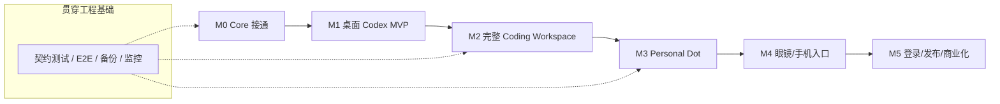

## 1. 产品需求与前期功能验收范围

### 1.1 Desktop Codex 必须完成的用户故事

| ID | 用户故事 | 最小验收条件 | 目标阶段 |
|---|---|---|---|
| C-01 | 选择本地 Git 仓库并开始任务 | `cwd` 与 Git 根目录正确，仓库详情可见 | M1 |
| C-02 | 创建 Thread 并提交自然语言请求 | 消息流、工具调用、最终完成状态能显示 | M1 |
| C-03 | 中途停止或补充指令 | `turn/interrupt`；活跃时符合协议的 `turn/steer` | M1 |
| C-04 | 安全执行代码修改 | 变更可预览，权限审批可响应，无未经授权越界写入 | M1 |
| C-05 | 退出应用后恢复历史 | 启动后可列出 Thread、分页读取旧内容、继续对话 | M1 |
| C-06 | 同一仓库多项任务并行 | 每个任务绑定独立 Worktree，编辑内容隔离 | M2 |
| C-07 | 查看 Diff/测试结果并审查 | Diff 可视化、测试进程状态、可人工合并提交 | M2 |
| C-08 | 管理 Skills/MCP | 可浏览、显式调用、处理不可用提示 | M2 |
| C-09 | 观察 Sub-Agent | 树状视图展示生成、状态和完成事件；无事件时友好降级 | M2 |
| C-10 | 后台计划执行 | 定时运行、日志、取消、崩溃恢复；不重复不可逆副作用 | M2 |

### 1.2 Personal Dot 必须完成的用户故事

| ID | 用户故事 | 最小验收条件 | 目标阶段 |
|---|---|---|---|
| D-01 | 与同一个 Dot 长期对话 | 主聊天统一呈现消息，不把全部历史塞入模型 | M3 |
| D-02 | 创建长期目标 | Goal 有结束条件、约束和任务关系 | M3 |
| D-03 | Dot 自主拆分任务 | 生成执行计划与 Future Tasks，用户可查看与修改 | M3 |
| D-04 | 跨时间自动续接 | 到期触发能构造 Task Context 并开启 Codex Run | M3 |
| D-05 | 对旧任务进行指代续接 | “上个 Android 项目继续”匹配旧任务；歧义时澄清 | M3 |
| D-06 | 长期记忆 | 用户偏好和历史决策按需召回；支持纠正/删除 | M3 |
| D-07 | Dot 委托 Coding Agent | 主 Dot 创建子任务，Codex Thread 完成后回传结果 | M3 |
| D-08 | 主动提醒不过载 | 去重、静默时间、订阅/取消和频率上限生效 | M3 |
| D-09 | Goal 变化重新规划 | 修改截止日期后重排未执行任务并停止过期 Watch | M3 |
| D-10 | 执行可审计 | 能追溯 Goal→Task→Run→Action→审批→结果 | M3 |

### 1.3 用户使用流程（桌面 Codex）

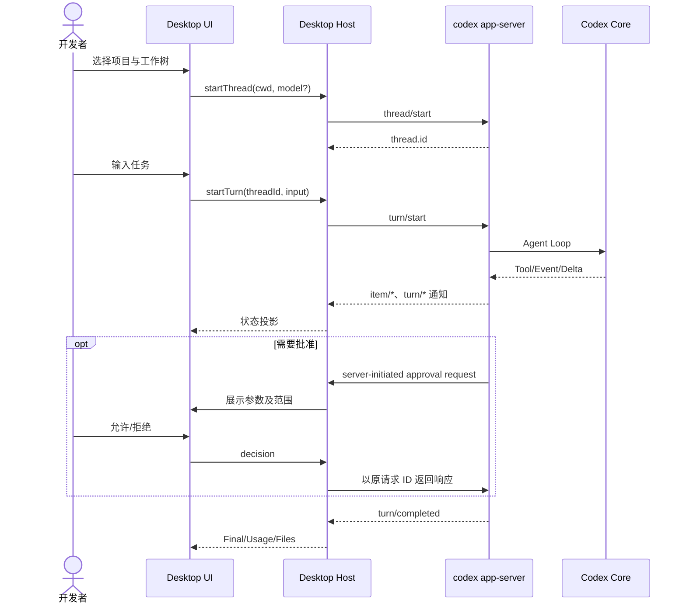

### 1.4 用户使用流程（桌面 Dot）

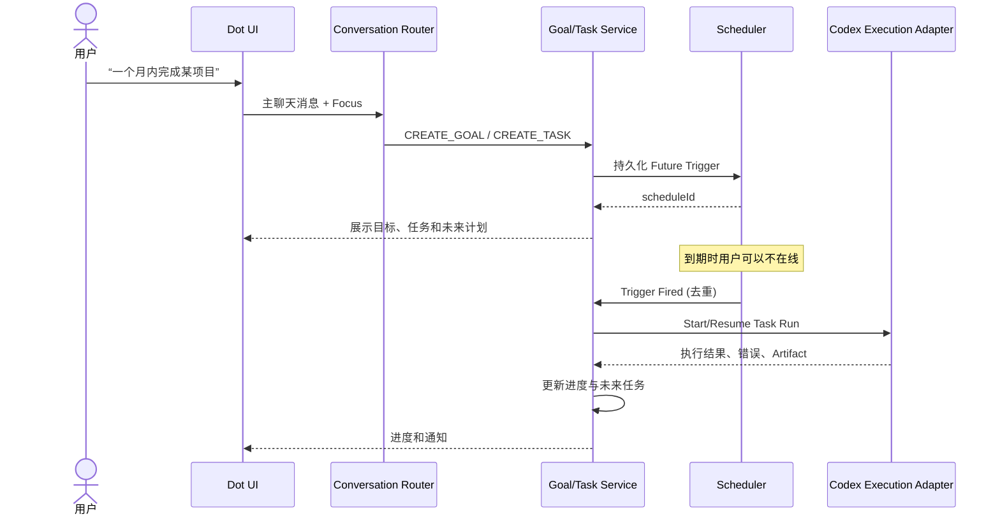

## 2. Codex 开源能力清单和复用边界

### 2.1 源码与 API（2026-10-26 核对）

| 已有能力 | 源码/正式接口 | 计划的处理方式 |
|---|---|---|
| 核心 Agent Loop | `codex-rs/core` | 完全保留 Rust 上游实现 |
| Thread/Turn/Item | `app-server` 的 `thread/*`、`turn/*`、`item/*` | 桌面 Adapter/UI 消费 |
| 多 Agent | `core/src/agent/control.rs` 及工具定义 | 加可视化与独立任务映射 |
| 历史压缩 | `core/src/compact.rs` | 使用原生 Compaction，无需自造 |
| 记忆生成 | `codex-rs/memories/README.md` + `core/src/memories` | Coding Memory 直接借鉴；Personal Memory 分离 |
| 长目标续接 | `codex-rs/ext/goal` | 功能开关后实验；不当作 Future Scheduler |
| Git Worktree | `codex-rs/worktree`、`git-utils` | 封装 WorkspaceService，支持独立工作树 |
| 沙箱/审批 | Core Approval / Guardian / Sandbox | 不改默认强制边界，建设 GUI 审批 |
| Skills/MCP | App Server 提供列表/工具和事件 | UI 展示、配置、调用 |
| Codex App Server | `codex-rs/app-server` | 核心统一协议入口 |
| 完整官方 Dot 服务 | 无完整开源实现 | 实现本地 Personal Dot，不假定私有 API |
| 完整官方桌面 UI | 无完整开源实现 | 自己开发 Electron + React |
| 正式第三方 OAuth / 用户体系 | 不属于 CLI 直接可复用产品模块 | M5 完成 |

**特别澄清**：`Memory Pipeline` 已能从符合条件的编码会话提取历史经验并整合，但不等于个人关系、联系人、事实版本的 Memory Claim Store；`Goal Runtime` 能继续某个 Thread 的工作，但不等于跨天事件调度器；开源代码里出现 `automation_update` 相关动态工具，不代表完整桌面 Automation 产品与全部运行保障也已开源。

### 2.2 版本锁定规范

- 在 `codex-version.lock` 写入 `codexVersion`、上游 Git SHA、生成协议文件的哈希、目标 OS/arch、已启用 feature flags。
- `protocol-generated/` 按上游版本保存自动生成的 TS/JSON Schema，禁止人工改生成文件。
- 依赖升级时先运行版本兼容 Smoke Test、审批集成测试和历史会话迁移测试，再更新锁文件。
- 对每个 RPC 标记 `stable / experimental / unsupported`；仅在检测到对应能力时启用实验特性。
- App Server 与客户端不应各自使用不同版本生成的类型文件。

### 2.3 评估的两个核心集成路径

- **首选：App Server**。双向 RPC、流式 Item、审批、Thread 管理，适合完整 GUI。
- **备选：Codex TypeScript SDK**。适合任务/脚本运行，也支持 JSONL 事件；但丰富桌面级 Thread、审批和会话治理以 App Server 更直接。

不直接 Fork TUI，也不依赖解析 CLI 控制台输出。**UI 永远不推测内部 Rust 私有状态**，只根据协议事件和可持久化快照重建。

## 3. 技术选型、系统总体拓扑与安全域

### 3.1 首期技术栈

| 层级 | 推荐 | 选择原因 | 可替代方案 |
|---|---|---|---|
| Desktop Shell | Electron（受限 Main/Preload/Renderer） | TS 生态与跨平台、进程管理和成熟组件 | Tauri（Rust 熟悉后评估） |
| UI | React + TypeScript + Vite | 桌面长列表、复杂状态和组件生态 | Vue |
| UI 状态 | Zustand + TanStack Query | 本地 UI 与远程事件投影分离 | Redux Toolkit |
| 样式 | CSS Variables + Tailwind（可选） | 主题/密度/暗色主题、响应式 | CSS Modules |
| Code Editor | Monaco（懒加载） | 语法/搜索/Diff 视图 | CodeMirror |
| Terminal | xterm.js + node-pty（后期） | 独立 PTY 终端 | 系统外部终端 |
| Git | Git CLI + worktree 管理器 | 可审计、与现有仓库兼容 | libgit2 |
| Agent Runtime | 官方 `codex` CLI 进程的 `app-server` 模式 | 减少 Core 改动 | Rust 嵌入仅在证据足够时研究 |
| App 自有持久化 | SQLite + 迁移脚本 | 单用户桌面数据、任务/事件映射 | PGlite/PostgreSQL |
| 调度 | 独立 Desktop Background Service + SQLite | App 窗口关闭也能保留本机任务管理 | Temporal（云端成熟时） |
| Dot Memory | SQLite/FTS + 可选向量索引 | 从小规模事实存储逐步扩展 | PostgreSQL + pgvector |
| 日志/测试 | structured logs + Vitest + Playwright + Rust 原生测试 | 事件回放和 E2E | 任意同等级框架 |

初期主平台建议 **Linux x86_64**（方便与现有开发/测试环境一致）；代码层保留 macOS 与 Windows 的路径、Shell 和 Sandbox 抽象。Linux MVP 成功后再做 macOS，Windows 原生/WSL 走独立兼容性里程碑。**不要为了首版“全平台完美”拖延功能验证。**

### 3.2 运行拓扑

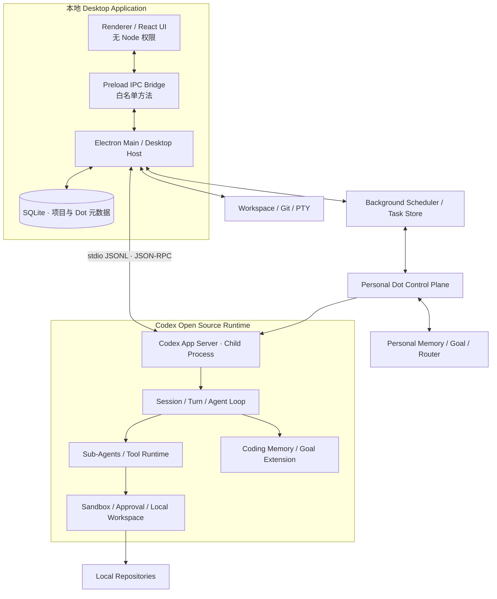

### 3.3 信任域

- **Renderer：不可信展示层**。必须 `contextIsolation=true`、`nodeIntegration=false`，使用 CSP；HTML/Markdown、外部资源和任务 Artifact 需安全渲染。
- **Electron Main：可信宿主桥**。仅保留必要 IPC；检查调用来源、文件路径、参数与操作权限；持有子进程句柄，不把任意 Shell 暴露给 Renderer。
- **Codex App Server：受控执行核心**。通过本地 stdio 接入；Agent 工具执行遵守 Sandbox/Approval，UI 必须响应需要的服务端请求。
- **Personal Dot：业务控制平面**。可提出 Task/Tool 请求，不直接越过 Host Approval 或读取未经授权的秘密。
- **可选 Browser/Computer Worker：独立能力层**。将来出现外部账号和支付之前必须增加 Broker、凭据隔离和专门审批；不得让浏览器 Agent 直拿付款凭据。

**认证后置与安全前置互不冲突**：当前不做账号注册，但不能以 `approvalPolicy=never` 作为生产型默认值，也不能为省开发关闭沙箱；只在隔离测试仓库和明示的自动化测试中使用严格受限的特殊配置。

---

## 4. 仓库组织、分层接口与依赖约束

### 4.1 推荐 Monorepo

```text
codex-personal-desktop/
├── AGENTS.md                       # 约束编码 Agent 的工作规则
├── README.md
├── docs/
│   ├── architecture/               # ADR、状态机、协议、信任边界
│   ├── milestones/                 # M0-M5 分阶段验收和任务跟踪
│   ├── api-contracts/              # 文档/协议备份
│   └── design/                     # UI/UX 规范、原型
├── apps/
│   └── desktop/
│       ├── src/main/               # Electron Main、进程/窗口/托盘
│       │   ├── bootstrap/
│       │   ├── rpc/
│       │   ├── ipc/
│       │   ├── workspace/
│       │   └── services/
│       ├── src/preload/            # 白名单 IPC API
│       ├── src/renderer/
│       │   ├── screens/codex/
│       │   ├── screens/dot/
│       │   ├── features/chat/
│       │   ├── features/project/
│       │   ├── features/approval/
│       │   ├── features/agent-tree/
│       │   ├── features/worktree/
│       │   └── features/artifact/
│       └── assets/
├── packages/
│   ├── codex-appserver-client/      # 类型化 RPC 客户端、协议适配与兼容性
│   │   ├── src/transport/
│   │   ├── src/generated/          # 由选定 Codex 版本生成
│   │   ├── src/mappers/
│   │   └── test/fixtures/
│   ├── shared-contracts/           # 桌面与 Dot Domain Types
│   ├── desktop-store/              # SQLite/Migrations/Repositories
│   ├── workspace-service/          # Git、Worktree、Diff
│   ├── task-runtime/               # Task、Run、Event、Lease、Outbox
│   ├── scheduler/                  # Cron、Event、Wake
│   ├── personal-dot/               # Router/Goal/Proactivity/Memory
│   │   ├── router/
│   │   ├── goals/
│   │   ├── memory/
│   │   ├── context/
│   │   ├── policy/
│   │   └── adapters/
│   ├── browser-broker/             # M3+ 可选，尚不需要第一期落地
│   └── observability/
├── tests/
│   ├── unit/
│   ├── protocol/
│   ├── integration/
│   ├── e2e/
│   ├── recovery/
│   └── security/
├── scripts/
│   ├── codex-version.lock
│   ├── prepare-codex.sh
│   ├── generate-protocol.sh
│   └── smoke-test.sh
└── vendor/                       # 可选：Codex Git submodule/固定 tag 引用
    └── codex/
```

### 4.2 依赖方向约束

`renderer → preload contract → Electron Main → services → Codex Adapter → App Server`。`Dot` 只能依赖 `Task/Agent Gateway` 抽象，**不能直接依赖 Electron 组件**。这样后期手机和眼镜可以重用同一个 Personal Agent Service 而不移植 UI。

禁止的耦合：

- `renderer` 直接 `spawn` CLI 或执行 Git/Shell。
- 多个 UI 组件独立创建、关闭 Codex 子进程。
- `Dot Goal` 直接调用 Rust Core 非公开内部函数。
- Task Metadata 保存的 `cwd` 任意拼接成 Shell 指令。
- 把 Codex 历史 JSONL 当成稳定的主业务数据库并随意修改。

### 4.3 Domain 接口（建议）

```typescript
export interface AgentExecutionGateway {
  startSession(request: StartSession): Promise<{ threadId: string }>;
  startRun(request: StartRun): Promise<{ runId: string; turnId: string }>;
  steerRun(request: SteerRun): Promise<void>;
  interruptRun(request: InterruptRun): Promise<void>;
  resumeSession(threadId: string): Promise<void>;
  getSessionHistory(threadId: string, cursor?: string): Promise<HistoryPage>;
  subscribeEvents(threadId: string, listener: AgentEventListener): Unsubscribe;
}

export interface TaskService {
  createTask(input: NewTask): Promise<Task>;
  updateTask(id: string, expectedVersion: number, patch: TaskPatch): Promise<Task>;
  enqueueRun(taskId: string, reason: WakeReason, idempotencyKey: string): Promise<Run>;
  pauseTask(taskId: string): Promise<void>;
  cancelTask(taskId: string): Promise<void>;
}

export interface FutureTaskService {
  createTrigger(input: TriggerCreate): Promise<FutureTrigger>;
  updateTrigger(id: string, expectedVersion: number, patch: TriggerPatch): Promise<void>;
  cancelTrigger(id: string): Promise<void>;
}
```

类型中的 `NewTask/StartRun` 等是本项目新建 Domain Contract，不能误当官方 RPC 方法。核心原则是 **CodexAdapter 可被替换，Dot 层不受协议小变更影响**。

## 5. App Server 协议、类型生成和进程管理

### 5.1 基线验证步骤（M0 必做）

```bash
# 0. 已在本机安装合法可用的 Codex CLI
codex --version
codex app-server --help

# 1. 为当前版本生成类型（目录可修改）
mkdir -p packages/codex-appserver-client/src/generated
codex app-server generate-ts \
  --out packages/codex-appserver-client/src/generated

# 2. 需要对比协议字段时生成 JSON Schema
codex app-server generate-json-schema \
  --out docs/api-contracts/codex-current

# 3. 在单独终端做最小 RPC Smoke
codex app-server
```

`app-server` 默认 stdio JSONL；线上的报文采用**省略 `jsonrpc: "2.0"` 字段的 JSON-RPC 2.0 语义**。请求有 `id/method/params`，通知没有 `id`；Host 还必须处理**服务端主动向客户端发送的请求（例如权限审批）**。正式实现以当前生成类型为准。[官方] https://developers.openai.com/codex/app-server

### 5.2 初始化与 Thread/Turn 主路径

```json
{"id":1,"method":"initialize","params":{"clientInfo":{"name":"personal_codex_desktop","title":"Personal Codex Desktop","version":"0.1.0"}}}
```

收到成功响应后发送：

```json
{"method":"initialized","params":{}}
```

随后查询模型（如支持）：

```json
{"id":2,"method":"model/list","params":{}}
```

开始新的 Thread：

```json
{"id":3,"method":"thread/start","params":{"cwd":"/home/dev/project"}}
```

使用 `thread/start` 返回的 `thread.id`：

```json
{"id":4,"method":"turn/start","params":{"threadId":"ACTUAL_THREAD_ID","input":[{"type":"text","text":"分析并修复这个项目的失败测试"}]}}
```

以上报文只说明字段组织。**不要把 `ACTUAL_THREAD_ID` 当真 ID，也不硬编码任何模型名**。将来新增 `model/approvalPolicy/sandbox` 参数时，必须按生成类型与实际能力动态提供。

### 5.3 RPC 客户端必须处理的六种消息

| 消息类别 | 判断方式 | 客户端处理 |
|---|---|---|
| 发起请求 | 本地生成 `id` | `pendingMap[id]` 记录 Promise/超时 |
| RPC 响应 | `id` + `result` 或 `error` | 对应 Promise resolve/reject；移除 pending |
| Server 通知 | `method` 且无 `id` | 投影到 Thread/Turn/Item Store |
| Server 主动请求 | `id` + `method`（来自服务器） | 人工审批/补问界面后用原 `id` 回应 |
| 进程异常 | 退出、STDIO 断开、非法 JSON | 标记连接断开，清理 pending，启动恢复 |
| 订阅和重连 | 连接恢复 | 重新 initialize，恢复 Thread，读取状态并补齐事件 |

**严重错误不要静默重试**。任何写入型动作都需要可追踪的请求/操作 ID；若服务器已执行但客户端断开，先读取最终状态而不是重新发送相同写操作。

### 5.4 TypeScript 通信层示意

```typescript
// packages/codex-appserver-client/src/transport/StdioRpcClient.ts
// 演示生命周期和消息分流；生产版还需接入日志、队列、取消和完整类型。
import { spawn, type ChildProcessWithoutNullStreams } from "node:child_process";
import { createInterface } from "node:readline";

export class StdioRpcClient {
  private proc?: ChildProcessWithoutNullStreams;
  private nextId = 1;
  private pending = new Map<number, {
    resolve: (value: unknown) => void;
    reject: (reason: Error) => void;
  }>();
  private listeners = new Set<(message: any) => void>();

  start(executable = "codex") {
    if (this.proc) throw new Error("App Server already running");
    this.proc = spawn(executable, ["app-server"], {
      stdio: ["pipe", "pipe", "pipe"],
      env: process.env,
    });
    this.proc.stderr.on("data", (data) => this.logStderr(String(data)));
    const lines = createInterface({ input: this.proc.stdout });
    lines.on("line", (line) => {
      try { this.onMessage(JSON.parse(line)); }
      catch { this.logProtocolError("non-JSON stdout frame"); }
    });
    this.proc.on("exit", () => {
      this.proc = undefined;
      for (const p of this.pending.values()) p.reject(new Error("App Server exited"));
      this.pending.clear();
      this.listeners.forEach(cb => cb({ method: "local/connectionClosed" }));
    });
  }

  private onMessage(message: any) {
    if (message.id !== undefined && ("result" in message || "error" in message)) {
      const p = this.pending.get(message.id);
      if (!p) return;
      this.pending.delete(message.id);
      message.error ? p.reject(new Error(message.error.message)) : p.resolve(message.result);
      return;
    }
    // 服务端通知以及带 id 的服务端请求均交给 Host Dispatcher。
    this.listeners.forEach(cb => cb(message));
  }

  request<T>(method: string, params: unknown): Promise<T> {
    const id = this.nextId++;
    return new Promise<T>((resolve, reject) => {
      if (!this.proc?.stdin.writable) return reject(new Error("Disconnected"));
      this.pending.set(id, { resolve: resolve as (v: unknown) => void, reject });
      this.proc.stdin.write(JSON.stringify({ id, method, params }) + "\n");
    });
  }

  notify(method: string, params: unknown) {
    this.proc?.stdin.write(JSON.stringify({ method, params }) + "\n");
  }

  respondToServerRequest(id: string | number, result: unknown) {
    this.proc?.stdin.write(JSON.stringify({ id, result }) + "\n");
  }

  onEvent(fn: (message: any) => void) {
    this.listeners.add(fn);
    return () => this.listeners.delete(fn);
  }

  private logStderr(line: string) { /* redacted structured log */ }
  private logProtocolError(msg: string) { /* capture telemetry locally */ }
}
```

说明：这是 **Spike 代码骨架**，不是复制后即可上生产的完整适配器。开发者仍需补上请求超时、唯一请求 ID 生命周期、最大帧限制、失败降级、待响应审批取消、多窗口订阅、关闭顺序、`spawn` 失败、stderr 泄漏防护以及类型化消息校验。

### 5.5 `AppServerSupervisor` 要求

1. 单一 Main Process 拥有可执行路径与子进程，应用启动时探测 `codex --version`、可执行权限和运行状态；只在本地合法可用环境下发起推理。
2. 子进程退出时 **不把所有正在运行的 Turn 直接显示为失败**；先记 `unknown`，重建连接后 `thread/read` 或历史/状态查询确定结果。
3. 重启策略指数退避（带抖动）、最大尝试次数、手动重新连接，防止无限重启。
4. 保持 `protocolCapabilities` 运行快照；实验接口不支持时显示灰色/降级，不重启循环尝试。
5. 版本不匹配时提示用户升级/重新生成协议，不动态猜测未知 schema。
6. 原始 stdout 只接收 RPC，**日志写 stderr**；错误中不得记录 API Key、Cookie 或完整私有文件内容。

### 5.6 事件投影与历史分页

`thread/list` 列出历史；对持久 Thread 优先 `thread/turns/list`、`thread/items/list` 按游标分页，避免一次加载所有消息。`thread/resume` 恢复可执行状态，不应在用户只是展开历史时无必要地启动任务；纯只读用 `thread/read`。

```typescript
interface UiThreadState {
  threadId: string;
  cwd: string;
  currentTurnId?: string;
  status: "idle" | "running" | "needsApproval" | "interrupted" | "unknown";
  itemsById: Record<string, UiItem>;
  displayItemIds: string[];
  olderCursor?: string;
  lastEventAt?: string;
}
```

事件必须按 `(threadId, turnId, itemId)` 去重；先接收到完成事件而缺失 Delta 的情况下，通过重新读取历史补足数据。`turn/steer` 要携带 `expectedTurnId`，只追加到仍在运行的 Turn，避免给已完成 Turn 错加内容。

### 5.7 客户端能力协商

- **稳定功能先行**：不因单个实验 RPC 不可用阻断普通聊天。
- `experimentalApi=true` 只在对应版本验收后单独开启，不能默认视为全部稳定功能。
- `model/list` 返回哪些模型就显示哪些，不硬编码 GPT 名称或推理档位。
- 如出现 `serverShuttingDown`、`readStateConflict`、`-32001 Server overloaded` 等明确错误码，按不同恢复策略处理，不按字符串模糊猜测。
- 远程 WebSocket 目前标记为实验性，不作为 M1 主要传输；若 M4 使用远端 Host，必须通过经过认证的安全通道并重新验收。

## 6. 桌面 Codex：会话、流式 UI、审批与交互

### 6.1 MVP 页面结构

```text
App Window
├── 左侧导航
│   ├── Projects（按项目分组）
│   ├── Recent Threads
│   ├── Running Tasks
│   └── Settings（开发者配置）
├── 中央工作区
│   ├── Thread Header：项目/模型/工作树/模式/状态
│   ├── Message Stream：User/Assistant/工具进度
│   ├── Approval Cards / User Input
│   └── Composer：输入、文件/图像、发送、Steer、Interrupt
├── 右侧可选面板
│   ├── Changes / Diff
│   ├── Plan / Todo
│   ├── Sub-Agent Tree
│   └── Terminal/Artifacts
└── 底部状态栏
    └── App Server、模型、沙箱、仓库、Token、错误
```

M1 不追求官方 UI 像素级复刻。优先保证：**正确的状态、可读的事件、可靠的审批、可恢复历史**。

### 6.2 UI 事件分类

| 类别 | 表示方式 | 可见的用户动作 |
|---|---|---|
| `agentMessage` | Markdown 文本，增量渲染 | 复制、选中、保存 |
| `reasoningSummary` | 折叠的可展示摘要（如服务端提供） | 展开/收起；不要求暴露私人思维链 |
| `commandExecution` | 命令、工作目录、退出码、折叠日志 | 打开终端详情 |
| `fileChange` | 文件路径和 Diff 摘要 | 打开 Diff，选择检视 |
| `mcpToolCall` | 工具名称、参数摘要、状态 | 查看结构化结果 |
| `plan` | 分阶段步骤、完成状态 | 视具体支持度展示 |
| `subAgent` | 父子关系和活动 | 切换到子 Thread 查看 |
| `approvalRequest` | 明确的允许/拒绝审批卡 | 最小权限、拒绝、详情 |
| `requestUserInput` | 用户补问卡片 | 提交补充信息 |
| `turn/completed` | 成功、失败、被中断、用量 | 重试（按安全协议）、继续 |

**优先保存原始结构化事件引用**，再生成 UI 投影。这样 Codex 新增 Item 类型时可以先使用通用事件面板，而不会丢失记录。

### 6.3 审批交互要求

- 收到服务端 Request 后生成 `approvalRequestId`，与原始 RPC `id` 和 Thread/Turn 绑定。
- 显示操作类型、目标路径/命令、权限范围、沙箱变化及潜在外部副作用；参数太长时摘要+展开详情。
- 用户批准/拒绝必须通过 App Server 预期格式回复；**绝不让 Renderer 伪造协议级“已批准”事件**。
- 多窗口只允许一个 Owner 处理同一项审批；另一个窗口显示状态镜像。
- 超时/关闭应用时要按协议进行取消、拒绝或保留待恢复状态；不能静默默认批准。
- 区分“允许一次/持续允许/拒绝”的实际语义；必须以当前协议允许的选项为准，不自行扩大授权范围。
- App 端出现 UI 错误时对审批**默认拒绝/保持阻止**，不放行。

### 6.4 Composer 行为

- **Idle**：发送创建新 `turn/start`。
- **Running**：用户选择“追加指令”走 `turn/steer`（验证 `expectedTurnId`）；选择“停止”走 `turn/interrupt`。
- **Waiting Approval**：操作由权限卡决定，主输入框不能冒充审批。
- **Disconnected**：禁用危险操作，消息可先留草稿，不自动重发造成重复任务。
- **Model Unavailable**：展示实际 `model/list`/服务端错误，不擅自更换收费或权限等级不同的模型。

### 6.5 M1 验收脚本

在小型测试仓库（含一个失败单测）操作：

1. 打开桌面 App，选择仓库，建立 Thread。
2. 提交“找出失败测试并修复”；显示 Token/工具阶段/最终状态。
3. 触发文件改动并在 UI 显示 Diff；应能查看原始工作树文件。
4. 触发需要审批的操作；同意/拒绝分别正确影响执行，不允许无响应死锁。
5. 运行时按 Interrupt；任务状态不得伪造成功。
6. 关闭 App 再打开：Thread 存在、消息不重复、可继续下一 Turn。
7. CLI 仍可独立运行，原来的 `~/.codex` 历史没有被 App 破坏。

## 7. 桌面 Codex：Project、Git Worktree、Diff、终端

### 7.1 Project 与 Workspace 数据模型

```typescript
interface Project {
  projectId: string;
  displayName: string;
  gitRoot: string;           // 真实路径，canonicalize
  defaultBranch?: string;
  createdAt: string;
}
interface Workspace {
  workspaceId: string;
  projectId: string;
  cwd: string;
  kind: "main" | "worktree" | "external";
  branch?: string;
  gitWorktreeId?: string;
  associatedThreadIds: string[];
  lifecycle: "ready" | "busy" | "archived";
}
```

项目只是 UI/Repo 组织概念，Worktree 是 Git 实际工作空间，Codex Thread 是 Agent 上下文。三者相互引用但生命周期不同。**一个 Thread 绑定一个有效工作区；在运行中任意改变 `cwd` 需要明确的安全/一致性策略。**

### 7.2 Worktree 服务接口

```typescript
interface WorkspaceService {
  importProject(gitRoot: string): Promise<Project>;
  createWorktree(projectId: string, opts: { branch: string; baseRef?: string }): Promise<Workspace>;
  listWorktrees(projectId: string): Promise<Workspace[]>;
  getGitStatus(workspaceId: string): Promise<GitStatus>;
  getDiff(workspaceId: string, opts?: DiffOptions): Promise<DiffFile[]>;
  safeRemoveWorktree(workspaceId: string, opts?: { force?: false }): Promise<void>;
}
```

M2 先通过 Git CLI 执行，参数必须以数组传入 `spawn`，不要拼接 Shell 字符串；进程在 Host 层运行，Renderer 不能给任意工作目录。参考 Codex 开源的 `codex-rs/worktree` 和 `git-utils` 功能，但 Desktop Service 必须处理自己的所有权元数据、UI 生命周期及竞态。

### 7.3 一项并行开发的典型流程

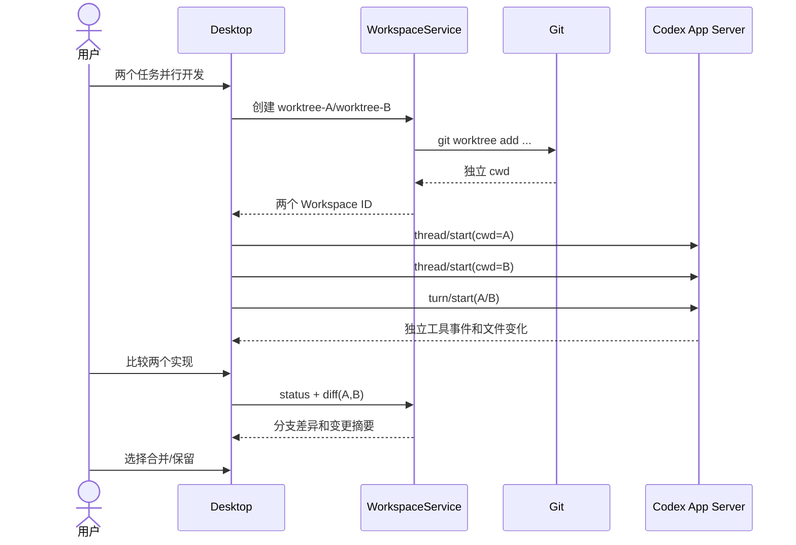

### 7.4 Git/文件安全边界

- 不为当前活动 Worktree 执行强制删除；先查看活跃 Thread、用户未提交更改和外部变更。
- 如果目录含未提交内容，删除必须阻止并给出“手动保留/显式清理”路径。
- 不自动将 Agent 改动合并进用户主分支；默认人工检查 Diff。
- Diff 大文件分页/限制、二进制单独标识；Symlink/相对路径规范化，避免越界路径打开。
- Git 状态显示要容忍用户在外部 IDE 修改文件，不能把 App 的本地缓存当唯一事实。

### 7.5 终端

建议两套逻辑终端：

1. **Agent Tool Log**：从 Codex 事件读取已执行命令与输出，只读、可追踪，受 Codex 审批和沙箱约束。
2. **用户 Interactive Terminal**：独立 PTY（`node-pty`），用户主动使用，运行在当前受信任工作区，权限与 Agent Tool 不完全相同。显著标记两者区别。

PTy Worker 在 Electron Main/utility process，关闭窗口时释放句柄；不把任意 PTY `stdin` 通道暴露为无鉴权 Renderer API。

## 8. 桌面 Codex：Sub-Agent、Skills、MCP、Memory、Goal

### 8.1 Sub-Agent Dashboard

- 从 Thread 事件、子代理启动/结束 Item 或受支持的父子关系 API 重建 `AgentTree`。
- 对每个 Agent 展示 ID、父 ID、目标、执行状态、相关 Thread、运行结果、耗时/用量（若可用）。
- UI 只展示“实测存在”的子代理；不能按模型输出中的一句“我派了两名 Agent”自动伪造真实子 Agent。
- Worker 数量先受上游 Codex 并发限制与用户资源配额控制；后期可对 Project/Goal 增加并发预算。
- 多 Agent 不是越多越好；默认单 Agent + Skills，遇到独立、可并行、上下文隔离收益显著的任务才委派。

### 8.2 Skills

从 `skills/list` 获取可用清单，展示名称、描述、作用域、依赖是否满足，点击可将 `skill` Input 项加入 `turn/start`。不要手工拼接自定义 Skill Prompt 到系统消息，避免绕过源项目的 Tool 选择规则。支持刷新、启停（如版本提供）、更新后提示依赖缺失。

### 8.3 MCP/Plugins

先实现 **列表 → 状态 → 工具调用事件展示**，随后才做安装/配置向导。MCP 是第三方能力边界，高风险操作与权限审批仍由受控执行层处理；不得把插件凭据写入个人 Dot Memory。连接器 OAuth 属于 M5 或受限演示环境，不成为 M2 阻塞。

### 8.4 Coding Memory

当前 Codex Memory 管线有 Phase 1（按 Session 抽取）与 Phase 2（全局汇总）并由数据库 Lease/锁协调。桌面 UI 可展示 Memory 摘要与更新状态，但**不能擅自把内部 `memory_summary.md` 当产品唯一的个人记忆库**。Personal Memory 需要另建（见第 13 章）。

### 8.5 Goal Extension

`codex-rs/ext/goal` 用于一个工作线程的持续 Goal 执行与续接，可作为 Dot 单次任务自主完成的加速能力。它不是全局持久目标管理器：

- Dot Goal 可以跨多个 Task/Thread，而 Codex Thread Goal 聚焦一个执行环境。
- 外部等待、到期触发必须由 Scheduler 控制；防止 Goal Loop 为等待外部事件反复生成 Token。
- M2 先单独通过 Feature Flag 观察其状态/预算/停止条件；M3 后再接入 Dot Task 计划。

---

## 9. 可恢复执行、后台任务、自动化和本地存储

### 9.1 三种“后台”必须严格区分

| 运行条件 | 能否继续执行 | 需要什么 |
|---|---|---|
| 用户切到其他页面/最小化窗口 | 可以 | 同一 Electron Main / Codex 进程活着 |
| 所有窗口关闭，但应用保留后台进程 | 可以 | 托盘服务或独立 Background Service 常驻 |
| Electron 完全退出/崩溃 | 只能以后恢复，不保证期间继续 | 状态落盘、服务守护或重启机制 |
| 主机关机/休眠/离线 | 不能本地执行 | 未来重新唤醒时补偿检查，或后期云端 Scheduler |

M2 **先做到最小化和隐藏窗口仍能完成当前任务**，随后实现独立可选的本地后台进程。不得在没有常驻进程的情况下承诺关闭应用仍可执行任务。

### 9.2 任务模型与 Codex Thread 的边界

- `Project`：本地代码仓库。
- `Workspace`：代码操作目录/Worktree。
- `Codex Thread`：一个逻辑 Agent 上下文。
- `Turn`：该 Thread 的一次执行请求与事件序列。
- `Task`：本项目可长期追踪的目标性工作；**可以跨多个 Codex Turn、甚至创建新的 Thread**。
- `Run`：由 Task 产生的一个实际执行尝试，保存执行环境、幂等键和结果。
- `Action`：一次有具体副作用的工具或外部业务操作。
- `Future Trigger`：将来唤醒任务的时间/条件。

一个 Codex Thread 可以绑定到一个当前 Task；Task 允许多个历史 Thread 引用用于恢复/迁移。不要把 `taskId` 和 `threadId` 直接视为同一个 ID。

### 9.3 Task / Run 状态机

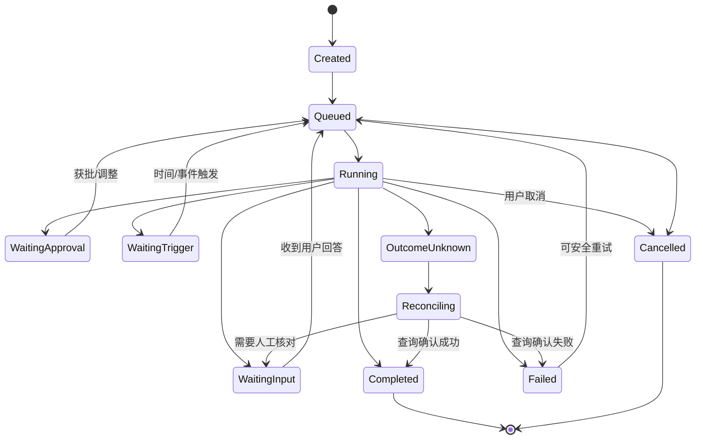

**关键原则**：Codex `turn/completed` 只能确认一次 Turn 完成；Task 是否完成应根据计划、产物、验收和外部操作状态判断。错误恢复时不得把 `OUTCOME_UNKNOWN` 当作可立即重试的失败。

### 9.4 建议的 SQLite Schema（M2 引入，M3 扩展）

```sql
PRAGMA foreign_keys = ON;

CREATE TABLE projects (
  project_id TEXT PRIMARY KEY,
  name TEXT NOT NULL,
  git_root TEXT NOT NULL UNIQUE,
  created_at TEXT NOT NULL
);

CREATE TABLE workspaces (
  workspace_id TEXT PRIMARY KEY,
  project_id TEXT NOT NULL REFERENCES projects(project_id),
  cwd TEXT NOT NULL,
  kind TEXT NOT NULL CHECK (kind IN ('main','worktree','external')),
  branch TEXT,
  state TEXT NOT NULL DEFAULT 'ready',
  created_at TEXT NOT NULL
);

CREATE TABLE thread_links (
  thread_id TEXT PRIMARY KEY,
  workspace_id TEXT REFERENCES workspaces(workspace_id),
  task_id TEXT,
  display_order INTEGER,
  last_seen_at TEXT
);

CREATE TABLE tasks (
  task_id TEXT PRIMARY KEY,
  goal_id TEXT,
  title TEXT NOT NULL,
  description TEXT NOT NULL,
  status TEXT NOT NULL,
  priority INTEGER NOT NULL DEFAULT 0,
  version INTEGER NOT NULL DEFAULT 1,
  current_run_id TEXT,
  context_summary TEXT,
  next_wake_at TEXT,
  created_at TEXT NOT NULL,
  updated_at TEXT NOT NULL
);

CREATE TABLE task_runs (
  run_id TEXT PRIMARY KEY,
  task_id TEXT NOT NULL REFERENCES tasks(task_id),
  codex_thread_id TEXT,
  codex_turn_id TEXT,
  attempt INTEGER NOT NULL,
  status TEXT NOT NULL,
  trigger_kind TEXT NOT NULL,
  idempotency_key TEXT NOT NULL UNIQUE,
  lease_owner TEXT,
  lease_expires_at TEXT,
  fencing_token INTEGER NOT NULL DEFAULT 0,
  started_at TEXT,
  finished_at TEXT,
  result_ref TEXT
);

CREATE TABLE task_events (
  event_id TEXT PRIMARY KEY,
  task_id TEXT NOT NULL REFERENCES tasks(task_id),
  sequence INTEGER NOT NULL,
  event_type TEXT NOT NULL,
  correlation_id TEXT,
  causation_id TEXT,
  payload_json TEXT NOT NULL,
  occurred_at TEXT NOT NULL,
  UNIQUE(task_id, sequence)
);

CREATE TABLE outbox (
  outbox_id TEXT PRIMARY KEY,
  dedupe_key TEXT UNIQUE,
  event_type TEXT NOT NULL,
  payload_json TEXT NOT NULL,
  status TEXT NOT NULL DEFAULT 'pending',
  attempts INTEGER NOT NULL DEFAULT 0,
  next_attempt_at TEXT
);

CREATE INDEX idx_task_runs_task ON task_runs(task_id, attempt);
CREATE INDEX idx_task_events_task ON task_events(task_id, sequence);
CREATE INDEX idx_tasks_next_wake ON tasks(status, next_wake_at);
```

所有表与字段均为 `[方案]`。迁移必须版本化，先使用 `SqliteMigrationRunner`，禁止运行中即兴建表覆盖用户数据；增加开发用 Seed 数据集。

### 9.5 Worker Lease、Fencing、幂等键

本地任务 Worker 接受执行之前，使用事务尝试领取任务；领取成功才可发起新 Run。执行期间续租；状态更新要求当前 `fencing_token` 未失效。若 App 宕机，恢复时检测租约过期，先检查 Codex Thread 是否仍在执行或已经完成，再决定重入。

```typescript
interface RunClaim {
  taskId: string;
  runId: string;
  workerId: string;
  fencingToken: number;
  leaseUntil: string;
}
```

**提交到 Git、发送邮件、购买、删除远端资源**等副作用应作为独立 `Action` 状态跟踪：`PREPARED → AWAITING_APPROVAL → APPROVED → DISPATCHED → SUCCEEDED / FAILED / OUTCOME_UNKNOWN`。当上游不支持 Idempotency Key 时，以外部订单号、消息 ID 或 Git Commit 进行 Reconciliation；未知结果绝不自动重复执行。

### 9.6 Task Event 与 UI 同步

事件 Envelope 建议为：

```json
{
  "eventId": "evt_001",
  "eventType": "TASK_RUN_COMPLETED",
  "goalId": "goal_001",
  "taskId": "task_002",
  "runId": "run_003",
  "sequence": 52,
  "correlationId": "msg_004",
  "causationId": "turn_005",
  "occurredAt": "2026-10-26T00:00:00Z",
  "payload": {"status":"completed","artifactRefs":["artifact_007"]}
}
```

`sequence` 只在单 Task 内严格递增，UI 重连后按 `taskId + lastSequence` 补齐，不依赖 WebSocket 每一条都送达。Dot 计划修改、Task 状态更新和 Outbox 事件须在同一数据库事务完成；事件消费者需幂等。

### 9.7 自动化最小实现

- 先支持 `one_shot` 与 `cron` 两种 Trigger；事件触发增加 `webhook/manual/changed_data` 时沿用统一接口。
- 保存 IANA Timezone，避免简单保存 UTC 时区导致用户当地夏令时错误。
- `next_fire_at` 必须数据库化；程序启动时先 Reconcile 已过期 Trigger。
- 每次触发产生唯一 `(trigger_id, scheduled_fire_at)` 幂等键；处理后的 Trigger 再推进下一次时间。
- 不满足运行条件时进入 `WAITING_HOST` 而非伪装完成。
- 暂停/取消/修改 Trigger 使用乐观版本，已被领取的 Run 在外部副作用前再次核对任务版本。

### 9.8 任务恢复演示

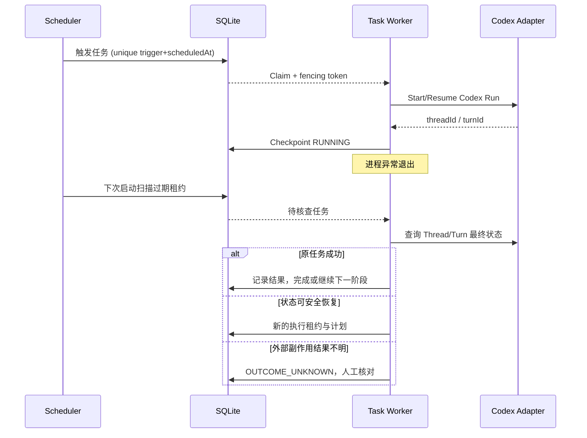

## 10. 桌面 Dot：独立 Personal Agent Control Plane

### 10.1 产品定义

Personal Dot 是一个**长期存在的个人工作实体**，拥有主会话、可审阅的长期目标、多个独立任务、个人记忆和未来任务计划；Codex Core 是它执行复杂任务的引擎，而不是它的全部产品形态。

**Dot 不直接等于 Codex Thread**。用户前台只有一个主会话，后台通过 Task Router 把具体工作分配给多个 Task Session；一个 Task 可以产生多个 Run、多个 Codex Thread 和 Sub-Agent。UI 上有 **Today / Goals / Tasks / Memory / Activity / Approvals / Settings**，不会把所有功能硬塞进聊天对话。

### 10.2 Dot 的结构图

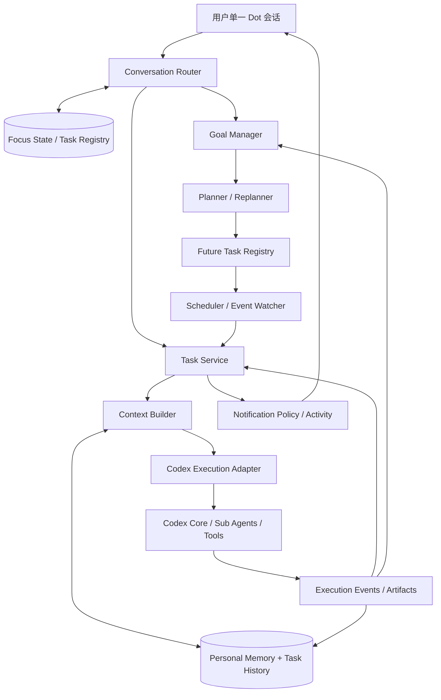

### 10.3 Dot 系统模块与输入输出

| 模块 | 主要输入 | 主要输出 | 可确定性验证 |
|---|---|---|---|
| Conversation Router | 最新消息、Focus、候选任务 | Route Decision | 选中 Task 必须真实存在 |
| Goal Manager | Goal、约束、已完成事项 | Goal State、Plan Version | 版本、任务依赖合法 |
| Planner | Goal + Memory + Tools | Plan / Task Spec | Schema、预算、依赖闭环 |
| Task Registry | 任务创建、状态变化 | Task Snapshot/Events | CAS、唯一键 |
| Scheduler | Trigger | 唤醒 Event | 唯一时间触发键 |
| Context Builder | Task Summary + Retrieval | 有预算的 Model Context | Token 配额与来源白名单 |
| Memory Service | 对话/执行事件 | Claims/Entries | 来源与敏感性规则 |
| Execution Adapter | Run Spec | Codex Thread/Turn | 真实 Thread ID 和终态 |
| Notification Policy | Event + 用户设置 | Notify / Silent | 去重、静默窗口 |
| Policy Gate | 请求的外部副作用 | Allow/Ask/Deny | 非 Agent 可伪造 |

### 10.4 独立 ID 体系

```text
owner_id                  # M3 本地单用户固定 profile，不含登录系统
  └── dot_id
      ├── main_conversation_id
      │   └── message_id...
      ├── goal_id...
      │   ├── task_id...
      │   │   ├── task_conversation_id
      │   │   ├── run_id...
      │   │   │   ├── codex_thread_id / turn_id
      │   │   │   └── action_id...
      │   │   └── future_trigger_id...
      │   └── plan_version
      └── memory_claim_id / entry_id
```

这里 `owner_id` 是数据隔离占位字段，不需要用户认证 UI 就能使用；M5 可以将单用户 Owner 升级成真实的用户身份而不大规模迁移业务主键。

### 10.5 Dot 与 Coding Workspace 的协作

例如用户说：“持续修复 Android Host App 的连接问题，直到通过指定的端到端测试。”Dot 创建 Goal/Task → 找到目标 Project/Workspace → 通过 Codex Adapter 启动 Coding Thread → 收集日志/测试 → 更新 Goal → 如果遇到外部等待，安排未来唤醒，而不是让 Codex 立即空循环。

Dot 必须拥有 `autonomyPolicy`：能否写本地项目、能否后台运行、最大工具/Token 预算、是否允许执行已有测试、是否必须用户批准提交/推送。权限由 Host 的真实受控接口强制实施，不是只有 Prompt 的“请谨慎”。

## 11. Conversation Router、Task Session、Context Builder

### 11.1 前台一条聊天，后台多 Context

- `main_conversation_id`：提供连续的视觉聊天历史，不等于无限 Token Prompt。
- `task_conversation_id`：每个任务独立记录用户交互、执行记录和摘要。
- `codex_thread_id`：实际 Agent 的执行会话，可恢复、可 Fork。
- `run_id`：任务某次执行，连接 Trigger、Thread/Turn、结果。

例如一个 Dot 同时管理“OpenMuse 研究”“Android 开发”“眼镜产品竞品监控”；主聊天里“继续 Android 项目”时只注入 Android Task Summary、最近消息与相关记忆，不把另外两个任务的网页历史装进本次上下文。

### 11.2 Router 分阶段判定

优先级由高到低：

1. **明确目标**：来自任务详情页的 `taskId`、Reply-to、审批卡片的 `actionId`；先授权和状态校验，再确定动作。
2. **待回答问题**：当前任务最近等待的澄清 ID；用户只回“选 B”时可以直接消歧。
3. **Focus State**：当前窗口最近明确讨论的 Task，不等于最近运行的后台 Worker。
4. **Task Retrieval**：针对标题、摘要、别名、实体、最近动作检索 Top-K。
5. **轻量模型结构化路由**：在候选列表内选择 Task 与 Action；若候选不唯一，澄清。
6. **确定性 Dispatcher**：验证模型选中的 Task 存在、未被取消、属于 Owner，才能创建或恢复 Run。

### 11.3 Router Action Schema

```typescript
type RouteAction =
  | "CHAT" | "CREATE_TASK" | "RESUME_TASK" | "UPDATE_TASK"
  | "QUERY_TASK" | "CANCEL_TASK" | "CREATE_GOAL"
  | "MULTI_ACTION" | "CLARIFY";

type RouteDecision = {
  action: RouteAction;
  targetTaskIds: string[];
  targetGoalId?: string;
  confidence?: number;           // 仅辅助，不当真实概率
  clarification?: { question: string; candidates: string[] };
  extractedConstraints?: Record<string, unknown>;
};
```

模型必须对 `candidateTaskIds` 设枚举或强制后验证；不得凭空生成旧 `taskId`。模型的 `confidence=0.99` 也不能代替安全和归属检查。

### 11.4 Focus State

```json
{
  "dotId": "dot_local",
  "mainConversationId": "conv_main",
  "focusedTaskId": "task_android",
  "recentTaskIds": ["task_android", "task_openmuse"],
  "pendingClarificationId": null,
  "lastExplicitContextAt": "2026-10-26T10:00:00Z"
}
```

当用户回复“停止上一个任务”且两个候选都合理时，**必须澄清**；查询进度类低风险问题可以在不修改任何 Task 的前提下做保守响应。用户明确说“另外开始一个项目”，则更偏 `CREATE_TASK`。

### 11.5 Task Retrieval 的评分方案

`score = w_semantic × semantic + w_exact × entityMatch + w_focus × focus + w_recent × recency + w_state × taskState`。

初期用关键词/FTS + Focus + 最近 Task 即可，不急着接 Embedding；当任务达到一定数量或出现大量指代误判时，再用小模型/向量检索辅助。不要无依据写死全局权重，使用人工标注对话进行调参。

### 11.6 Context Builder 合同

```typescript
interface TaskContextBuildInput {
  taskId: string;
  goalId?: string;
  userMessageId?: string;
  codexThreadId?: string;
  tokenBudget: number;
}
interface TaskContextBundle {
  taskSummary: string;
  goalConstraints: Record<string, unknown>;
  recentMessages: Array<{ id: string; text: string }>;
  memoryRefs: string[];
  artifactRefs: string[];
  unresolvedApprovals: string[];
  instructions: string[];
}
```

Context 装配顺序：系统/安全规则（由上游 Codex 维护）→ Task Goal/约束/当前状态 → 最近相关消息 → Memory Retrieval → 本次指令。历史原文与文件以 `ref` 方式按需读取。定期 Compaction 不得覆盖 Task Registry 的真实状态，也不得把“模型总结”当唯一事实依据。

### 11.7 主会话消息分配流程

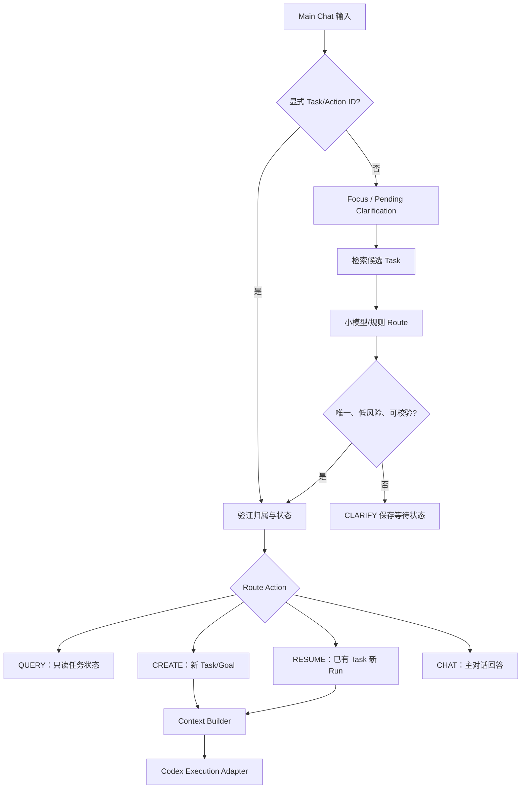

### 11.8 Router 专项测试

最少覆盖“继续”“上一个”“那个项目”“把预算改一下”“日本旅行那个”“把全部监控暂停”“选 B”“我说的是手机 Host，不是云端”“查询已完成任务”等 20+ 语料。每条样本保留候选 Task、期望 Action、是否应澄清；在版本升级时作为固定回归集。对 `CANCEL`/高风险写入，一旦候选不唯一必须升级到人工确认。

## 12. Dot Goal Manager、Future Task、主动执行

### 12.1 Goal 不等于 Cron，也不等于 Codex Thread Goal

`Goal` 是长时间有效的目标，包含成功条件、约束、活动计划、关联任务、授权策略和复审节奏。`FutureTrigger` 是某次后续唤醒条件。`Codex Goal Runtime` 能在一个线程内部推动执行，但**不能替代跨天 Task Scheduler**。

### 12.2 Goal Schema

```typescript
interface AutonomousGoal {
  goalId: string;
  dotId: string;
  title: string;
  objective: string;
  status: "active" | "paused" | "completed" | "cancelled";
  successCriteria: Array<{ id: string; description: string; evidenceRule?: string }>;
  constraints: Record<string, unknown>;
  planVersion: number;
  relatedTaskIds: string[];
  relatedTriggerIds: string[];
  nextReviewAt?: string;
  deadlineAt?: string;
  autonomy: {
    allowReadOnlyResearch: boolean;
    allowLocalCodeChanges: boolean;
    allowCreateFutureTasks: boolean;
    requireApprovalForExternalWrites: boolean;
    maxConcurrentRuns: number;
    maxDailyEstimatedCostUsd?: number;
    maxNotificationsPerDay: number;
  };
}
```

### 12.3 Future Trigger 数据模型

```typescript
type FutureTrigger = {
  triggerId: string;
  goalId: string;
  taskId: string;
  type: "once" | "cron" | "event" | "condition";
  expression: string;
  timezone: string;
  nextFireAt?: string;
  expiresAt?: string;
  status: "active" | "paused" | "cancelled";
  version: number;
  lastFireKey?: string;
};
```

创建/修改/取消触发器必须真实调用 `FutureTaskService`，不能只在对话里写“我会记得”；成功持久化并返回 ID 后才向用户宣称已经安排。

### 12.4 主动执行引擎：三层触发

- **L0 确定性过滤**：Cron/阈值/去重/过期检查，不消耗大模型 Token。
- **L1 轻量相关性判断**：事件是否与长期 Goal 有关、是否已处理、是否需要复审；使用规则/小模型即可。
- **L2 主 Agent 决策**：更新计划、创建/取消 Task、选择是否通知用户；保留决策的 Goal Version 和证据引用。

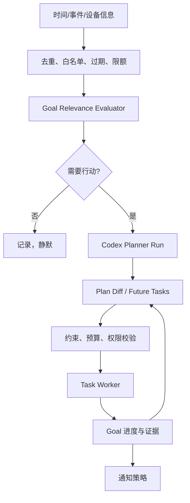

### 12.5 Goal Replanning 必须包含 Plan Version

例：用户说“出差提前三天”。Goal 版本从 v7 → v8；旧触发器、旧 Worktree Run 要在下一次实际提交/执行前检查当前 Goal 版本。LLM 可以提出计划修改，但数据库操作必须事务化执行，并在成功后原子更新关联 Trigger 与 Task。若部分操作失败，保留 `REPLAN_PENDING` 等状态，交由补偿作业核对。

### 12.6 Goal 自动完成与清理

- Goal 完成需要可核实的结果或用户确认；Agent 不能根据自身一句“我认为完成”关闭所有任务。
- 完成/取消时，应取消未来触发、处理执行中的任务、清理订阅并保留审计信息。
- 已经被领取的 Trigger 在执行前再次检查 Goal `status` 和 `planVersion`，防止目标取消后继续运行。
- 不允许 Agent 在未获许可下无限递归创建自我唤醒任务。

### 12.7 “长期代码项目”验收案例

给 Personal Dot 一项目标：“让某 Git 仓库通过 30 项现有测试，出现失败时继续排查；每晚检查一次，不要自动推送远端。”

**通过标准**：第一次创建可见 Goal/Task/Trigger；Codex 执行单测与修复；状态落盘；下一次到点可核对并续接；用户提前完成任务则取消 Future Trigger；用户修改约束后旧 Task 不越权执行；不自动 Push；UI 显示 Task History/成本/审批。

---

## 13. Dot 长期记忆：事实、来源、检索与修订

### 13.1 为什么不能只依赖 Codex 的 Coding Memory

Codex 当前开源的记忆写入管线适合跨 Coding Session 总结经验（Phase 1 每会话抽取、Phase 2 全局整合）。Personal Dot 需要额外处理：稳定偏好、人物/项目关系、长期 Goal 与约束、事实时间有效性、多个证据来源、用户可纠正/遗忘等。**两者应共享“可检索/按需注入”的思想，但保留分离的存储域和权限。**

初版先让现有 Codex Memory 保持上游行为，并由 Personal Memory Service 提供单独的上下文片段；不要直接改写 `~/.codex/memories` 作为唯一的用户个人数据库。

### 13.2 五个逻辑模块

| 模块 | 输入 | 逻辑 | 输出 |
|---|---|---|---|
| Extractor | 对话、执行事件、文件/工具结果 | 判断长期价值、抽取候选事实 | Claim Candidates |
| Consolidator | 旧 Claims + 候选 | 去重、冲突、过时、修订、来源 | Canonical Claims |
| Store | Claim + Evidence + Entry | 事务化持久化、版本 | 可检索事实 |
| Retriever | 当前意图/Task | FTS/语义查找、来源过滤、重排 | Relevant Memory |
| Context Builder | Relevant Memory + Goal State | 按 Token、隐私和时效筛选 | LLM 上下文引用 |

### 13.3 SQLite 表结构（独立于 Codex 内部 Memory DB）

```sql
CREATE TABLE memory_entries (
  entry_id TEXT PRIMARY KEY,
  dot_id TEXT NOT NULL,
  source_type TEXT NOT NULL,
  source_id TEXT NOT NULL,
  content TEXT NOT NULL,
  content_hash TEXT NOT NULL,
  source_revision TEXT,
  sensitivity TEXT NOT NULL DEFAULT 'normal',
  created_at TEXT NOT NULL,
  updated_at TEXT NOT NULL
);

CREATE VIRTUAL TABLE memory_entries_fts USING fts5(
  content,
  content='memory_entries',
  content_rowid='rowid'
);

CREATE TABLE memory_claims (
  claim_id TEXT PRIMARY KEY,
  dot_id TEXT NOT NULL,
  subject TEXT NOT NULL,
  predicate TEXT NOT NULL,
  object_text TEXT NOT NULL,
  status TEXT NOT NULL DEFAULT 'active',
  trust_level TEXT NOT NULL,
  confidence REAL,
  valid_from TEXT,
  valid_until TEXT,
  recorded_at TEXT NOT NULL,
  supersedes_claim_id TEXT,
  version INTEGER NOT NULL DEFAULT 1,
  FOREIGN KEY(supersedes_claim_id) REFERENCES memory_claims(claim_id)
);

CREATE TABLE claim_evidence (
  evidence_id TEXT PRIMARY KEY,
  claim_id TEXT NOT NULL REFERENCES memory_claims(claim_id),
  entry_id TEXT REFERENCES memory_entries(entry_id),
  source_message_id TEXT,
  quote TEXT,
  evidence_kind TEXT NOT NULL,
  verified_at TEXT
);

-- 可选的独立向量索引元数据。
CREATE TABLE memory_embeddings_meta (
  entry_id TEXT NOT NULL REFERENCES memory_entries(entry_id),
  model_id TEXT NOT NULL,
  vector_ref TEXT NOT NULL,
  content_hash TEXT NOT NULL,
  indexed_at TEXT NOT NULL,
  PRIMARY KEY(entry_id, model_id)
);
```

此 Schema 是 `[方案]`，不是 Meta Muse 的实际 SQL。FTS5 外部内容表需要 **INSERT/UPDATE/DELETE 触发器或显式重建机制**维持索引一致；不应只创建虚拟表就假定索引自动同步。初期可通过 SQL triggers 实现。

### 13.4 Claim 事实有效性与源级信任

`trust_level` 推荐 `explicit_user / verified_connector / agent_inference / untrusted_external`。

- 明确的用户偏好可形成可信 Claim；来自网页的“用户喜欢某品牌”只能作为未核实证据，不能直接变为用户当前真实偏好。
- `valid_from/valid_until` 表示事实适用时间，`recorded_at` 表示系统获知时间；支持历史偏好与暂时约束共存。
- 更新偏好时新增 Claim 可以通过 `supersedes_claim_id` 指向旧 Claim；但“这次价格优先”不能自动覆盖“长期舒适度优先”。
- 高敏感信息（账号、Token、支付卡、联系人私密数据等）默认不进入普通个人记忆；如确有必要需在独立可信存储中按权限访问。
- “删除记忆”要清理相关索引、Claim、证据及派生摘要，并根据产品级保留策略处理原始对话和备份；不能只删 `MEMORY.md` 的一行就宣称彻底遗忘。

### 13.5 检索路线

**M3.1：** `SQLite FTS + 最近性 + 任务关联 + 手工标签`；**M3.2：** 如测得召回不足，再接本地多语言 Embedding、向量库插件或独立检索服务，并增加 Reranker。中文资料优先验证中文与代码混合检索，不直接照搬早期研究中可能偏英文的模型配置。

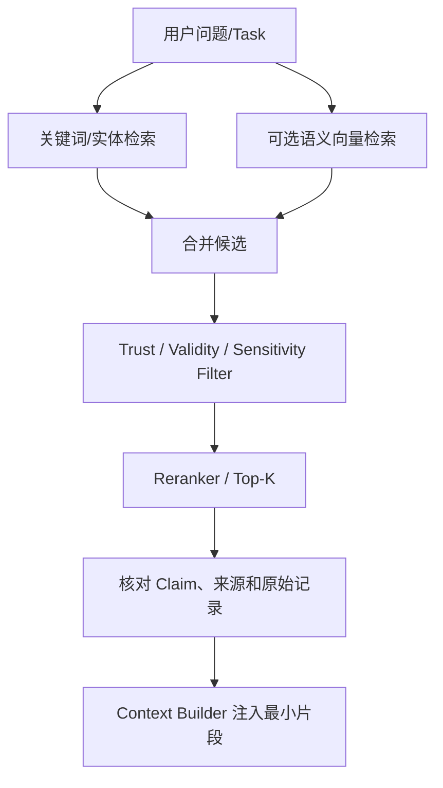

### 13.6 后台记忆整理

可以借鉴 Codex 的 **两阶段 Memory Pipeline**：

- Stage 1：低优先级异步从符合条件的 Session/Task 生成 `raw_memory` / `summary`，带来源和去重键。
- Stage 2：串行 Consolidation，读取新旧 Claim，根据冲突/时间规则修订并维护核心摘要；持久化前检查用户的“不要记住”策略。
- 不要求每条交互同步调用强推理模型，避免增加前台延迟。
- 对同一个来源同一个事实采用幂等键；并发 Consolidator 不可同时覆写核心记忆。

### 13.7 Memory 与 Goal 联动

当用户将“出差日期”从 11 月 1 日改为 10 月 29 日：个人记忆产生有效约束变化 → 发送 `CLAIM_SUPERSEDED` 事件 → 找到引用该 Claim 的活跃 Goal → 标记 Replan Needed → Scheduler 安排复审 Run → 修改未执行的 Future Tasks。这个事件关联是本方案新增功能，不宣称当前 Codex 或 Muse 已使用同样事件格式。

### 13.8 UI 功能

Dot / Memory 页显示：核心偏好、当前事实、来源、适用时间、最近修改、纠正/删除、查看历史版本。为免给用户“无所不知”的错误印象，每条 Agent 推断记忆应明确标为“推断、待核实”，与用户直接声明区分。

## 14. Dot 执行器接入 Codex Core 的适配协议

### 14.1 为什么需要 Execution Adapter

Personal Dot 不应该直接关心 Codex 的 `thread/resume` 报文格式、Tool Item 类型、Feature Flag 或内部 Memory 文件；它只需要知道“启动某种执行环境、提交目标、观察状态、支持中断、交付结果”。新增执行器（比如后期手机 Host、小模型、云端 Browser Agent）时，也可以实现同一接口。

```typescript
interface ExecutionRequest {
  taskId: string;
  runId: string;
  workspaceId?: string;
  goalSnapshotVersion: number;
  prompt: string;
  contextRefs: string[];
  sandboxProfile: "readOnly" | "workspaceWrite";
  maxBudget?: { estimatedUsd?: number; maxTurns?: number };
  completionCriteria: string[];
}

interface ExecutionReceipt {
  runId: string;
  codexThreadId: string;
  codexTurnId?: string;
  acceptedAt: string;
  status: "submitted" | "running" | "waiting" | "completed" | "failed" | "unknown";
}

interface ExecutionResult {
  runId: string;
  finalStatus: string;
  summary: string;
  artifacts: string[];
  changedFiles: string[];
  evidenceRefs: string[];
  cost?: { inputTokens?: number; outputTokens?: number; estimatedUsd?: number };
}
```

### 14.2 Task ↔ Codex 状态映射

| Personal Task | Codex Thread / Turn | 注意事项 |
|---|---|---|
| `RUNNING` | Turn 运行中 | 监听事件并保留正确 `turnId` |
| `WAITING_INPUT` | User Input 请求 / Turn 可暂停 | 记录补问 ID 和继续条件 |
| `WAITING_APPROVAL` | Approval Request | 由可信 Host 持有、不可自动同意 |
| `WAITING_TRIGGER` | 当前 Turn 已结束、Task 未完成 | Scheduler 下一次启动新的 Turn/Thread |
| `COMPLETED` | Turn 完成 + 验收满足 | 不能只根据 LLM 文本判断 |
| `FAILED` | Turn Error 或验证失败 | 保留诊断信息，按副作用安全重试 |
| `OUTCOME_UNKNOWN` | 连接丢失或外部执行结果未明 | 先 Reconcile，不重复写入 |

### 14.3 实际适配流程

1. `TaskService` 获取运行快照（目标、约束、工作区、版本）。
2. `ContextBuilder` 输出稳定摘要和相关记忆引用。
3. `CodexExecutionAdapter` 根据是否已有合适 Thread 选择 `thread/resume` 或 `thread/start`。
4. `turn/start` 执行当前阶段，订阅 `thread/turn/item` 事件。
5. 结束时写入 Run 结果、Artifact 与证据，必要时写 Goal 进度。
6. `TaskService` 决定 Task 结束、等待外部条件，或安排 Future Trigger。

**禁止在外部等待阶段无限立即续接**。多次运行仍是同一个 Task 的多个 Run，而非把所有状态隐式塞进 Codex 长对话。

### 14.4 Completion Evaluator

把验收标准分两类：

- **Deterministic**：测试命令退出码为 0、指定文件存在、`git diff` 符合目标约束、生成的 JSON 可解析。
- **Semantic**：研究报告是否覆盖所有要点、建议是否满足语义目标；可以用模型辅助判断，但要保留评分、证据和人工确认口。

只有条件符合才将 Goal/Task 标为 Completed；否则进入 `needsReview` 或生成下一阶段 Plan。对安全敏感副作用的成功必须依据外部收据，不依据 LLM 自述。

## 15. Browser/Computer、凭据和权限的渐进扩展

### 15.1 时间安排

- **M0–M1**：完全不开发独立 Browser Agent。Codex 内置工具、Shell、已有网络配置足以验证 Desktop Codex。
- **M2**：只做只读网页研究、受限的 Browser Worker 和通用 Artifact Preview（如确有需求）。
- **M3**：Dot 的“长期网页观察”可先通过授权 API/只读抓取实现；不要把真实支付自动化作为首版验收。
- **M4+**：如确需登录网站操作，再加入 `Browser Sub-Agent Loop + Broker + Human Takeover + Credential Broker`，并按安全等级逐步开放。
- **M5**：正式第三方账号登录、OAuth、商业付费交易和高级托管权限。

### 15.2 Browser Agent 与 Browser Broker 必须分开

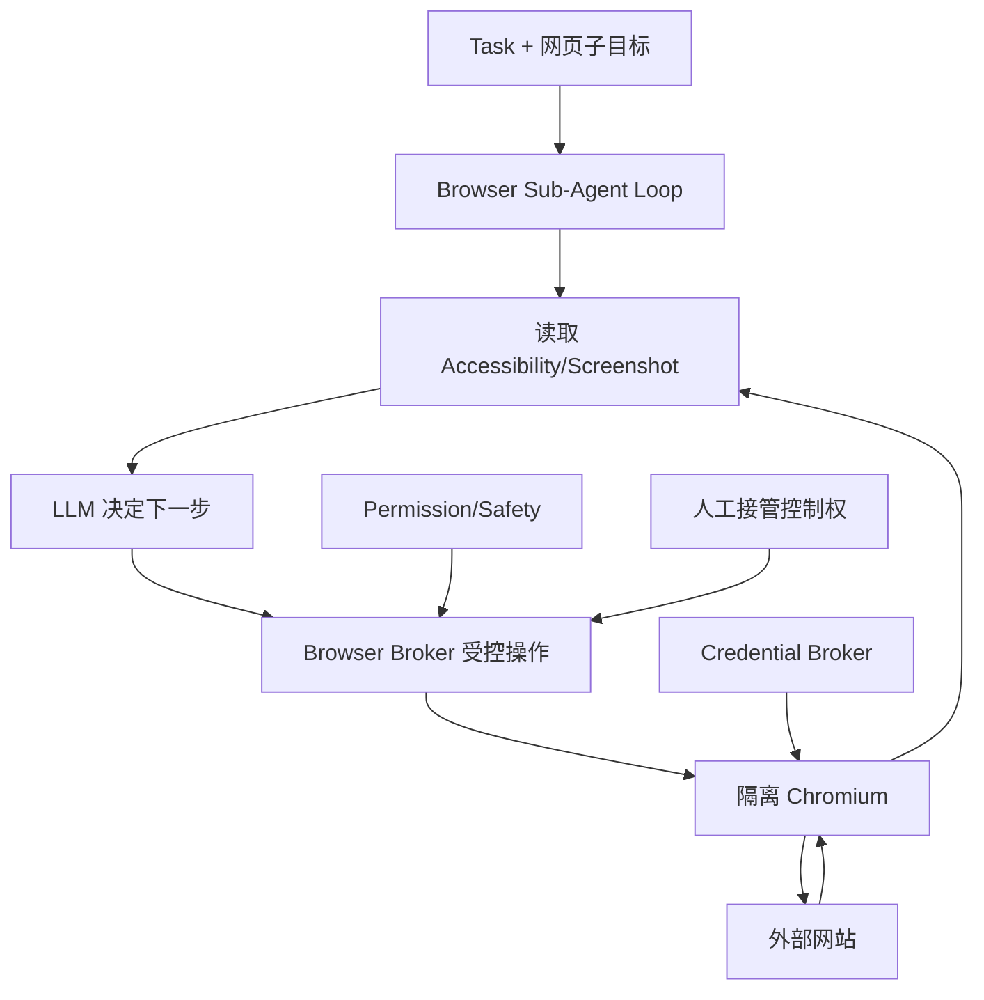

LLM 决定“点击哪里”，但它不应直接获取任意 CDP/JS 执行权限、操作系统凭据或绕过审批的网络出口。普通 Browser Worker 具备 Playwright 点击能力，并不自动意味着已有独立 Sub-Agent Loop。

### 15.3 Browser 控制权状态机

`BOT_ACTIVE → HUMAN_REQUESTED → BOT_PAUSED → HUMAN_ACTIVE → RELEASED → BOT_REOBSERVE → BOT_ACTIVE`。登录注入和用户接管期间必须撤销 Bot 控制租约；重新恢复前读取最新页面状态，防止基于过期页面继续点击。

### 15.4 凭据隔离路线

- 当前开发阶段使用已授权的本地 Codex 推理环境，不托管外部网站用户凭据。
- 未来 `Credential Broker` 独立存储 OAuth Token、密码、Passkey 授权及浏览器会话，按 Actor/Task/网站限定访问；Agent 本身不获取明文 Token。
- `Connector Worker` 使用受保护的服务身份调用第三方 API，而不是把凭据注入任意生成的脚本。
- 高风险操作（外部发送邮件、交易、账号变更）由独立的审批控制器决定是否执行，不允许模型消息替代正式审批。
- 网络出口控制必须覆盖 Tool/Shell/Browser 产生的真实请求，否则 Prompt 和 Tool Hook 无法形成完整强制边界。

### 15.5 购物案例留作后期安全验收

`搜索商品 → 选择 → 购物车 → 用户核对确切总额与商家 → 独立审批 → 受保护支付能力 → 订单收据`。如果 Checkout 后网络断开且结果不明，必须查订单/支付记录再恢复；**不自动重复提交**。本项目 M1/M2 的“功能可用”并不包括自动付款。

## 16. AI 眼镜与手机 Host 作为后期入口

### 16.1 先做 Desktop 后接设备的理由

桌面端先验证主 Agent、任务 Router、Memory/Goal、可靠 Scheduler 和执行权限。眼镜入口只新增多模态事件与反馈通道，**不在眼镜端重复构建一套独立 Goal Manager 或 Memory**，避免多端各自更新任务导致状态分叉。

### 16.2 三端职责

| 端 | 主要责任 | 不建议承担 |
|---|---|---|
| Glass | Camera/Mic/IMU/Touch 输入，显示/语音简短反馈 | 复杂长任务推理、外部网站支付 |
| Phone Host | 语音识别/轻意图、多模态初筛、定位/通知、本地权限入口 | 重复实现云端完整 Task Runtime |
| Desktop / Cloud Personal Agent | Goal、Task、Memory、Router、Sub-Agent、Browser、代码与文档 | 直接未经授权采集所有环境数据 |

### 16.3 通用 Context Event 协议

```json
{
  "eventId": "device_evt_001",
  "sourceDevice": "glass",
  "kind": "visual_observation",
  "timestamp": "2026-10-26T12:00:00Z",
  "userInitiated": true,
  "privacyClass": "contextual",
  "content": {
    "text": "帮我比较面前这副耳机的网购价格",
    "imageRef": "encrypted-local-ref"
  },
  "taskHint": null,
  "replyChannel": "glass_voice_and_hud"
}
```

这里只是协议形状，不要求前期做传感器采集。`imageRef` 应当是受控资源引用而非在每条事件中默认上传完整视频；Phone 可先做过滤，远端需独立授权和期限控制。

### 16.4 M4 演示链路

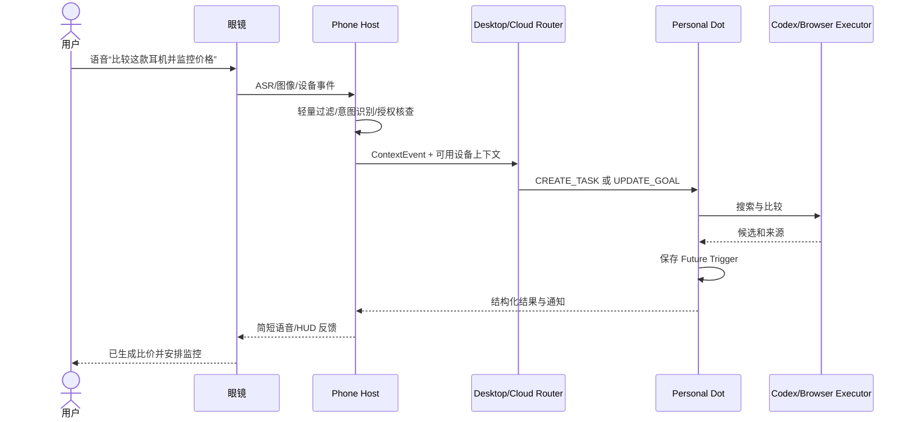

### 16.5 设备离线与权限

需要支持事件去重、弱网重传、设备时间偏移、音频打断、Prompt/Tool 审批转移到手机、消息回执和结果同步。眼镜端不应因为连接掉线而继续给出“任务已完成”的确认；只有 Task/Trigger 真正持久化成功时才报告已创建。

---

## 17. 安全、可靠性、可观察性及成本预算

### 17.1 最小安全约束必须从 M0 就具备

虽然正式认证最后开发，但下列底线不可以延后：

1. 单用户本地 App 使用已有 Codex 认证方式；不从官方客户端抓取/导出私有 Token，不内置第三方公开账号通用密钥。
2. 默认保留 Codex Workspace Sandbox 和用户审批；允许的命令/文件目录必须受 `cwd` 与沙箱约束。
3. Electron `contextIsolation=true`、`nodeIntegration=false`，Preload API 白名单、CSP、路径 canonicalization，不在 Renderer 暴露通用 `exec`。
4. API Key/Token 不写日志，不显示在 React 状态/Debug Console，不写普通 Dot Memory。
5. 用户数据和会话历史放在用户目录，有正确文件权限；备份/导入导出按最小权限实现。
6. 外部 Markdown、网页/文件内容作为不可信数据渲染，不允许其变成高优先级指令；Artifact 沙箱中运行。
7. 不做自动高风险支付或发送，未实现独立审批能力前只可提供建议/草稿。
8. 日志可审计但要做敏感信息脱敏，不复制整个代码仓库/聊天内容到遥测系统。

### 17.2 一致性和故障矩阵

| 故障 | 必须采取的行为 | 不允许的行为 |
|---|---|---|
| App Server 进程崩溃 | 待处理 RPC 失败、任务进入 unknown、读取快照恢复 | UI 显示成功并丢失原 Task |
| Desktop Renderer 崩溃 | Main 与后台状态保留，重建 UI | 因 UI 重启重发危险操作 |
| Linux 休眠/唤醒 | 检查过期 Trigger，按策略补偿 | 将过去的 Cron 每分钟无上限全部补跑 |
| Git Worktree 被外部删除 | 将 Workspace 标记 invalid，提示修复 | 自动创建同名覆盖用户工作树 |
| 审批响应超时 | 保持阻止/按协议取消 | 默认自动允许 |
| 一次外部写入返回超时 | OUTCOME_UNKNOWN、对账 | 无条件重复发送 |
| Memory 索引损坏 | 可从原始 Entry 重建，临时降级 FTS | 返回无来源的陈旧事实 |
| 同一个 Trigger 重复投递 | 唯一键去重 | 创建多个重复 Run |
| User 取消 Goal | 停止未来触发，正在运行的 Run 核对版本 | 旧计划继续执行 |
| 多 Agent 冲突编辑 | 工作树隔离、Git 冲突处理 | 互相覆盖修改 |

### 17.3 Observability 统一追踪

```text
dot_id
 └── goal_id
      └── task_id
           └── run_id
                └── codex_thread_id
                     └── codex_turn_id
                          ├── item_id / tool_call_id
                          ├── approval_id
                          ├── artifact_id
                          └── notification_id
```

每个 Run 至少记录：开始/结束时间、模型信息（若可用）、使用的 Codex Version、状态变化、Tool 次数、文件数、Token 用量、重试原因、用户批准/拒绝次数、关联 Goal/Task Snapshot Version。无权限时不记录第三方账号秘密或原始敏感数据。

建议在 UI 提供 **Activity Timeline** 和调试专用 **RPC Inspector（默认关）**。RPC Inspector 仅记录经过脱敏的事件元信息，允许用户导出“Bug 复现包”，不包含原始密钥。

### 17.4 成本/资源预算

- M1 可先直接展示 Codex 提供的 Token/Usage（若事件返回）；不能仅凭 Token 推断订阅额度实际扣减金额。
- M2 对每个 Project/Run 记录消耗摘要，设本地并发上限（先从 1–2 个活跃 Root Agent 验证）。
- M3 Goal 设置 `maxConcurrentRuns`、`maxDailyEstimatedCostUsd`、单次模型 Turn 上限、重复失败抑制、定时触发频率上限。
- 长期 Goal 的绝大多数等待时间不需要保持 LLM 连续推理；Scheduler 以持久化等待替代空转。
- Browser/PTY/Worker 超时回收，关闭 UI 不意味着盲目销毁仍活跃的安全任务进程。

### 17.5 评估指标的定义

| 指标 | 如何计算 | 期望方向 |
|---|---|---|
| Successful Task Rate | 符合验收的 Task / 已启动 Task | 上升 |
| Resume Success Rate | 能正确续接的恢复请求 / 合法恢复请求 | 上升 |
| Wrong Task Routing Rate | 误关联旧 Task 的路由 / 测试路由 | 趋近 0 |
| Duplicate Action Rate | 同一逻辑外部副作用重复发生 / 相关 Action | 高风险操作为 0 |
| Approval Bypass Rate | 未经审批成功执行的需审批动作 / 测试动作 | 0 |
| Notification Usefulness | 用户确认有帮助通知 / 抽样通知 | 上升 |
| Run Cost | 每个完成的目标实际消耗 | 下降 |
| UI Recovery Time | 进程故障后显示准确状态的耗时 | 下降 |

首版不编造量化 SLO；先用确定性测试建立基线，再给指标设版本化门槛。**涉及权限和未经授权副作用的测试为一票否决项。**

---

## 18. 开发任务 WBS、严格里程碑与测试矩阵

这部分是后续交给编码 Agent 执行的主清单。遵循“先做小的可验收任务、每个变更独立 PR、必须有回归测试”的策略。

### 18.1 M0 — 可运行的 Codex App Server Spike

| Task ID | 工作任务 | 依赖 | 交付物 | 验收 |
|---|---|---|---|---|
| M0-01 | 建立 Monorepo（pnpm/TypeScript/Electron） | 无 | 项目骨架、lint/test/build | 空窗口可运行 |
| M0-02 | 记录 Codex 版本、SHA 与构建信息 | M0-01 | `codex-version.lock` | 可重复生成同一版本信息 |
| M0-03 | 生成 TypeScript/JSON Schema 协议 | M0-02 | `generated/` | 编译类型通过 |
| M0-04 | `StdioRpcClient` 基础实现 | M0-03 | RPC 客户端 | initialize 成功 |
| M0-05 | 进程监督与状态监测 | M0-04 | Supervisor | 异常退出有明确反馈 |
| M0-06 | 最小 Handshake / model/list / thread/start | M0-04 | Spike UI/CLI | 可创建 Thread |
| M0-07 | turn/start / event stream / turn/completed | M0-06 | 最小会话闭环 | 真正获得 Codex 最终结果 |
| M0-08 | RPC fixture/契约测试 | M0-07 | Protocol Tests | 不匹配版本被发现 |

**M0 Gate**：一条真实输入能经桌面 Test Host 发给 App Server、获得完整 Turn 事件，不依赖专有桌面 App；任何认证/额度问题可提示开发者按现有官方方式配置，**不要求自建 OAuth**。

### 18.2 M1 — 功能可用的 Desktop Codex MVP

| Task ID | 工作任务 | 依赖 | 交付物 | 验收 |
|---|---|---|---|---|
| M1-01 | Electron Main/Preload 安全边界 | M0 | IPC 权限表、CSP | Renderer 无 Node 权限 |
| M1-02 | Project 导入和 `cwd` 管理 | M1-01 | Project Picker | Git 路径正确 |
| M1-03 | Thread 创建与历史列表 | M0-07 | Sidebar | 重启后可恢复 |
| M1-04 | Thread 历史分页和状态重建 | M1-03 | History Store | 不重复、不漏尾项 |
| M1-05 | Composer、Turn/Steer/Interrupt | M1-03 | Chat 操作 | 运行/停止状态正确 |
| M1-06 | 事件型 Message/Tool Timeline | M1-05 | Message Stream | 工具与最终回答可见 |
| M1-07 | Server Request/Approval Dispatcher | M0-04 | 审批状态机 | 拒绝后操作不执行 |
| M1-08 | Approval/UI 补问卡片 | M1-07 | 交互控件 | 能回应服务端请求 |
| M1-09 | 最小文件变化/Diff 只读预览 | M1-06 | Change Panel | 可核对文件修改 |
| M1-10 | 断开/重连/异常恢复 | M1-03 | Lifecycle | 无重复请求/幽灵运行 |
| M1-11 | MVP E2E | M1-01..10 | Smoke+自动化测试 | 修复测试仓库 Bug 成功 |

**M1 Gate**：至少完成真实的“选择项目→分析代码→申请权限→编辑→查看 Diff→完成→重启恢复历史”全链路，并能拒绝操作、停止 Turn。

### 18.3 M2 — Desktop Codex 完整工作台

| Task ID | 工作任务 | 依赖 | 交付物 | 验收 |
|---|---|---|---|---|
| M2-01 | Workspace/Worktree 管理 | M1 | WorkspaceService | 工作树生命周期正确 |
| M2-02 | 多 Thread 多 Worktree 并发 | M2-01 | Task Tab | 无写入冲突 |
| M2-03 | Diff/编辑器/代码文件预览 | M2-01 | Monaco Diff | 多文件可检查 |
| M2-04 | User PTY/终端管理 | M1-01 | Terminal | Agent Tool 与用户 Shell 区分 |
| M2-05 | Git Status/Commit/Review | M2-01 | Git Panel | 不擅自 Push 或删除 |
| M2-06 | Multi-Agent Tree/子线程跟踪 | M1-06 | Agent Dashboard | 实际父子状态可见 |
| M2-07 | Skills 列表/显式调用 | M1 | Skills UI | 与官方 `skills/list` 一致 |
| M2-08 | MCP/Connector 状态展示 | M1 | MCP UI | 不暴露凭据 |
| M2-09 | Coding Memory 摘要 | M1 | Memory Viewer | 不改写上游内存文件 |
| M2-10 | Goal Extension 兼容 Spike | M2-02 | 受控实验开关 | 不存在时无损降级 |
| M2-11 | Task/Run/Event SQLite Store | M1 | Schema+迁移 | CAS 与重启读取成功 |
| M2-12 | Background Worker/Lease/Checkpoint | M2-11 | Worker | 崩溃后可安全恢复 |
| M2-13 | One-shot/Cron 自动化 | M2-12 | Scheduler UI | 只运行一次/正常重复 |
| M2-14 | 应用最小化后台继续运行 | M2-12 | 进程生命周期 | 不丢执行结果 |
| M2-15 | 端到端 Debug Replay 与观察性 | M2-11 | Run Timeline | 追溯每个执行项 |
| M2-16 | 多工作树/崩溃/升级回归 | M2-01..15 | E2E/恢复测试 | 全部规定 Gate 通过 |

**M2 Gate**：桌面产品可以独立完成中型工程项目：多项编码任务、隔离 Worktree、Git Diff、测试、Review、恢复与本地自动化；无须部署云端、注册账户或 AI 眼镜。

### 18.4 M3 — Personal Dot 控制平面

| Task ID | 工作任务 | 依赖 | 交付物 | 验收 |
|---|---|---|---|---|
| M3-01 | Dot 主会话和 Task Registry | M2-11 | Domain/API/UI | 主聊天和子任务分离 |
| M3-02 | Goal Schema / Goal UI | M3-01 | Goal Manager | 版本/结束条件有效 |
| M3-03 | Future Trigger Registry | M2-13,M3-02 | FutureTaskService | 创建/改期/取消正确 |
| M3-04 | 定时唤醒 Codex Task | M3-03 | Scheduler Adapter | 重启后可自动执行 |
| M3-05 | Context Builder / Task Summary | M3-01 | Context Service | 不读取所有历史 Token |
| M3-06 | Focus State / Task Retrieval | M3-05 | Router 第一版 | “继续/那个任务”正确关联 |
| M3-07 | 结构化 Router / Clarification | M3-06 | 小模型/规则路由 | 歧义不擅自执行 |
| M3-08 | Personal Memory Entry + FTS | M3-01 | Memory Store | 来源可追踪 |
| M3-09 | Claim/Evidence/Consolidation | M3-08 | Fact Engine | 新旧偏好不冲突 |
| M3-10 | CodexExecutionAdapter | M3-01,M2 | Execution Gateway | Dot 可创建 Coding Thread |
| M3-11 | Goal Planning/Replanning | M3-02,03,10 | Planner/PlanDiff | Goal 变化更新 Future Tasks |
| M3-12 | Proactive Trigger L0/L1/L2 | M3-11 | Proactive Engine | 无关事件不频繁唤醒 |
| M3-13 | 通知与用户静默策略 | M3-12 | Notification Service | 去重/免打扰有效 |
| M3-14 | 活动/审批/预算可视化 | M3-10 | Dot Dashboard | 可追溯任务进展 |
| M3-15 | 记忆修改/删除/失效 | M3-09 | Memory Control | 相关索引正确更新 |
| M3-16 | 长期目标 E2E + 失败注入 | M3-01..15 | Dot 验收套件 | 目标/唤醒/恢复全链路通过 |

**M3 Gate**：用户在一个 Dot 主对话中建立长期目标，Dot 创建 Coding Task 和 Future Trigger；窗口关闭后按约定后台继续（需后台进程）；下一次唤醒自动恢复 Task；用户修订目标后计划可更新；任务/记忆/权限有明示的可控界面。

### 18.5 M4 — AI 眼镜与手机 Host 入口

| Task ID | 工作任务 | 依赖 | 交付物 | 验收 |
|---|---|---|---|---|
| M4-01 | ContextEvent 协议与本地 Relay | M3 | Device Event Gateway | 可注入模拟事件 |
| M4-02 | Android Host 权限与本地轻路由 | M4-01 | Phone Adapter | 不上传无关感知内容 |
| M4-03 | 眼镜语音事件和结果回显 | M4-02 | Glass Adapter | 输入/完成回执正确 |
| M4-04 | 设备消息去重与弱网续传 | M4-01 | Sync/ACK | 重复事件不会创建重复 Task |
| M4-05 | 主动通知跨设备同步 | M3-13,M4-03 | Notification Bridge | 手机/眼镜视图一致 |
| M4-06 | 端到端设备测试 | M4-01..05 | 验收报告 | 事件→Goal→结果闭环 |

**M4 Gate**：眼镜和手机是已稳定 Dot 的输入/反馈通道，而不是第二套任务管理器。眼镜断开后用户可在 Desktop/Phone 继续同一 Task。

### 18.6 M5 — 正式登录授权与产品化（最后）

| Task ID | 工作任务 | 前置 | 交付物 | 验收 |
|---|---|---|---|---|
| M5-01 | 第三方客户端授权可行性核查 | M4 | 正式授权方案 | 符合最新官方规则 |
| M5-02 | 账号/工作区身份抽象 | M5-01 | Auth Service | 身份切换不串用户数据 |
| M5-03 | Login/Logout/Token 生命周期 | M5-02 | Auth UI/Keychain | 不泄露 Token |
| M5-04 | 数据迁移与用户隔离 | M5-02 | Tenant Migration | 本地 Owner 安全迁移 |
| M5-05 | 更新与包签名/安装/卸载 | M4 | Release CI | 包安装、升级、回滚 |
| M5-06 | 商业许可证与商标审查 | M5-01 | 发布清单 | 不误称官方客户端 |
| M5-07 | 可选云任务/多用户运行时 | M5-02 | Cloud Control Plane | 租户间隔离测试 |
| M5-08 | 计费/配额/合规运营 | M5-02 | Billing/Operations | 审计可复现 |

**M5 不反向阻塞 M0–M4**。如果正式第三方订阅授权不可用，可以保持本地单用户版本，以官方支持的开发者 API Key 模式运行，或暂停面向公众的账号型分发。

### 18.7 开发阶段的相对工作量与并行性

| 里程碑 | 主要复杂度 | 可并行建设 | 关键路径 |
|---|---|---|---|
| M0 | 低 | UI Shell/协议测试 | App Server 可靠握手 |
| M1 | 中 | Chat UI/审批/历史 | RPC 客户端 → 状态管理 |
| M2 | 高 | Diff、PTY、Skills、可观察性 | Workspace + Task Store |
| M3 | 高 | Memory、UI、Router | Task Registry → Goal → Scheduler → Adapter |
| M4 | 中高 | 设备协议/手机 UI | Context Event → Task 事件 |
| M5 | 高 | 包签名/文档/授权评估 | 正式认证方案与隔离 |

按上述依赖拆分 PR，**不要为了赶进度在 M0 阶段就同时开发所有 Dot 模块**。

### 18.8 回归测试矩阵（建议最低覆盖）

| 编号 | 测试 | 期望 |
|---|---|---|
| T01 | Initialize 一次成功 | 后续 Thread RPC 可用 |
| T02 | initialize 前乱序调用 | 受控错误，不假成功 |
| T03 | 未知模型选择 | 提示/回退到真实 model/list |
| T04 | 新 Thread + 单次 Turn | 完整输出 |
| T05 | 多次 Turn | 保持正确会话历史 |
| T06 | Turn Steer | 按 expectedTurnId 追加 |
| T07 | Steer 过期 Turn | 明确拒绝 |
| T08 | Interrupt | 结束状态为 interrupted |
| T09 | Delta 与 Completed 交错 | UI 不重复 |
| T10 | 分页加载历史 | 完整且顺序正确 |
| T11 | App Server 进程崩溃 | UI 重连、状态不假成功 |
| T12 | Renderer 崩溃 | Main 不丢执行状态 |
| T13 | 代码文件修改 | Diff 正确展示 |
| T14 | 拒绝命令审批 | 原操作不执行 |
| T15 | 审批 UI 断开 | 不自动批准 |
| T16 | 需要用户补问 | 正确收集并恢复 |
| T17 | Worktree A/B 隔离 | 文件修改不互相覆盖 |
| T18 | Worktree 含未提交变更 | 不自动删除 |
| T19 | Repo 路径含空格/中文 | 正确执行 |
| T20 | 非 Git 项目 | 给出明确受限策略 |
| T21 | Agent Tool 和 User PTY 区分 | 权限/标记正确 |
| T22 | Sub-Agent 状态显示 | 实际事件驱动 |
| T23 | Skills 显式调用 | 不靠 Prompt 猜路径 |
| T24 | Skill 不存在 | 友好错误，无隐式执行 |
| T25 | Memory 功能关闭 | 不注入不相关历史 |
| T26 | Goal 执行外部等待 | 不空循环烧 Token |
| T27 | TaskWorker 崩溃 | Lease 过期恢复 |
| T28 | 旧 Worker 续写 | Fencing 拒绝 |
| T29 | 同时两次领取 Task | 只有一个 Run 有效 |
| T30 | 一次性 Trigger 重复投递 | 创建一个 Run |
| T31 | DST/跨时区 Cron | 唤醒时刻正确 |
| T32 | 用户取消 Trigger | 后续不触发 |
| T33 | App 完全退出后到期 | 标记错过/等待重启，不假承诺 |
| T34 | 持续后台进程模式 | 隐藏窗口后任务可继续 |
| T35 | Dot 新 Goal | 版本/成功条件可见 |
| T36 | Dot 修改 Goal 截止日期 | Replan 并更新 Trigger |
| T37 | Dot Goal 已完成 | 取消旧 Trigger |
| T38 | 主聊天“继续” | 正确匹配 Focus |
| T39 | “上一个项目”歧义 | 必须澄清 |
| T40 | 用户指定 taskId | 校验归属/状态 |
| T41 | 多任务一句话 | 分解多个动作 |
| T42 | 查询 Task 进度 | 不无端唤醒 Agent |
| T43 | Task 多次续接 | Context 不无限膨胀 |
| T44 | Memory 同义事实 | 去重/合并 |
| T45 | 新偏好替换旧偏好 | 正确 Supersede |
| T46 | 临时约束与长期偏好 | 不错误互相覆盖 |
| T47 | 外部网页伪造个人记忆 | 不能自动提升信任级别 |
| T48 | 删除个人记忆 | 相关索引/Claim 被更新 |
| T49 | Memory 来源解释 | 提供原消息/文件引用 |
| T50 | Dot 自主安排未来任务 | 真实返回 triggerId |
| T51 | 无关事件洪泛 | 不唤醒主 LLM |
| T52 | 主动通知重复事件 | 去重/静默限制 |
| T53 | 高风险外部写入未审批 | 操作不执行 |
| T54 | 外部写入结果不明 | OUTCOME_UNKNOWN，不重试付款 |
| T55 | 多 Agent 高并发 | 配额/取消/状态回收 |
| T56 | Glass 同一事件重传 | 不创建重复任务 |
| T57 | Glass 断网恢复 | 正确 ACK 和结果回传 |
| T58 | API Key/Token 出现在 Tool 输出 | UI/日志脱敏 |
| T59 | Renderer XSS 试图发 Shell IPC | 被白名单阻止 |
| T60 | 升级 Codex 版本 | 协议契约+历史回归通过 |

T01–T16 是 M1 强制测试；T17–T34 是 M2 强制测试；T35–T55 是 M3 强制测试；T56–T57 是 M4 设备测试；T58–T60 横跨各阶段。M5 另追加正式认证/账号切换/多用户隔离/发布测试。

---

## 19. 工程实施指令、CI、构建打包与升级策略

### 19.1 首批 PR 的推荐顺序（可直接开始开发）

**PR-001：项目骨架与安全窗口**

- 初始化 `pnpm` 工作区、Electron Main/Preload/Renderer、Vite、Vitest、lint/format。
- 建立最小窗口，Main/Preload/Renderer 有明确 API 白名单。
- 交付 `pnpm dev` 打开窗口的演示录屏和一个 Preload IPC Test。
- 验收：Renderer 的 `require('node:fs')` 不可用，外部网页脚本无法直接调用系统命令。

**PR-002：Codex 版本探测与 JSON-RPC 客户端**

- 运行 `codex --version` 并保存版本锁；生成当前版本的 TS 协议类型。
- 实现 AppServerSupervisor 和 StdioRpcClient，必须处理 `initialize`、`initialized`、请求/响应 ID、通知、Server Request 和 `stderr` 日志。
- 验收：协议 Smoke 测试通过，未知/断开的响应不会导致 UI 假成功。

**PR-003：第一条真实 Codex Thread/Turn**

- `model/list`（如果可用）、`thread/start`、`turn/start`、`turn/completed` 打通。
- UI 接受一条文字任务并展示最终结果。初期允许 Tool Timeline 采用原始 JSON 面板。
- 验收：在本地 Git 测试仓库中真实执行一次非破坏性 Agent 任务，留下可追溯 ID。

**PR-004：流式历史与恢复**

- 展示 `item/started`、`item/agentMessage/delta`、`item/completed`，统一消息排序与去重。
- `thread/list`、`thread/read`、`thread/turns/list`/`thread/items/list`（以当前能力可用性为准）；实现持久 Thread Sidebar。
- 验收：关闭窗口后重开，准确恢复一条完整历史，不产生虚假 Assistant 消息。

**PR-005：审批与停止控制**

- 构建 Server Request Dispatcher + Approval Card；支持按当前协议响应。
- 接入 `turn/steer`、`turn/interrupt`、审批超时/取消、过程日志。
- 验收：拒绝高风险命令后确实不执行；断开连接时也不能默认批准。

完成上述五个 PR 后，项目就具有可演示、可排查问题的 Desktop Codex 核心主线，随后进入 M1 其他任务和 M2 工作台扩展。

### 19.2 建议的 `AGENTS.md` 约束（放在项目根目录）

```markdown
# Project Agent Rules

This repository implements a desktop application built on the open-source
Codex Core through its app-server protocol, then a distinct Personal Dot
control plane. Follow docs/architecture and docs/milestones as the source of truth.

1. Build in milestone order: M0 -> M1 -> M2 -> M3 -> M4 -> M5.
2. Do NOT add custom login/OAuth, billing, multi-tenant SaaS or glasses support
   in M0-M3 unless the user explicitly changes the milestone order.
3. Do NOT fork or edit upstream Codex Rust Core without an approved ADR and
   a failing contract test proving the public interface is insufficient.
4. Generate protocol types from the pinned Codex version; never hand-edit
   generated files or assume experimental RPCs always exist.
5. Electron Renderer must have no Node integration. All OS/Git/PTY operations
   go through typed, validated Main/Preload IPC.
6. Preserve Codex sandbox and approval boundaries. Never auto-approve a
   pending permission to make tests pass.
7. Every task needs: scoped files, acceptance tests, migration note (if DB),
   failure behavior, and a short evidence report.
8. Distinguish Dot Goal, Task, Run, Codex Thread, Turn, and Action IDs.
9. For dangerous side effects, treat ambiguous network results as UNKNOWN;
   reconcile before retries.
10. Avoid modifying user projects outside disposable test fixtures during CI.
11. Keep UI, personal control plane, and execution adapter decoupled.
12. Before marking work done, run relevant unit, protocol and E2E tests and
    report exact results. Do not claim tests were run if they were not.
```

### 19.3 任务模版（给编码 Agent 的一次性输入）

```markdown
任务编号：M1-07
目标：实现 Codex App Server 的双向审批请求分发器。
范围：packages/codex-appserver-client、apps/desktop/src/main、renderer/approvals。
前置：M0-04、M1-01 已通过。
必须复用：当前锁定版本生成的 App Server 请求/响应类型。
不允许：在 Renderer 执行命令、全局跳过 Approval、不相关登录/UI 功能。
实现要求：
- 每个 Server Request 有原始 RPC id、threadId、turnId、状态。
- 用户可查看参数，允许/拒绝正确响应；多窗口只一个 Decision Owner。
- 关闭 UI/连接断开不产生隐式批准；超时可恢复或拒绝。
测试要求：
- Unit：同一 ID 两次响应被拒绝；丢失请求不会默认 allow。
- Contract：真实协议 Approval 事件能到达 UI。
- E2E：拒绝命令后文件不被修改。
交付：代码 + 测试 + 变更说明 + 验收证据。
```

此模版需针对每个 WBS 任务修改，不建议一次发一个“从零完成整个 App”的超大 Prompt。每阶段至少留一组独立的 Code Review / Security Review。

### 19.4 Codex App Server 集成易踩坑

1. **历史 SourceKinds**：某些 `thread/list` 的默认 `sourceKinds` 只包含交互式 CLI/VSCode，App Server 创建的 Thread 可能需要显式包含 `appServer`。实现 Thread 列表时应根据官方协议过滤规则设置来源，不能把“默认列表为空”认定为存储丢失。
2. **历史分页**：现代持久 Thread 的 `thread/resume` 完整历史返回可能标记为弃用。优先使用 `thread/turns/list` 和 `thread/items/list`，保留向旧版降级的适配。
3. **纯展示不要 Resume**：历史只读使用 `thread/read`，避免 UI 展开历史时不必要地加载执行状态。
4. **动态工具实验接口**：有些字段必须启用 `experimentalApi`。能力检测失败时降级，不强行修改 Codex 配置。
5. **断开时不重发 Turn**：如果 `turn/start` 结果丢失，先查询 Thread/Turn；不能因请求超时就盲目重复开始。
6. **App Server 是双向 RPC**：不能只写 client request/response；审批、补问等 Server Request 会被漏掉。
7. **`turn/steer` 需当前 Turn ID**：不能对已结束 Turn 用普通 Steer；无活跃 Turn 时走新 `turn/start`。
8. **终端与 Agent 执行不一样**：用户 Shell 可能不经过 Codex Sandbox；必须清晰区分。
9. **`experimentalApi` 并非生产就绪证明**：实验 RPC 升级可变更字段与语义，需自动契约测试。
10. **Tool 输出不等于最终结果**：UI 只在正确终态事件到达/状态核查完成后标记 Task 成功。
11. **审批与 Shell 副作用**：如果自研 Runner 绕开原 Core 执行命令，就需要自己负责同等级 Sandbox/Permission，绝不能绕过。
12. **模型选择**：只能选择模型目录返回的可用模型；不把历史对话模型名硬编码为部署要求。

### 19.5 持续集成 CI Gate

```text
Pull Request
 ├── Formatting / Lint / TS typecheck
 ├── Unit tests (Router / Services / Reducers)
 ├── Protocol contract tests (locked Codex server)
 ├── Database migration tests (forward and backup restore)
 ├── Electron renderer security checks
 └── Relevant smoke/E2E (disposable Git repo)
         |
         v
  Review + Merge
         |
         v
Milestone Release Candidate
 ├── End-to-end task completion
 ├── Restart/restore / fault injection
 ├── Git/Worktree no-loss tests
 ├── Approval / permission regression
 └── Upgrade compatibility tests
```

可在 `package.json` 中定义 `pnpm lint`、`pnpm typecheck`、`pnpm test:unit`、`pnpm test:protocol`、`pnpm test:e2e` 等脚本。脚本名是 `[方案]` 的目标接口，仓库初始化后需要实际创建，**文档并不假称这些脚本已经存在**。

### 19.6 数据目录与迁移

```text
Linux:   ~/.local/share/personal-codex-desktop/
macOS:   ~/Library/Application Support/PersonalCodexDesktop/
Windows: %APPDATA%/PersonalCodexDesktop/
```

由 Electron `app.getPath('userData')` 作为实际来源，不在核心代码中写死平台路径。单用户数据库至少要有 schema version、原子迁移、启动前备份/恢复、崩溃后的事务重放/修复；不要直接写入或迁移 Codex 自身的 State DB。`~/.codex` 保持 Codex 所有，Desktop App 只保存自有业务的外键/引用。

### 19.7 开发环境运行方式

```bash
# 目标流程，待 PR-001 提供具体 package scripts
pnpm install
pnpm dev                   # Electron + React 开发环境
pnpm test:unit
pnpm test:protocol
pnpm test:e2e
pnpm build
```

前提是正确安装本机受支持的 `codex`、已用合法开发者凭据完成 CLI 可用性验证，以及对应 Linux/macOS/Windows 构建所需工具链。在 M0 只需一个开发者配置入口 `codexExecutablePath`，不必开发完整登录页面。

### 19.8 升级 Codex Core 的工作流

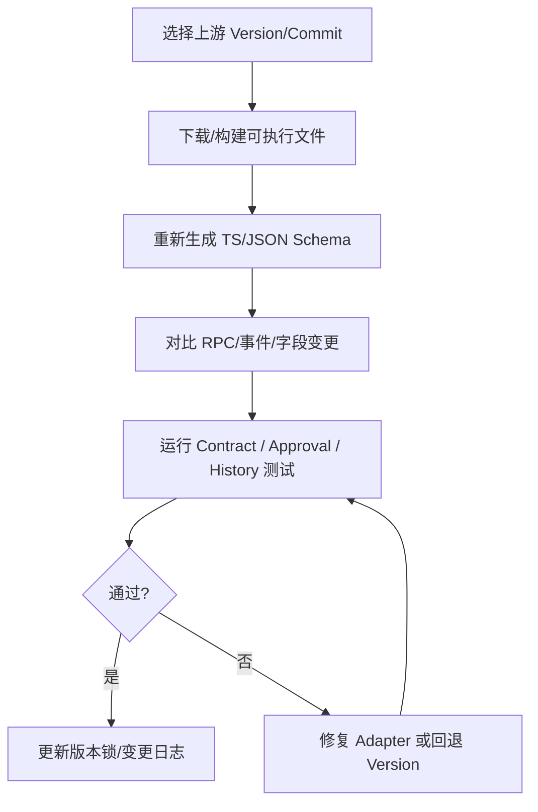

每次升级都记录破坏性变更、原有 Thread 的可读性与恢复策略、Goal/Memory 插件特性开关变化，避免边更新 Codex 边盲目修改上层 Dot。

---

## 20. 技术风险、ADR 与替代路线

### 20.1 风险登记表

| ID | 风险 | 严重性 | 缓解方案 |
|---|---|---|---|
| R01 | Codex App Server 协议更新 | 高 | 锁版本、代码生成、契约测试 |
| R02 | Rust Core 与 Electron 状态重构互相耦合 | 高 | 通过 Adapter/RPC，不 Fork 核心 |
| R03 | Renderer 越权调用本地 OS | 严重 | IPC 白名单、Preload、CSP、安全测试 |
| R04 | Worktree 被错误删除或覆盖 | 严重 | ownership、status、no-force 默认 |
| R05 | 多 Agent 修改冲突 | 高 | 独立 Workspace、人工 Diff 审查 |
| R06 | Task 重试造成重复写入 | 严重 | 幂等键、UNKNOWN、Reconciliation |
| R07 | Dot 主聊天上下文持续膨胀 | 高 | Router、Task Session、Context Builder |
| R08 | 长期记忆将恶意网页当用户事实 | 严重 | Trust Level、来源核对、记忆审计 |
| R09 | 长 Goal 空循环消耗配额 | 高 | WAITING_TRIGGER、预算、限流 |
| R10 | 自动化在 App 真正退出后无法继续 | 高 | 正确声明运行模式、后台 Service/未来云端 |
| R11 | 官方 Dot API 非公开 | 高 | Personal Dot 独立实现，不依赖私有 API |
| R12 | 现有认证不适合第三方正式分发 | 高（M5） | 开发者本地可用先行；正式发布前重新核查 |
| R13 | Windows/macOS Shell/路径/沙箱差异 | 中高 | Linux 先验证、适配接口、平台 E2E |
| R14 | Browser 自动化越权 | 严重 | Broker、审批、隔离，推迟高风险动作 |
| R15 | 过度创建 Sub-Agent | 中高 | 任务收益评估、并发和成本上限 |
| R16 | Codex Memory Pipeline 与 Personal Memory 互相污染 | 高 | 独立域、显式 Context Injection |
| R17 | 本地大量事件/日志泄露个人信息 | 高 | 分类分级、脱敏、默认本地保存 |
| R18 | 长时间升级后数据 Schema 不兼容 | 高 | Migration、备份、演练恢复 |

### 20.2 架构决策记录（ADR）

| ADR | 决策 | 备选 | 重新评估条件 |
|---|---|---|---|
| 001 | Codex App Server，而非 TUI 解析 | TS SDK / Rust Embed | App Server 核心功能缺失 |
| 002 | Electron + React 首期 | Tauri | 安装体积、内存或安全约束成为瓶颈 |
| 003 | SQLite 本地元数据 | PostgreSQL | 多用户/多机并发正式进入范围 |
| 004 | 单用户 Linux 优先 | 三平台同时开发 | Linux Gate 通过后开展移植 |
| 005 | 先桌面 Codex，后个人 Dot | 同步开发 | Codex MVP 功能稳定后开始 M3 |
| 006 | Goal/Task 独立于 Codex Thread | 直接把 Thread 当 Task | 无需等待/多阶段任务才可推翻（不推荐） |
| 007 | Personal Memory 独立于 Coding Memory | 改写 Codex Memory | 原 Core 提供足够的可扩展个人记忆接口 |
| 008 | 定时器和状态持久化，不靠连续 Prompt | 常驻 LLM Loop | 无需无限运行且成本可证明更低 |
| 009 | 登录 OAuth、计费后置 | 提前接商用用户 | 开始 M5 或功能测试明确依赖认证 |
| 010 | 眼镜只做后期事件入口 | 眼镜先行 | 桌面 Dot Goal/Task API 已稳定 |

### 20.3 Electron/Tauri 与 Core Fork 的取舍

**Electron** 适合快速落地，主要代价是打包大小和多进程资源。**Tauri** 在性能与 Rust 共享上有潜在优势，但需要额外维护前后端协议、WebView 兼容性和原生系统行为。前期选 Electron 是为了缩短功能闭环路径，而不是宣布 Tauri 不适合长期产品。

**Fork Codex Core** 的门槛：至少有一个可复现的需求、App Server 不可扩展的源码证据、跨版本成本评估、回归测试。否则优先通过自有 MCP、Adapter、独立 Control Plane 实现。

---

## 21. 最后阶段：认证、合规分发、多用户与产品化

**本章专为 M5 保留，不向前移动。**

### 21.1 正式身份模块边界

- 定义 `AuthProvider`、`AccountSession`、`CredentialAccess` 接口，M0–M4 返回本地开发者环境状态，不实现完整 OAuth。
- M5 根据 OpenAI 最新的第三方应用授权政策及正式公开 API，实现受支持的登录与取消授权。**不能拿用户的 ChatGPT 订阅、CLI 认证文件或官方 App 登录状态当作第三方分发自动授权的许可**。
- Token 存储使用 OS Keychain，支持撤销、账号切换、工作区与数据绑定；避免跨账号读取之前的个人 Dot Memory。
- 个人 Dot 的 Owner ID 从本地 profile 安全映射到新 User ID；原有 Task/Goal/Memory 不因迁移丢失或串户。
- 云端 Worker 和账户代理前增加真实租户隔离、速率限制、审计和数据保留规则。

### 21.2 发布版本计划

| 发布形态 | 阶段 | 可以承诺 | 不能承诺 |
|---|---|---|---|
| 开发者本地构建 | M0–M1 | 使用现有合法 Codex 环境完成基础任务 | 官方 Dot 接入、商用认证 |
| 本地单用户 Alpha | M2 | 多项目、Worktree、后台任务等按已验收范围可用 | 公共多租户 SaaS |
| Personal Dot 本地 Beta | M3 | 长期目标、Future Task、记忆、自动续接（按规定模式） | 关闭整台电脑后继续执行 |
| 多设备研发版本 | M4 | 手机/眼镜作为事件入口和反馈设备 | 未经验收的全天候隐私采集 |
| 正式产品版 | M5 | 经认证、合规审查及运营保障的公开能力 | 未获授权的官方 Dot 云端访问 |

### 21.3 源码与许可

Codex 开源仓库采用 Apache-2.0；本项目应保留原版权与许可证通知，遵守 NOTICE、商标和第三方依赖许可证。**Apache-2.0 授权开源代码，不授予使用 OpenAI/ChatGPT/Codex 商标造成官方背书混淆的权利，也不自动开放私有模型、云服务或计费接口。**正式发布前做依赖 License SBOM 和品牌核查。

---

## 22. 源码入口、参考文档、术语与决策附录

### 22.1 官方与开源源码入口（2026-10-26）

| 主题 | URL | 研究重点 |
|---|---|---|
| 开源 Codex 总仓库 | https://github.com/openai/codex | LICENSE、Core、SDK、CLI、App Server |
| App Server 官方协议 | https://developers.openai.com/codex/app-server | initialize、thread/turn、event、approval、类型生成 |
| App Server 实现 | https://github.com/openai/codex/tree/main/codex-rs/app-server | RPC 运行、通知、权限、兼容性 |
| Agent Core | https://github.com/openai/codex/tree/main/codex-rs/core | Agent Loop / Tool Runtime |
| Sub-Agent | https://github.com/openai/codex/blob/main/codex-rs/core/src/agent/control.rs | 代理创建、控制、运行元数据 |
| Goal Extension | https://github.com/openai/codex/tree/main/codex-rs/ext/goal | 任务持续续接，非完整 Future Scheduler |
| Memory | https://github.com/openai/codex/blob/main/codex-rs/memories/README.md | Phase 1/2、锁、摘要和文件 |
| Worktree | https://github.com/openai/codex/tree/main/codex-rs/worktree | 工作区隔离与生命周期 |
| TypeScript SDK | https://github.com/openai/codex/blob/main/sdk/typescript/README.md | 适合脚本式调用的备选适配 |
| Codex 官方文档 | https://developers.openai.com/codex | 功能、协议、使用限制与变更 |
| OpenMuse | https://github.com/CopilotKit/OpenMuse | 作为产品 UI/TaskWorker 设计参考，而非新项目直接基础 |
| OpenDots | https://github.com/CopilotKit/OpenDots | 持久化多 Agent UI/Workspace 思路 |
| Muse 安全架构 | https://research.meta.ai/blog/security-and-safety-for-ai-agents-our-approach-with-muse | Broker、Credential、Sentinel 思路 |

**对先前 Muse 研究文档的复用**：沿用《muse类personal agent产品和技术总结.md》的产品概念、官方案例、记忆与安全研究；沿用《复原的技术架构设计文档.md》的 Goal/Task/Memory/安全边界设想。但本方案最终选型调整为 **Codex Core 为中心**，而不是直接采用 OpenMuse 的 TanStack Agent Loop。

### 22.2 核心术语

| 术语 | 本项目定义 |
|---|---|
| Desktop Host | Electron Main 与本地后台基础服务 |
| Codex Core | 上游开源 Rust Agent Harness |
| App Server | Codex 的双向客户端 RPC 入口 |
| Thread | Codex 的逻辑对话与执行上下文 |
| Turn | Codex 的一次用户驱动 Agent 执行过程 |
| Item | Turn 内的消息、工具调用、文件变更等事件单位 |
| Project | 用户 Git 项目 |
| Workspace | 代码执行目录，包括独立 Worktree |
| Dot | 本项目独立实现的个人 Agent 产品层 |
| Goal | 跨天/跨任务的长期目标 |
| Task | 可多次恢复、可关联多个 Run 的工作单元 |
| Run | 任务某次具体执行尝试 |
| Future Trigger | 定时/事件/条件驱动的未来唤醒 |
| Context Builder | 构建有限长度的任务相关 LLM 上下文 |
| Memory Claim | 具有来源、信任、时间和修订关系的事实陈述 |
| Policy Gate | 非模型本身决定的权限检查位置 |
| Action Receipt | 外部操作的参数、审批与执行结果记录 |

### 22.3 开工前必须锁定的配置

```yaml
project:
  productName: PersonalCodexDesktop
  repository: your-org/personal-codex-desktop
  baselineDate: 2026-10-26
  implementationOrder: [M0, M1, M2, M3, M4, M5]
  firstTargetOS: linux-x86_64
  runtime: codex-app-server
  desktopShell: electron
  ui: react-typescript
  localStore: sqlite
  customAuthenticationBeforeM5: false
  billingBeforeM5: false
  cloudMultiTenantBeforeM5: false
  officialDotsPrivateAPIRequired: false
  keepCodexSandboxAndApprovals: true
  preferUpstreamCodexNoFork: true
```

### 22.4 仍需要通过实际代码运行确定的问题

1. 当前本机 Codex 可执行文件的版本/架构和已配置认证是否能通过 `app-server` 正常执行模型请求；本设计没有代替用户完成该测试。
2. 最终选定版本的 App Server 支持哪些实验 RPC/权限模式和完整 Item Schema；必须依据生成代码和 Smoke 测试确认。
3. Linux 目标发行版上 Electron/PTY/权限沙箱、桌面通知与工作树生命周期的兼容性。
4. `Goal Runtime` 和原生 Memory 各自是否可稳定启用，是否与 Desktop 版本的 App Server 协议一致。
5. 浏览器和设备能力需要到 M3/M4 再依据具体硬件及环境验证；不提前承诺完整 Computer Use 或眼镜联动。
6. 官方 Dot 私有服务是否将来提供第三方接口；目前按无正式公开 API 来设计独立 Personal Dot。

### 22.5 开发决策验收原则（终版）

- **M0/M1 是生死线**：真实 Codex Agent Loop 必须可从自研桌面端使用；如果做不到，优先修复 RPC 协议和开发环境，而不是开始写 Dot UI。
- **M2 是产品可用线**：项目、工作树、审批、终端、Diff、Review 和故障恢复能够形成完整的 Coding Workspace。
- **M3 是自主 Agent 线**：长 Goal 能可靠创建 Future Task，并在到期或事件满足时继续执行与更新计划；个人记忆和聊天 Task Context 不混乱。
- **M4 是多设备入口线**：眼镜/手机只是已可用的长期 Agent Runtime 的新输入/输出适配器。
- **M5 是产品发布线**：正式登录授权/账号/多租户/计费等全部在功能验证完成后建设。

> **最终架构判断**：这条路线的核心资产不是“复刻官方 Codex UI”，而是利用开源 Codex Rust Harness 作为可信的执行内核，建设可维护的桌面宿主和独立的长期 Personal Agent 控制平面。应把桌面 Codex 做扎实，再增加 Dot 的 Goal/Task/Memory/Future Schedule，最后再连接眼镜。登录授权是产品化课题，不应拖慢前期功能验证。

---

*本文为实施设计，不等同于已完成的软件、生产安全认证或官方桌面源代码。文档中新增模块、Schema、阈值和 API 必须在工程中按任务实现并通过验收。*

---


## 2026-10-31 增量修订：DeepSeek Super-Agent 对 Dot / Muse 复现的架构影响

> **修订类型**：经项目调研触发的非破坏性架构修订；保留本文件此前全部正文。此前与本章冲突的 Dot Control Plane 建议，以本章为准。**Codex Core → 桌面 Codex → 桌面 Dot → 手机/眼镜入口 → 正式登录及商业化（最后）**的路线不变。

### A. 结论与不变项

1. **不替换 Codex Core**：既有 Agent Loop、Thread、Turn、Tools、Sandbox、Compaction、Memory 和 App Server 仍是首选执行基础。DeepSeek Harness 作为隔离验证的可插拔替代 Executor，而不是生产主线强制依赖。
2. **升级 Dot Control Plane**：将原来的 `Conversation Router + Task Registry + Scheduler` 扩展为 `Source → Immutable Trigger → Evaluation/Admission → Mandate → Ticket → Assignment → Executor`，并加入 `Thread Subscription Registry`。
3. **保持两层不同的“Thread”**：`source_thread_ref` 指 GitHub Issue、PR、邮件线程或 Dot 主聊天的外部关联；`codex_thread_id` 指 Codex Agent 的执行上下文。两者绝不能混用。
4. **长任务不等于常驻 LLM**：Ticket 可 WAITING，相关事件命中 Subscription 才重新创建 Assignment；Codex Turn 的自动续接只负责一次执行窗口内的进展。
5. **安全边界不退化**：Mandate 记录来源、理由、范围和策略版本，实际写操作仍由 Permission Gateway 独立审批；密码、OAuth、付款、网络出口的强制限制不能只依赖 Prompt 或 Ticket 元数据。
6. **开发先后顺序不变**：桌面 Codex M1/M2 不引入此复杂度为阻塞依赖；M3 的单主聊天、M4 的主动任务优先集成，之后才扩展跨设备入口。

### B. 领域术语及旧模型映射

| 新概念 | 职责 | 旧模块的处理方式 | 边界 |
|---|---|---|---|
| Source | 事件源配置、身份和回调 | 扩充 Gateway/Connector | 不能默认为可信用户授权 |
| Trigger | 不可变的外部事件事实 | 统一 Message/Event 表，追加入库 | `(source_id, source_event_id)` 幂等 |
| Source Thread | 外部消息串/Issue/PR 关联 | Task Alias + Message Links | 不是 Codex Thread |
| Eval / Admission | 判断忽略/新建/关联/澄清 | 升级 Conversation Router | 本身不执行高风险工具 |
| Mandate | 任务可做之事的来源与范围 | 从 `autonomyPolicy` 独立出来 | 不替代实时 Policy Decision |
| Ticket | 长期稳定待办/工作目标 | 映射原 `Task`，迁移时保留 ID | 一个 Ticket 多个 Assignment |
| Assignment | 某次派工、租约和执行身份 | 分离原 `Run` 和 Agent 归属 | 过期租约必须 Fencing |
| Subscription | Ticket 对未来事件的确定性订阅 | 新增注册表 | 命中不自动扩大授权 |
| Executor Session | 实际 Agent 执行上下文 | Codex Thread + Turn/Run | 可替换、可恢复、可迁移 |

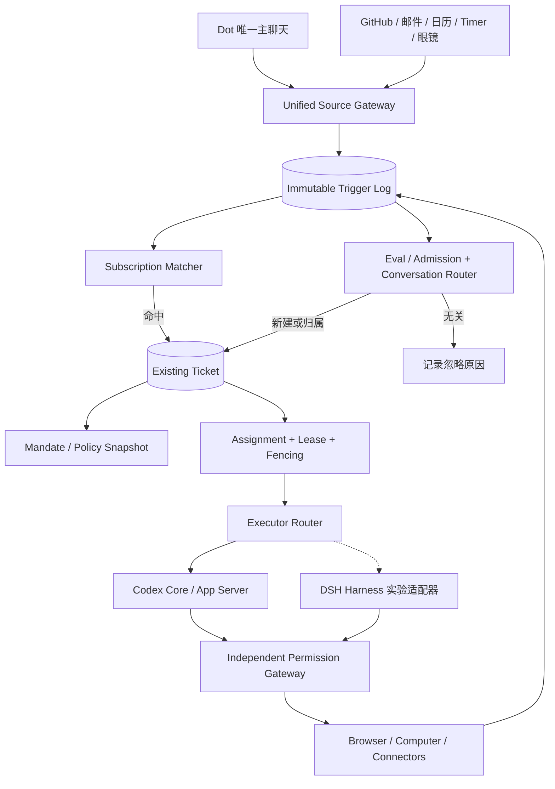

### C. 必须遵守的业务不变量

- **ID 不变量**：`message_id`（原始输入）、`trigger_id`（规范化事件）、`ticket_id`（原 Task）、`assignment_id`（派工）、`codex_thread_id`（执行上下文）各自唯一且不互相替代；一条用户消息只保存一份原文，通过关联表可以影响多个 Ticket。
- **幂等**：外部 Source 的重复回调不应产生第二个 Trigger 或第二次不可逆外部写入；索引 `UNIQUE(source_id,source_event_id)` 并配合 Action Receipt 和外部 Idempotency Key（如支持）。
- **并发**：同一个 Ticket 的可写 Assignment 需要乐观版本、Lease、Fencing Token；过期 Worker 不能继续提交 Checkpoint。外部已发送但结果不明确的 Action 进入 `OUTCOME_UNKNOWN`，禁止盲目重试。
- **安全**：只能从显式可审计来源建立 Mandate，推断/长期授权需限制在低风险行动；审批凭据绑定 Action 参数哈希、任务版本、一次性使用/到期时间、操作身份和目标商家或服务。
- **Event Subscription**：准确匹配来源及远端线程后，优先直接路由到已订阅 Ticket；只有未命中时才进入语义检索和轻量 Eval。多目标匹配可路由多 Ticket，但不得静默共享私有上下文。
- **撤销**：用户取消 Goal/Task 或撤销权限时，Subscription、Future Trigger、未开始 Assignment 和未消费授权同时失效；已经外发的行为记录结果，不宣称能够撤回。
- **保留 Task Context**：Codex Thread 可 Compaction 或 Rollover，但 Ticket State、Evidence、授权范围、待补问和事件订阅不应被清空。

### D. 核心接口合同（TypeScript 示例：本项目新设计）

```typescript
type Admission =
  | { kind: 'ignore'; reasonCode: string }
  | { kind: 'create'; goalId?: string; mandateRequest: MandateRequest }
  | { kind: 'route'; ticketIds: string[] }
  | { kind: 'clarify'; candidateTicketIds: string[]; question: string };

interface IncomingTrigger {
  triggerId: string; sourceId: string; sourceEventId: string;
  sourceThreadRef?: string; actorRef?: string;
  occurredAt: string; receivedAt: string;
  payloadRef: string; payloadSha256: string;
}
interface MandateRequest {
  originTriggerId: string; policyVersion: string;
  grantedBy: 'user'|'system-policy';
  allowedCapabilities: string[];
  expiresAt?: string;
}
interface TicketAssignment {
  ticketId: string; assignmentId: string;
  executor: 'codex'|'dsh-experimental';
  executionThreadId?: string;
  ticketVersion: number; leaseToken: string;
  leaseExpiresAt: string;
}
interface ThreadSubscription {
  subscriptionId: string; ticketId: string;
  sourceId: string; sourceThreadRef: string;
  eventTypes: string[]; active: boolean;
}
```

### E. 建议的数据库迁移（SQLite 原型；非官方 Schema）

```sql
CREATE TABLE IF NOT EXISTS agent_triggers (
  trigger_id TEXT PRIMARY KEY,
  source_id TEXT NOT NULL,
  source_event_id TEXT NOT NULL,
  source_thread_ref TEXT,
  occurred_at TEXT NOT NULL,
  payload_ref TEXT NOT NULL,
  payload_sha256 TEXT NOT NULL,
  UNIQUE(source_id,source_event_id)
);
CREATE TABLE IF NOT EXISTS agent_mandates (
  mandate_id TEXT PRIMARY KEY,
  ticket_id TEXT NOT NULL,
  origin_trigger_id TEXT NOT NULL,
  policy_version TEXT NOT NULL,
  capabilities_json TEXT NOT NULL,
  granted_by TEXT NOT NULL,
  revoked_at TEXT,
  expires_at TEXT
);
CREATE TABLE IF NOT EXISTS agent_subscriptions (
  subscription_id TEXT PRIMARY KEY,
  ticket_id TEXT NOT NULL,
  source_id TEXT NOT NULL,
  source_thread_ref TEXT NOT NULL,
  event_types_json TEXT NOT NULL,
  active INTEGER NOT NULL DEFAULT 1,
  UNIQUE(ticket_id,source_id,source_thread_ref)
);
CREATE TABLE IF NOT EXISTS agent_assignments (
  assignment_id TEXT PRIMARY KEY,
  ticket_id TEXT NOT NULL,
  executor_kind TEXT NOT NULL,
  codex_thread_id TEXT,
  ticket_version INTEGER NOT NULL,
  lease_token TEXT NOT NULL,
  lease_until TEXT NOT NULL,
  state TEXT NOT NULL,
  updated_at TEXT NOT NULL
);
```

> 迁移原则：**保留原 `tasks` 表与 Task ID**，先加 `ticket_id = task_id` 兼容视图和 Adapter，再将新的 Admission、Subscription、Assignment 逐阶段切流。新表设计与旧版 `task_runs` 可能存在语义重叠，必须在代码中选定唯一事实源，禁止双向写入导致状态分叉。

### F. Dot 前台单对话与 GitHub 后台事件的两个样例

```mermaid
sequenceDiagram
  autonumber
  actor User as 用户
  participant UI as Dot Chat
  participant GW as Event Gateway
  participant SM as Subscription Matcher
  participant EV as Eval Router
  participant DB as Ticket Store
  participant W as Assignment Worker
  participant CX as Codex App Server
  User->>UI: “继续之前的 Android Bug”
  UI->>GW: message + messageId
  GW->>SM: normalize trigger
  SM-->>GW: 无明确订阅
  GW->>EV: candidates + focus + history
  EV-->>DB: route to existing Ticket
  DB->>W: 创建 Assignment/Lease
  W->>CX: thread/resume 或 thread/start; turn/start
  CX-->>W: events + result
  W->>DB: versioned checkpoint
  DB-->>UI: linked progress + taskId
```

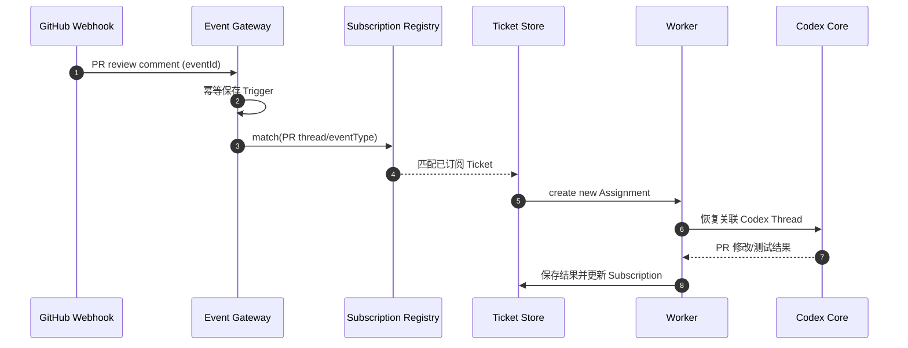

### G. 与 OpenMuse / DSH 的开源实现取舍

- **DSH 概念复用，不是强依赖**：优先抽取 Trigger、Admission/Eval、Mandate、Ticket/Assignment、Subscription 的行为与接口，不直接搬运研究原型的单仓库身份假设或无逐步审批的 Shell 权限模型。
- **OpenMuse 定位调整**：OpenMuse 可继续用作 UX、TaskWorker/ActionService 对照参考；**目前主实施基线仍是 `Codex Core + 自研 Desktop Host + Dot Control Plane`**，不应出现两个相互竞争的主运行时。
- **多引擎策略**：先将 Executor Router 接口稳定化、完成 Codex Adapter；DSH Adapter 只在独立实验分支中测试，不参与前期 M1/M2 验收。
- **完整个人 Memory、Browser/Computer Use、Authd-like Credential Broker、Sentinel-like Permission Gateway** 仍需按照既有独立文档实现。DSH Super-Agent 的研究原型不证明这些能力具备生产安全。

### H. 增量开发任务与验收

| ID | 阶段 | 任务 | 验收 |
|---|---|---|---|
| DSH-01 | M2-Spike（非阻塞） | 锁定 DeepSeek 两仓库 Commit 和 License | 可重现 checkout、构建、测试结果 |
| DSH-02 | M2-Spike | 复现 Issue→Ticket→Executor→PR→Review | 事件与任务一一可追踪 |
| DSH-03 | M2-Spike | 对照 Codex Executor、统计耗时与失败 | 形成证据矩阵，不凭印象切换 |
| DOT-AD-01 | M3 | Trigger 规范化、去重、审计 | 重复 webhook 仅一个业务 Trigger |
| DOT-AD-02 | M3 | Source Thread Subscription | PR 新评论确定性关联原 Ticket |
| DOT-AD-03 | M3 | Eval 与 Conversation Router 分离 | `create/route/ignore/clarify` 有日志 |
| DOT-AD-04 | M3 | Task/Ticket 与 Assignment 解耦 | 崩溃恢复 + 无双重活动写租约 |
| DOT-AD-05 | M3 | Mandate 版本与撤销 | 超范围动作被 Gateway 拒绝 |
| DOT-AD-06 | M4 | Goal→Subscription/Future Trigger 关联 | Goal 完成后自动终止关联订阅 |
| DOT-AD-07 | M4 | 多事件合并、主动通知限流 | 无重复通知与循环任务创建 |
| DOT-AD-08 | M5 | Device Source 复用 | 手机/眼镜事件有明确来源及授权 |

**非阻塞原则**：以上设计不应阻止 Codex Desktop 的第一阶段功能验证，也不能将正式 OAuth、多用户账号和计费提前到 M1/M2。**但本地沙箱与敏感操作的有效审批始终是底线。**


### I. 对总体方案的正式 ADR 更新

**ADR-DSH-001：保持 Codex Core 为首选 Engine（Accepted）**：理由是当前 App Server、Agent Loop、Memory、Worktree 已适配本地桌面原型；替换主 Engine 将引入不可控 API 变化与重测成本。

**ADR-DSH-002：Dot 控制平面采用事件准入与 Ticket 分层（Accepted for M3）**：桌面 Codex 本身仍维持原来的 Thread/Turn 工作流；新领域对象只服务跨时间、跨来源的 Personal Dot。

**ADR-DSH-003：DSH Harness 多引擎运行（Deferred）**：仅通过实验适配器和统一 Task 契约对照，直到性能、兼容性及安全评估过关。

**总路线约束**：M1/M2 桌面 Codex → M3 Dot 单主聊天/任务路由 → M4 长期主动执行 → M5 设备和产品化（正式授权最后）。若旧章采用其他 M 编号，以原 WBS 编号为准；本次新增 DSH 任务是附属工作包而不是改写既有验收编号。


### 参考来源与证据等级（截至 2026-10-31）

- [代码/项目声明] [DeepSeek Harness](https://github.com/deepseek-ai/deepseek-harness) — Developer Preview；版本和运行接口需锁定 Commit 后逐项实测。
- [代码/研究原型] [DSH Super-Agent Prototype](https://github.com/deepseek-ai/dsh-superagent-prototype) — Research Prototype，聚焦 GitHub/飞书软件工程事件，并非成熟的通用个人助手。
- [架构] [Domain Model](https://github.com/deepseek-ai/dsh-superagent-prototype/blob/main/docs/001-domain.md)、[Authorization](https://github.com/deepseek-ai/dsh-superagent-prototype/blob/main/docs/002-authorization.md)、[Execution](https://github.com/deepseek-ai/dsh-superagent-prototype/blob/main/docs/003-execution.md)、[Architecture](https://github.com/deepseek-ai/dsh-superagent-prototype/blob/main/docs/007-architecture.md)。文档路径可能随版本变化，应以锁定的源 Commit 为准。
- [当前主线] [OpenAI Codex 开源仓库](https://github.com/openai/codex)，[App Server 协议](https://github.com/openai/codex/blob/main/codex-rs/app-server-protocol/src/protocol/common.rs)。

**证据限制**：开源项目宣称实现的功能不等于已在本项目完成部署或安全验收；本修订所有 `personal-dot/*` 类型、Event/Subscription/Mandate 表和迁移脚本均为本项目新设计。严禁将 Mandate 当成支付、网络出口或凭据使用的最终授权凭证。
