# Muse 类 Personal Agent 复原：技术架构设计文档

> **版本**：v1.2 · 2026-10-31（保留截至 2026-10-26 的全部正文）  
> **类型**：架构设计 / 可实施技术蓝图（不是 Meta Muse 官方源码）  
> **基线**：优先复用 `CopilotKit/OpenMuse` 的 Expo/AG-UI、Hono API、TaskWorker、Browser Worker 和 ActionService；扩展 Goal-driven Runtime、Memory、专用 Browser Agent、可信执行边界、多设备协同。  
> **配套研究**：《muse类personal agent产品和技术总结.md》，含产品能力、全部讨论、官方/逆向证据与开源项目调研。

**事实层级**：`[官方]` 为厂商披露；`[开源]` 为对应仓库当前实现；`[逆向]` 为运行环境观察；`[本方案]` 为新设计。所有本文新增 API、数据库表、Hook、消息协议、P0/P1 指标均属 `[本方案]`，不应宣称 Meta 或 OpenMuse 已原生支持。


> **v1.1 更新（2026-10-26）**：原有 §0–§22 的技术蓝图全部保留。新增 §23《2026 年 10 月技术变化与架构增补》，重点补齐 Muse Wonder Active Memory/Focus、Muse Spark Open/Glimmer 模型部署约束、Claude Duet 隐私/凭据/付款安全、dots 移动与任务状态、OpenMuse/OpenDots/OpenBot 能力边界、Sub-Agent 拆分评测、OTel 追踪以及新增端到端验收。若原文与增补冲突，优先采用 §23 的时间戳结论；新协议、SQL 和接口均属于**待实现的建议设计**。

## v1.1 变更概览

| ADR / 接口 | 2026-10-26 调整 | 理由 |
|---|---|---|
| ADR-MODEL-2026-10 | 新增能力化 `Model Registry`，明确模型与 Agent Runtime 分离 | Muse Wonder / Spark Open 使模型层演进加快 |
| ADR-MEM-2026-10 | 增加 Active Memory 请求契约、检索证据与记忆失效检测 | 模型可主动检索但不能替代 Claim / Source 治理 |
| ADR-FOCUS-2026-10 | Active Focus 映射到可评估的持续任务恢复策略 | 模型耐心不等于 Durable Execution |
| ADR-SAFE-2026-10 | 外发信息 DLP 与动作审批独立为两道 Gate | Claude Duet 公布外发隐私控制 |
| ADR-LOOP-2026-10 | 单 Agent + Progressive Skills 与多 Sub-Agent A/B 评测后选型 | 减少不必要的 Handoff、成本及等待 |
| ADR-OTEL-2026-10 | 采用 OpenTelemetry GenAI Trace，并保护敏感数据 | 支持跨框架观察、复现与端到端评价 |
| ADR-OSS-2026-10 | 更新 OpenMuse E2B、OpenBot、OpenDots Learning 证据边界 | 避免把可选/未验收部分写成已经生产可用 |


## 目录

0. 设计目标、范围与架构决策
1. 用户场景、功能需求与验收边界
2. 系统组件与安全域的总体拓扑
3. ID 体系、协议与统一数据模型
4. Message Gateway / Conversation Router / Focus
5. Context Builder、Session 与 Compaction
6. Hatch-like Main Agent / Sub-Agent Runtime
7. Task Worker、持久执行、事件日志与故障恢复
8. Goal Manager / Future Task / 主动执行引擎
9. Browser Sub-Agent / Broker / Session Controller
10. Authd-like Credential Broker、Connector/Privsep
11. Sentinel-like Capability Gateway 与网络出口
12. Memory Service：Entries/Embeddings/Claims/Consolidation
13. Model Routing、Jev 与安全分类模型
14. Dynamic Skills、Artifacts、用户接管与通知
15. 三端协作：眼镜、手机 Host、云端 Agent
16. Linux / VM / 容器 / 运行时生命周期
17. 核心业务时序：购物、邮件、审批、跨时间任务
18. 对 OpenMuse 的精确改造点与源码位置
19. 可观测性、测试、威胁模型与验收
20. 资源成本、部署与迭代计划
21. 架构决策记录（ADR）与开放问题
22. 附录：Schema、接口、参考源码与覆盖矩阵

---

## 0. 设计目标、范围与架构决策

### 0.1 产品与目标

目标是一套能以主聊天/语音/眼镜接收用户意图，同时支持**独立 Task Conversation、长期个人记忆、Goal 驱动的自主未来任务、浏览器及工具执行、人工审批、失败恢复、跨设备状态同步**的 Personal Agent 平台。

核心闭环：

```text
User Input / Device Event
  → Conversation/Task Router
  → Goal / Task Registry
  → Context Builder
  → Main Agent / Sub-Agent Runs
  → Tool & Browser Executors (isolated)
  → Independent Capability / Credential / Network Enforcement
  → Durable Result / Event Log / Memory Update
  → Goal Replan / Future Task Trigger
  → UI / Notification
```

**设计成败的标准不是 LLM 说“我会持续帮你”，而是系统在 30 天长期任务中能真正确认未来触发、执行、暂停、恢复、纠错、授权与终止。**

### 0.2 功能范围（Must/Should/Could）

| 级别 | 功能 | 备注 |
|---|---|---|
| Must | 一个主入口、多 Task Context、可靠 Router | 跨平台与历史隔离 |
| Must | Task 持久化、Lease/Fencing、Run/Action 状态 | 重启/掉线/不重复动作 |
| Must | Goal Registry、任务关系、Future Task API、Scheduler | 自主计划闭环基础 |
| Must | Memory 持久文件与结构化事实、来源与纠错 | 不只向量搜索 |
| Must | Browser 自动化与受控动作接口 | Agent 不直接拥有无限制 CDP |
| Must | 凭据隔离、可信审批、最小权限的工具执行 | 所有危险操作受控 |
| Must | 手机/网页任务状态和批准入口 | 跨设备一致性 |
| Should | 工具生成、Skills 注册、Artifacts、主动通知 | 沙箱与审查后上线 |
| Should | 多模态眼镜事件、Phone 本地任务路由 | 兼顾功耗、隐私 |
| Should | VM Hibernation、配额、成本可观测 | 商用规模化 |
| Could | eBPF LSM 精细 Tainted Egress、Confidential VM | 后续高级安全阶段 |

### 0.3 不属于初版目标

- 不试图逐字节复刻闭源 Muse Spark / Hatch 内部实现；无法得到的内部协议只以通用接口替代。
- 不承诺当前 OpenMuse 的 E2B、Docker 沙箱安全性等同 Meta Secure VM。
- 不自动处理真实银行卡信息；购物初期先做到**模拟结账/人工跳转/正式审批**，支付仅在独立安全审计及商家接口允许的情况下开启。
- 不默认上传所有眼镜视觉流与手机私人数据；以事件级数据和最小授权为前提。
- 不依赖模型“自我保证”完成安全职责；安全网关必须独立执行。

### 0.4 必须坚持的架构原则

1. **Agent 可被攻破**：以最低权限面对 LLM、网页和生成代码。
2. **Task 生命周期与 Agent Run 分离**：Run 有上下文长度和超时，Task/Goal 长期存在。
3. **记忆可追溯且可修订**：File/Entry/Embedding/Claim/Evidence 分层。
4. **外部副作用可信执行**：Agent 只提出 Action，受保护执行器裁决及执行。
5. **明确的稳定 ID**：user/agent/thread/goal/task/run/action/session/event 均不可混用。
6. **策略与机制分离**：Prompt 引导，Runtime 强制状态与安全约束。
7. **跨时间自动任务有成本与权限边界**：配额、范围、到期时间和可撤销性。
8. **来源标识**：官方/逆向/设计不可混淆，源码更新必须重新验证。

---

## 1. 主要用户场景与验收问题

### UC-01 普通聊天

用户询问技术概念，系统在主聊天短时 Run 回答；不无缘无故创建后台 Task。

### UC-02 新任务委派

用户“研究 OpenMuse 源码并出报告”，Router 创建 Task T1；TaskWorker 执行，用户可关闭 App，稍后获得文件/报告。

### UC-03 续接旧任务

用户随后讨论另一个项目，再说“继续刚才的 OpenMuse 研究”，Router 在 Task Index 里找到 T1，注入 T1 的状态及摘要，不需恢复其他项目的所有上下文。

### UC-04 长期目标与自调度

用户“下月出差前准备会议设备，500 美元以内”；Agent 自主安排价格查询/设备清点/日期检查，后续出差改期引发任务更新、重规划、取消失效触发器。

### UC-05 云端购物与安全支付

搜索/比价、登录/2FA 用户接管、购物车、具体交易审批、提交、网络未知结果对账、后续物流监控。禁止在用户批准之前产生有效支付/订单副作用。

### UC-06 邮件和表单

读学校邮件、读取 PDF、补问必要信息、填表、准备邮件发送，经 ActionService 独立审批后发送，保存成功/失败/未知回执。

### UC-07 AI 眼镜场景

用户看商品，说“比较一下”，眼镜/手机仅上传必要视觉推断、商品线索、意图和隐私等级；云端 Browser/Research 执行；眼镜读出简短结果，手机负责交易确认。

### UC-08 用户撤销权限/忘记记忆

撤销 Gmail 使相关 Future Tasks 暂停，待审批 Action 失效；Forget 清理 Memory/索引/关联 Claim/派生摘要，并保证后续 Dream 不从未授权的残留来源重建。

### UC-09 故障恢复

Worker 在外部邮件发送或支付提交后崩溃，状态进入 Outcome Unknown，自动查证而非直接重放副作用。

---

## 2. 组件图、控制面与安全边界

### 2.1 逻辑架构

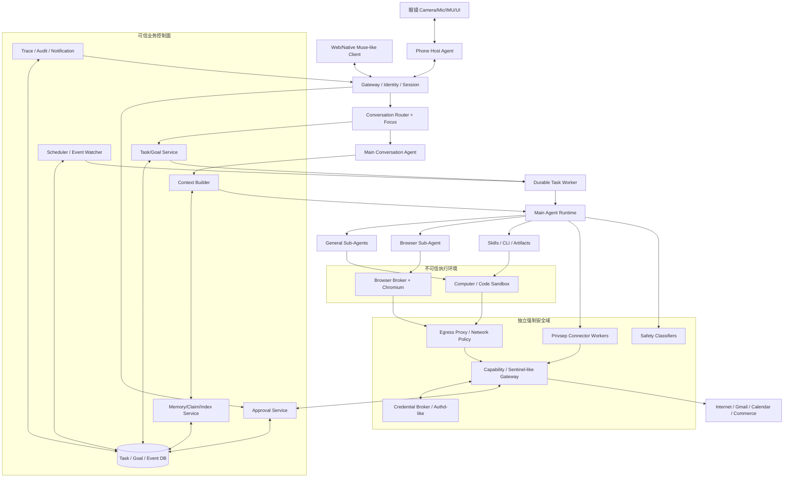

**两条控制路径必须分开**：

- 任务控制：`Gateway → Router → TaskWorker → Agent → Tool/Sub-Agent → Result`。
- 权限控制：`Tool/Browser/Network → Capability Gateway ↔ Credential Broker/Approval → 受控执行`。

### 2.2 隔离信任层级

| 安全域 | 包含 | 信任假设 |
|---|---|---|
| Client | 眼镜、手机、Web | 客户端用户可确认操作，但需强认证、防重放 |
| Control Plane | Task/Goal/Memory/Event/审批 | 可信代码，不能由 Agent 自由修改 |
| Agent Runtime | 主模型循环/子 Agent | 可因提示注入被诱导，视为不可信 |
| Execution Sandbox | Browser/Computer/生成代码 | 极度不可信，最小网络与文件权限 |
| Secret/Policy Plane | Credentials、Privsep、Permission、Egress | 单独进程/VM，具强制策略 |
| External | 互联网、邮件、商家网站 | 不可信，必须核对副作用结果 |

### 2.3 初期与生产部署的差异

- **本地研究**：OpenMuse API/TaskWorker 同进程 + PGlite + Playwright Worker + Docker Computer，模拟或受控真实账号；不进行真实购物支付。
- **试点**：API/Worker 分离、PostgreSQL、强认证、Connector 隔离、外部写操作审批，最小稳定 Browser 会话管理。
- **生产**：多租户身份与数据隔离、每用户 VM/独立可信沙箱、多层网络出口、强制审计、配额、资源调度/冷启动、故障恢复和灾备。

---

## 3. 统一数据模型和标识协议

### 3.1 全局对象与归属关系

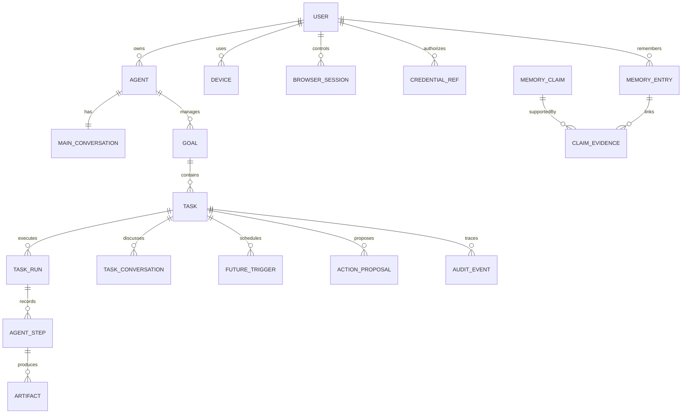

| ID | 含义 | 注意 |
|---|---|---|
| `user_id` | 账号所有者 | 租户级授权和所有权 |
| `agent_id` | 个人 Agent / dot | 可跨设备存在 |
| `main_thread_id` | 统一主聊天 | 前台连续不等于单 Context |
| `task_thread_id` | 特定任务 Conversation | 不自动继承主聊天全部历史 |
| `message_id` | 不可变原始消息 | 可通过关联表多视图展示 |
| `goal_id` | 长期目标 | 独立生命周期 |
| `task_id` | 一个任务 | 可经历多 Run |
| `run_id` | 一次 Agent 执行 | Context 有界，可重试 |
| `child_task_id` | Sub-Agent Task | 归属父 Task，有权限和预算 |
| `action_id` | 具体外部操作 | 审批、幂等、对账单位 |
| `approval_id` | 用户针对动作作的明确许可 | 绑定用户与动作 Hash |
| `browser_session_id` | 浏览器登录/操作空间 | 会话与控制权分离 |
| `trigger_id` | 将来唤醒规则 | 可变更/取消/过期 |
| `memory_entry_id` / `claim_id` | 文本/事实 | 不混用 |
| `event_id` | 审计事件 | 严格唯一，便于去重 |

### 3.2 消息统一信封

```typescript
interface AgentEventEnvelope<T = unknown> {
  eventId: string;                 // UUID/ULID
  userId: string;
  agentId: string;
  conversationId?: string;
  goalId?: string;
  taskId?: string;
  runId?: string;
  actionId?: string;
  correlationId: string;           // 业务因果链
  causationId?: string;            // 前驱 Event/Message
  eventType: string;
  seq?: number;                    // 每 Task 单调增序列
  expectedVersion?: number;
  schemaVersion: number;
  occurredAt: string;              // ISO-8601
  source: "user" | "device" | "agent" | "tool" | "scheduler" | "policy";
  privacyClass: "public" | "personal" | "sensitive";
  payload: T;
}
```

在身份边界完成后再写入 `userId`，**不信任客户端自行指定别人的 User ID**。所有消费者处理幂等，重复 Event ID 不得重复外部副作用。事件与业务状态变更应放入同一 DB 事务（Transactional Outbox）。

### 3.3 数据存储分离

- **PostgreSQL**：User/Goal/Task/Run/Future Trigger/Action Approval/Event/Claim/Entry Metadata。
- **对象存储/用户 Workspace**：原始文件、不可变消息附件、Artifact、截图、Browser Profile（按隔离要求）。
- **pgvector + FTS**：文本检索索引，索引值可重建，引用原始内容 Hash/Revision。
- **Secret Store**：凭据、Token、Passkey 交互，不放业务数据库普通 JSONB，也不在 LLM 上下文保存。
- **Trace Store**：非敏感执行摘要与证据引用，可配置独立生命周期与数据留存。

---

## 4. Message Gateway 与 Conversation Router

### 4.1 为什么必须做独立 Router

一个人可以始终从一个 Chat 窗口输入，而底层存在多个长期 Task Conversation。例如“研究 OpenMuse”→“另外开发 Android App”→“继续刚才的 OpenMuse”→“上一个项目进展如何”。**UI 连续不表示所有任务历史放入同一个模型上下文**。Router 在 Main Agent 前面区分普通交流、新 Task、旧 Task 补充、状态查询和取消/审批，并可将多动作输入拆分为有序操作。

OpenAI dots 官方仅确认“每个 Task 有自己的 Conversation，不会自动继承用户与 dot 的全部聊天”；其内部 Router 未公布。OpenMuse 目前更多靠 ConversationAgent 的 LLM Tool Calling 管理任务，因此这部分是本方案新增。

### 4.2 动作枚举及安全等级

| Route | 动作 | 是否唤醒 Task Agent | 风险 |
|---|---|---|---|
| `CHAT` | 普通问答 | 不一定 | 低 |
| `CREATE_TASK` | 新建并计划任务 | 是 | 低-中 |
| `RESUME_TASK` | 向现有 Task 追加输入/恢复 | 是 | 中 |
| `QUERY_TASK` | 直接查 DB 状态 | 否 | 低 |
| `UPDATE_TASK` | 修改 Budget/Deadline/Constraint | 可能需重规划 | 中 |
| `CANCEL_TASK` | 取消未完成任务 | 不需要模型做最终裁决 | 高，应明确目标 |
| `APPROVE_ACTION` | 特定高风险操作审批 | 不交给语义 Router 直接授权 | 高，独立审批 UI |
| `MULTI_ACTION` | 拆分多个目标/动作 | 根据子动作 | 按最高动作 |
| `CLARIFY` | 指代不明 | 否 | 低 |

关键：模型可以输出“建议 APPROVE_ACTION”，**绝不能将普通聊天中的“同意”当作支付审批凭证**。审批必须验证可信客户端或签名的独立动作 Token。

### 4.3 Focus State

```typescript
interface FocusState {
  userId: string;
  mainThreadId: string;
  focusedTaskId?: string;
  lastExplicitMentionedTaskId?: string;
  recentlyMentionedTaskIds: string[];  // 最近 N 个，按消息时间排序
  pendingQuestion?: {
    questionId: string;
    taskId: string;
    requestedFields: string[];
    expiresAt: string;
  };
  pendingClarification?: {
    messageId: string;
    action: string;
    candidateTaskIds: string[];
  };
  focusVersion: number;
  updatedAt: string;
}
```

Focus 表示**当前聊天引用的任务**，不等于最近执行的 Worker，也不等于最新创建的 Task。用户从 Task 详情页点击“继续”，UI 应携带签名或服务端核验的 `task_id` / `reply_to`，避免语义猜测。

### 4.4 两阶段 Task Retrieval + LLM 指代消解

1. **强确定性路径**：UI 任务引用、审批卡片 ID、对待回答问题的回复、Slash Command 或 reply-to。
2. **候选任务检索**：只查当前用户权限内的 Task Index；匹配标题、别名、描述、参与实体、状态、最近交互、Focus 和事件关系。
3. **受约束决策**：小模型接收当前消息、有限最近消息、前 3–8 个候选的摘要，返回固定动作与已存在的 Task ID。
4. **后置校验**：Task ID 归属、状态、Version、操作允许性、歧义 Margin、取消/删除风险。
5. **Dispatch**：对旧 Task 添加输入/查询状态；新 Task 写入 Registry；不确定则问用户。

评分可用启发式而不是单信一个模型的置信度：

\[
S(T_i)=w_sS_{semantic}+w_eS_{entity}+w_fS_{focus}+w_rS_{recency}+w_pS_{pending}-w_aP_{ambiguity}
\]

模型输出的 `confidence` 不是经统计校准的真实概率；取消、付款等动作的歧义阈值要更严格。

### 4.5 Router 输出 Schema

```typescript
type RouteKind =
  | "CHAT" | "CREATE_TASK" | "RESUME_TASK" | "QUERY_TASK"
  | "UPDATE_TASK" | "CANCEL_TASK" | "CLARIFY";

type RouteCommand = {
  action: RouteKind;
  taskId: string | null;
  messageSpan?: [number, number];
  recognizedEntities?: string[];
  proposedChanges?: Record<string, unknown>;
  ambiguityReason?: string;
};

type RoutePlan = {
  commands: RouteCommand[];        // 可包含多个操作
  confidence: number;
  needsUserConfirmation: boolean;
  originalMessageId: string;
};
```

注意以 JSON Schema 严格限定枚举和候选 ID 范围。**Schema 限制格式，无法保证语义引用准确。** 始终在服务端用 `getAuthorized(userId, taskId)` 验证。

### 4.6 伪代码

```typescript
async function routeMessage(msg: IncomingMessage): Promise<RoutePlan> {
  const explicit = await resolveExplicitRef(msg); // 只信已核验引用
  if (explicit) return authorizeAndPlan(explicit, msg);

  const focus = await focusStore.get(msg.userId, msg.mainThreadId);
  const pending = await pendingQuestionStore.match(msg, focus);
  if (pending) return authorizeAndPlan(pending, msg);

  const candidates = await taskIndex.hybridSearch({
    userId: msg.userId,
    query: msg.text,
    focusTaskId: focus?.focusedTaskId,
    topK: 6
  });
  const decision = await smallRouterModel.route({
    message: msg.text,
    recentMainMessages: await mainThread.recent(msg.mainThreadId, 6),
    focus,
    candidateSummaries: candidates.map(toRoutingView)
  });

  if (!schemaValid(decision)) return clarify(msg, candidates);
  if (decision.commands.some(c => c.taskId && !candidates.some(t => t.id === c.taskId)))
    return clarify(msg, candidates);
  if (hasAmbiguousDestructiveAction(decision, candidates))
    return clarify(msg, candidates);
  return routeDispatcher.validateAndExecute(decision, msg.userId);
}
```

### 4.7 特殊输入处理

- “继续”：若同一当前 Task 正等待用户输入，回复关联该 Task；若多个等待问题，提出澄清。
- “上一个项目”：最近讨论顺序和时间是弱证据，不能仅按最近运行任务推断。
- “暂停耳机监控、修改日本行程、告诉我 Android 项目状态”：拆成三个命令，分别执行或校验；不能把三项合并进单一 Task Prompt。
- “取消所有与旅行有关的自动化”：检索相关 Goal/Trigger，展示要影响的对象，确认后批量取消。
- 外部 Webhook：必须携带稳定 `task_id/trigger_id` 的订阅元数据；不应经过普通语言 Router。

### 4.8 Router 的评估

需要含代词、跨话题、多任务、跨渠道、旧任务被取消、同时多个等待问题、恶意构造 Task ID 等数据集；指标包括 Top-1/Top-K 准确率、误关联率、澄清召回率、取消误判为零、跨用户任务泄漏为零；应记录路由意图和依据摘要，避免保存无关敏感原文。

---

## 5. Context Builder / Session Manager / Compaction

### 5.1 四个时间/数据层次

| 层次 | 生命周期 | 存储 | 模型是否全部加载 |
|---|---|---|---|
| Main Conversation | 长期用户界面 | 完整 Message/Event | 否 |
| Task Conversation | 任务专题 | Thread + Task 事件 | 否 |
| Task State | 到完成/保留期 | 结构化持久化 | 只选必要状态 |
| Agent Run Context | 单次请求和工具轮次 | 临时窗口 + Checkpoint | 模型此刻真正看到的 Token |

### 5.2 推荐 Context 构造

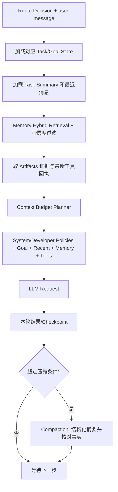

Context Builder 必须优先保留：当前用户要求、执行权限/限制、Task 成功条件、尚未解决阻塞、已批准动作/状态、最近工具回执。低相关老聊天可摘要或通过检索按需恢复。

### 5.3 Token Budget（示例，非官方阈值）

```typescript
interface ContextBudget {
  total: number;
  policy: number;
  currentGoal: number;
  taskState: number;
  recentHistory: number;
  retrievedMemory: number;
  toolEvidence: number;
  reservedForOutput: number;
}
```

可使用模型上下文的比例预算（例如为输出留出 15%–25%，具体按模型与任务测量）。Compaction 不应直接删原始历史；压缩结果必须保留来源、决策、未完成动作、失败/未知结果和 Task Version。

### 5.4 Compaction 与 Memory 的边界

Compaction 用来把长 Run 的旧轨迹摘要化；Memory 记录跨 Task 的稳定偏好/事实；Task State 是代码可理解的权威状态。**不能以摘要作为唯一的交易账本**。主对话摘要与任务摘要分别维护，避免 Android 项目的测试错误污染旅行任务。

### 5.5 上下文增量与历史重放

新的 Run 先加载状态快照，再仅重放快照版本之后的 Event Log；正常情况下不需要将所有 LLM Tool Calls 再次喂给模型。只有调试重放时才按版本化模型、Prompt、工具输入及环境快照模拟运行；真实写入动作不得随调试重放再执行。

---

## 6. Agent Harness / General Sub-Agent Runtime

### 6.1 Agent Loop 的建议接口

```typescript
interface AgentRunRequest {
  taskId: string;
  runId: string;
  planVersion: number;
  contextRef: string;
  role: "main" | "browser" | "research" | "coding" | "review";
  toolCapabilities: string[];
  maxSteps: number;
  deadlineAt: string;
  tokenBudget: number;
  abortSignalRef: string;
}

interface AgentRunResult {
  status: "finished" | "delegated" | "waiting_input" |
          "waiting_approval" | "failed" | "cancelled";
  outputRef?: string;
  taskStatePatch?: Record<string, unknown>;
  proposedActions: string[];
  spawnedChildTasks: string[];
  evidenceRefs: string[];
}
```

OpenMuse 当前 `executeModelTask()` 更接近**任务有限步模型 Loop**，每次通过最新 Task State 重建上下文。保留此方式更利于恢复，但要增加结构化结果验证和事件记录。

### 6.2 主 Agent 与 Sub-Agent 的边界

- Main Agent 定义 Task/Goal、选择执行方式、协调结果、与用户对话。
- Browser Sub-Agent 负责网页范围内的观察-操作，不能自行扩大访问资源和付款权限。
- General Sub-Agent 可以按角色配置工具集合（研究、编程、分析、计划校验），而非一开始为每一种任务建固定服务。
- Safety/Permission 服务不是主 Agent 创建或可以关闭的 Sub-Agent。

### 6.3 Sub-Agent 生命周期

```text
SPAWNED → READY → RUNNING → WAITING/PAUSED → RUNNING → COMPLETED
                     └──────────────────→ FAILED / CANCELLED
```

有两种运行模式：`TaskScoped`（执行完销毁）与 `Persistent`（跨多次子任务等待重用）。初版采用 TaskScoped，保留通向 Persistent 的 Agent ID/状态接口。子 Agent 接收**最小必要上下文**，不自动继承完整用户聊天/全部私人记忆。

### 6.4 Sub-Agent 任务合同

```typescript
interface SubAgentTask {
  childTaskId: string;
  parentTaskId: string;
  goal: string;
  allowedTools: string[];
  contextRefs: string[];      // 已授权的最少必要信息
  outputSchema: string;
  completionCriteria: string[];
  constraints: string[];
  maxRuntimeSeconds: number;
  tokenBudget: number;
  networkPolicyId?: string;
  privilegeLevel: "read_only" | "propose_write" | "approved_write";
}
```

父 Task 可并行研究质量、实时价格和物流时限。完成后 Result Aggregator 按证据强度与约束核对合并，不应直接拼接几个 Agent 的自然语言结论。子 Agent 失败不能无声转为成功，必须返回 `blocked/error/cancelled` 并附可追溯来源。

### 6.5 确定性约束

- 生成子任务前由 Runtime 检查最大子 Agent 数、最大递归深度、Token/CPU/时间预算。
- Agent 请求“未来安排继续”只能经 Schedule Tool，不能直接编辑 Scheduler DB。
- Tool Schema、参数约束和 Capability 都在运行时代码验证。
- 主 Agent 负责计划，安全网关独立决定是否可以执行实际操作。

---

## 7. Durable Task Runtime：状态、Lease、事件、外部副作用

### 7.1 Task 与 Action 必须两套状态机

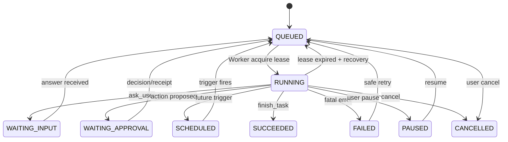

外部 Action 另建状态：

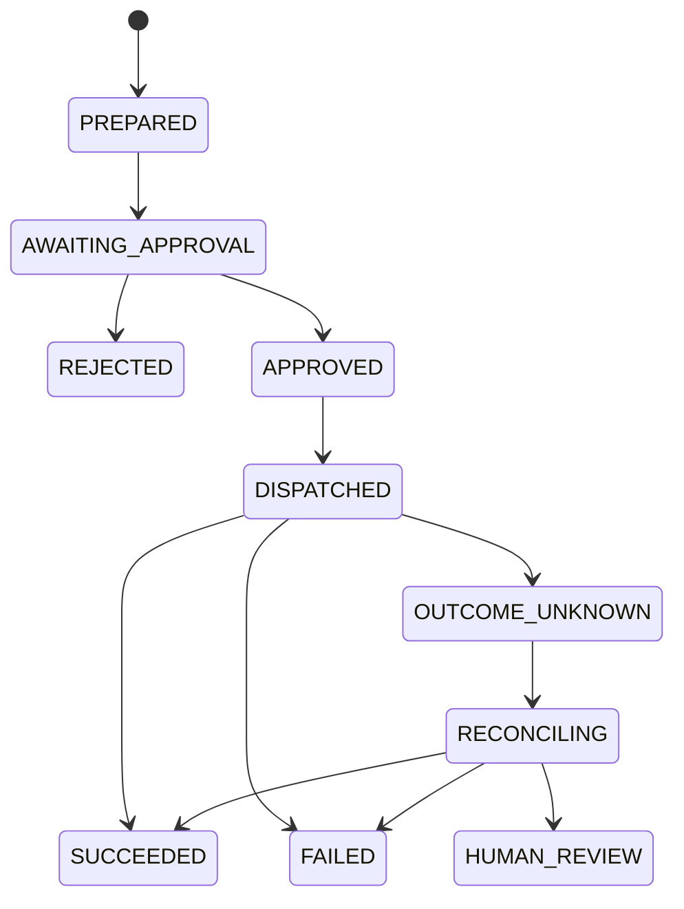

Task 可重试 ≠ Action 可以无条件重试。`OUTCOME_UNKNOWN` 不能自动变成 `FAILED` 并再次付款。

### 7.2 PostgreSQL 结构：核心表

```sql
CREATE TABLE tasks (
  task_id UUID PRIMARY KEY,
  owner_id UUID NOT NULL,
  goal_id UUID,
  parent_task_id UUID,
  title TEXT NOT NULL,
  status TEXT NOT NULL,
  task_version BIGINT NOT NULL DEFAULT 0,
  plan_version BIGINT NOT NULL DEFAULT 0,
  state JSONB NOT NULL DEFAULT '{}',
  next_run_at TIMESTAMPTZ,
  lease_id UUID,
  lease_until TIMESTAMPTZ,
  lease_fence BIGINT NOT NULL DEFAULT 0,
  created_at TIMESTAMPTZ DEFAULT now(),
  updated_at TIMESTAMPTZ DEFAULT now()
);

CREATE INDEX tasks_due ON tasks(status, next_run_at);
CREATE INDEX tasks_owner_goal ON tasks(owner_id, goal_id);

CREATE TABLE task_runs (
  run_id UUID PRIMARY KEY,
  task_id UUID NOT NULL REFERENCES tasks(task_id),
  started_at TIMESTAMPTZ,
  finished_at TIMESTAMPTZ,
  model_id TEXT,
  prompt_version TEXT,
  context_snapshot_ref TEXT,
  lease_fence BIGINT,
  state TEXT NOT NULL,
  error_code TEXT,
  token_input BIGINT DEFAULT 0,
  token_output BIGINT DEFAULT 0,
  tool_calls INT DEFAULT 0
);

CREATE TABLE task_events (
  event_id UUID PRIMARY KEY,
  task_id UUID NOT NULL REFERENCES tasks(task_id),
  seq BIGINT NOT NULL,
  event_type TEXT NOT NULL,
  run_id UUID,
  caused_by TEXT,
  payload JSONB NOT NULL,
  created_at TIMESTAMPTZ DEFAULT now(),
  UNIQUE(task_id, seq)
);
```

以上是新设计，OpenMuse Alpha 当前使用 JSONB 统一 Record Store。迁移时可保留原 `records` 并分阶段建立专用 Task/Action/Trigger 表，避免一次性全量重写。

### 7.3 SQL Lease + Fencing

Worker 要以数据库原子操作领取到期任务，持有 Lease ID 与递增 Fence。失去 Lease 的旧 Worker，即使仍然运行，也不能提交新的 Checkpoint：

```sql
-- 示例：单次领取一个到期任务，事务内执行
WITH candidate AS (
 SELECT task_id FROM tasks
 WHERE status IN ('QUEUED', 'SCHEDULED')
   AND (next_run_at IS NULL OR next_run_at <= now())
 ORDER BY next_run_at NULLS FIRST, created_at
 FOR UPDATE SKIP LOCKED
 LIMIT 1
)
UPDATE tasks t SET
 status = 'RUNNING',
 lease_id = gen_random_uuid(),
 lease_until = now() + INTERVAL '60 seconds',
 lease_fence = lease_fence + 1,
 task_version = task_version + 1,
 updated_at = now()
FROM candidate c
WHERE t.task_id = c.task_id
RETURNING t.*;
```

所有进度提交要带 `WHERE task_id=$1 AND lease_id=$2 AND lease_fence=$3` 作为 CAS 防护。Worker 定时续 Lease；Crash 后调度器重新领取。要校验在已退出/取消状态下是否允许续约，避免 Zombie Worker。

**注意**：仅靠 Lease 不能阻止旧 Worker 对第三方发出网络副作用。外部写操作必须绑定 Action ID 和由可信网关产生的幂等记录，必要时以外部服务的 Idempotency-Key/交易号协调。

### 7.4 Transactional Outbox 与事件一致性

```sql
CREATE TABLE outbox_events (
  outbox_id UUID PRIMARY KEY,
  aggregate_type TEXT NOT NULL,
  aggregate_id UUID NOT NULL,
  event_type TEXT NOT NULL,
  payload JSONB NOT NULL,
  created_at TIMESTAMPTZ NOT NULL DEFAULT now(),
  published_at TIMESTAMPTZ
);
```

同一 DB 事务：`更新 Task Version + 写 task_events + 写 outbox_events`。独立 Dispatcher 从 Outbox 读事件发到 Queue/Notification/Memory，按 Event ID 幂等消费。否则可能出现“任务更新成功但通知永远没发”或“重复发通知但任务仍未更新”。

### 7.5 Action Proposal / Action Receipt

```typescript
interface ActionProposal {
  actionId: string;
  ownerId: string;
  taskId: string;
  runId: string;
  capability: string;             // purchase.submit / gmail.send ...
  providerConnectionId?: string;
  destination?: string;
  canonicalArguments: Record<string, unknown>;
  argumentsHash: string;          // canonical JSON + scope + account + version
  maxAmountMinorUnits?: number;
  currency?: string;
  expectedTargetVersion?: string;
  expiresAt: string;
  requiresHumanApproval: boolean;
}

interface ActionReceipt {
  actionId: string;
  approvalId?: string;
  executionAttemptId: string;
  status: "SUCCEEDED" | "FAILED" | "OUTCOME_UNKNOWN";
  providerRequestId?: string;
  providerObjectId?: string;
  providerVersion?: string;
  completedAt?: string;
  evidenceRef?: string;
}
```

审批参数归一化包含商家、数量、商品 SKU、税费、运费、最终金额、账号、时间、能力及到期条件，用户批准的对象必须是**精确动作**而不是泛泛的“可以购物”。

### 7.6 Reconciliation Worker

- 邮件：用 Provider Message ID、草稿状态、送件箱和消息头查是否实际发送。
- 日历：用事件 ID/ETag 查是否创建/修改成功。
- 订单：用商家订单号、订单列表、付款状态查是否成交；查不到则 `HUMAN_REVIEW`。
- 对于不支持确定查询的商家：禁止自动重试，只提示用户核对。

### 7.7 容错其他事项

任务重试使用指数退避 + 随机抖动，Retry Policy 因错误类别不同；阻塞性用户输入无需高频轮询 LLM；Task Cancel 要撤销 Future Triggers、Browser 控制 Lease 与未使用 Approval Token，但不能承诺能撤销已发往 Provider 的请求。失败也应写 Receipt 和 Audit Event。

---

## 8. Goal Manager + Future Task Registry：长期自主执行

### 8.1 Goal 数据结构

OpenMuse 原 `Goal` 较轻，仅有标题、状态、里程碑等。建议扩展：

```typescript
interface AutonomousGoal {
  goalId: string;
  ownerId: string;
  agentId: string;
  objective: string;
  category: string;
  constraints: Record<string, unknown>;
  successCriteria: Array<{ id: string; evaluator: string; params: object }>;
  priority: number;
  state: "ACTIVE" | "PAUSED" | "COMPLETED" | "ABANDONED";
  planVersion: number;
  nextReviewAt?: string;
  parentGoalId?: string;
  relatedTaskIds: string[];
  triggerIds: string[];
  provenanceMessageId: string;
  autonomyPolicy: {
    autoResearch: boolean;
    autoSchedule: boolean;
    maxNewTasksPerDay: number;
    maxRunsPerDay: number;
    maxCostPerDay: number;
    requireApprovalForWrites: boolean;
    notificationMode: "quiet" | "balanced" | "proactive";
  };
}
```

Success Criteria 不应仅用 LLM 自评：机票已购可用订单凭据判定，邮件已发可用 Message ID 判定，采购全部完成需集合约束和用户确认。

### 8.2 Future Trigger 模型

```typescript
type TriggerDefinition =
  | { type: "one_off"; runAt: string }
  | { type: "cron"; cron: string; timezone: string }
  | { type: "event"; source: string; filter: object }
  | { type: "condition_watch"; pollerId: string; expression: object; intervalSeconds: number };

interface FutureTask {
  triggerId: string;
  ownerId: string;
  goalId: string;
  taskId: string;
  trigger: TriggerDefinition;
  action: "resume_task" | "review_goal" | "collect_observation";
  status: "ACTIVE" | "PAUSED" | "CANCELLED" | "EXPIRED";
  maxOccurrences: number;
  occurrences: number;
  expiresAt?: string;
  dedupeKey: string;
  createdByRunId: string;
  lastTriggeredAt?: string;
}
```

### 8.3 Scheduler Tool 合同

```json
{
  "tool": "schedule_task",
  "arguments": {
    "goal_id": "goal_trip_01",
    "task_id": "task_prices_01",
    "trigger": {
      "type": "cron",
      "expression": "0 9 * * *",
      "timezone": "Asia/Shanghai"
    },
    "action": "review_goal",
    "expires_at": "2026-11-01T00:00:00+08:00",
    "dedupe_key": "goal_trip_01:flight_price_daily"
  }
}
```

支持 `create/update/pause/resume/cancel/list FutureTask`，并设防递归创建的配额和防抖。`dedupeKey` 要在用户+Goal 范围唯一。LLM 不可直接写调度数据库，而由 Schedule Tool 验证。

### 8.4 自主规划与重评估算法

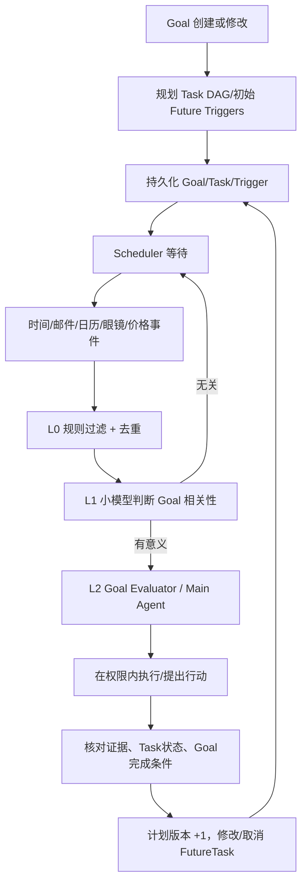

重新规划必须比较 `goal.planVersion`，防止两个 Worker 依据旧 Plan 同时创建冲突的触发器。Goal 完成后事务性禁用所有相关 Future Triggers。

### 8.5 三级主动判定与通知节制

- **L0 纯代码**：去重、阈值、事件源、时效、黑名单；不用 LLM。
- **L1 分类小模型**：事件是否与活跃 Goal 有关联，是否值得唤醒主 Agent。
- **L2 主模型**：综合 Memory/Goal/Task/事件决定行动、改变计划还是只提醒。

通知根据价值、紧急性、打扰成本、用户“主动性”偏好、时区/免打扰、重复事件和频率额度进行过滤。避免全天检查 100 条数据触发 100 次大模型推理/通知。

### 8.6 Goal/Memory 联动

重要记忆事实被更新时，发布 `MEMORY_CLAIM_SUPERSEDED` 或 `MEMORY_CLAIM_RETRACTED` 事件，Goal Manager 只评估引用这些 Claim 的目标；例如出差日期变更影响航班/酒店/设备监控，必须重新计算任务日期。**这是一项建议增强机制，非 Meta 已公布的内部实现。**

### 8.7 自主安全底线

主动发现需求不自动授予购买权限。允许自己创建 Check/Research/Summary 类未来工作，但发送外部消息、付款、共享数据、取消订单、修改第三方数据一律按 Capability Policy 处理。用户随时能够列出、调整或停止 Agent 自己创建的未来任务。

---

## 9. Browser Sub-Agent、Browser Broker 与会话控制

### 9.1 专用 Browser Agent Loop

OpenMuse 当前 Playwright Worker 是操作服务，不是专用独立 Browser LLM Loop。要接近 Muse，需要上层新建 `BrowserAgent.run()`：

```typescript
interface BrowserGoal {
  browserTaskId: string;
  userId: string;
  taskId: string;
  browserSessionId: string;
  objective: string;
  allowedOrigins: string[];
  allowedActions: ("navigate"|"read"|"click"|"type"|"scroll"|"submit")[];
  prohibitExternalWrites: boolean;
  maxSteps: number;
  timeoutAt: string;
}

async function browserAgentLoop(goal: BrowserGoal) {
  for (let step = 0; step < goal.maxSteps; step++) {
    const snapshot = await broker.accessibilitySnapshot(goal.browserSessionId);
    const choice = await llm.decideBrowserAction(goal, snapshot);
    if (choice.kind === "finish") return choice.result;
    if (choice.kind === "blocked") return await pauseAndEscalate(choice);
    const receipt = await broker.executeAuthorized(goal, choice);
    await eventStore.recordBrowserStep(goal, snapshot.ref, choice, receipt);
    if (receipt.requiresReobserve) continue;
  }
  return { status: "requires_review", reason: "max_steps_exceeded" };
}
```

Broker 必须检查操作属于允许动作、页面引用/元素引用仍有效、来源合法、DOM 模式没有越权、用户没处于接管状态。**绝不能将 `page.evaluate()`、任意 CDP、任意文件读取/网络请求作为默认 Agent Tool。**

### 9.2 Browser Broker 封装面

| API | 参数 | 返回 | 约束 |
|---|---|---|---|
| `create_session` | owner/profile/policy | sessionId | 租户归属/容量配额 |
| `snapshot_accessibility` | sessionId | Snapshot + pageRevision | 去敏信息、语义快照 |
| `navigate` | sessionId/url | Receipt | URL/DNS/IP/Origin 过滤 |
| `click` | elementRef/pageRevision | Receipt | 不可执行已过时元素指针 |
| `type` | fieldRef/text | Receipt | 敏感字段由 Authd 注入 |
| `scroll` | direction/amount | Receipt | 受限参数 |
| `screenshot` | sessionId | screenshotRef | 秘密与个人信息防泄漏 |
| `request_human_takeover` | sessionId | Pending | 撤销 Bot Lease |
| `release_human_takeover` | sessionId | Updated | Agent 重新快照 |

`pageRevision` 用来防止 Agent 在网页变化后依据旧元素“误点”；表单提交类动作必须结合目标 URL/HTTP Method/业务动作的权限规则进一步审查。

### 9.3 浏览器会话与 Credential 状态

```text
BrowserSession
  owner_user_id
  browser_profile_ref
  site_origin
  state: CREATED / READY / AUTH_REQUIRED / AUTHENTICATED / CLOSED
  control: BOT / TRANSITION / HUMAN / PAUSED
  control_lease_id, control_fence
  cookie_encrypted_ref (worker侧受保护)
  auth_credential_ref (Authd侧；不能返回给LLM)
  last_page_revision
```

账号密码和 OAuth Token 不存入 Agent 可读文件；Cookie/Profile 也应按账号与 Session 隔离，而非所有用户共享同一 Chrome User Data Dir。

### 9.4 登录与接管流程

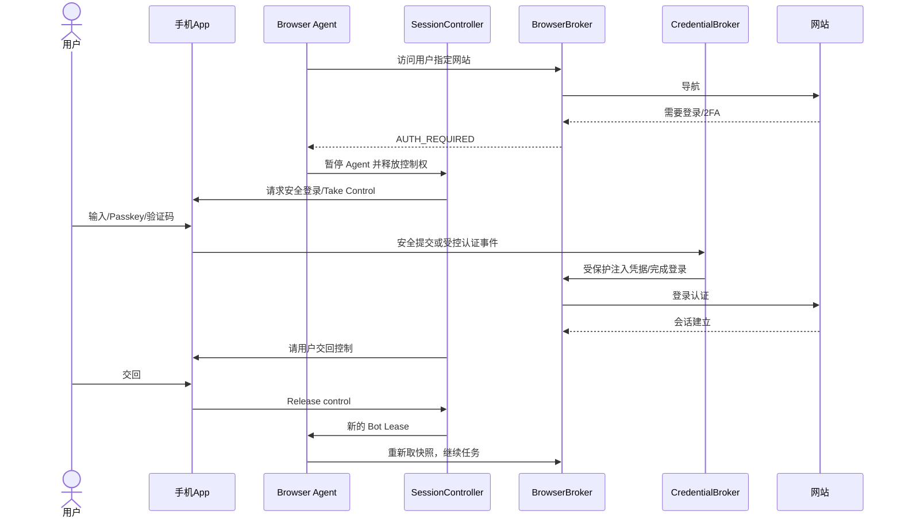

Passkey 等需要设备上的硬件/系统认证，云端无条件仿真并不可靠；出现风控/验证码应人工接管，不能绕过网站机制。Agent 观察不到原始密码，Cookie 权限也由执行服务限制。

### 9.5 Browser 与 Computer Use 双模式

默认网页用 Accessibility 快照；复杂 canvas/纯视觉 GUI 可在更严格的权限和预算下切换 Screenshot + Computer-Call（点击/键入/滚动），记录每次截图 Ref 与动作回执。Browser Broker 不允许模型执行任意 JS/脚本是重要默认约束。

### 9.6 Browser Worker 与持久 VM 生命周期

活跃浏览器可闲置回收，Profile 持久化并重新创建；释放 Browser Session 不等于注销第三方网站；用户明确“登出/断开账号”时应清理对应 Profile/凭据/Watch 依赖。用户接管期间必须冻结 Bot 端新动作及旧 Lease 的写入权限。

---

## 10. Credential Broker（Authd-like）、Privsep 与 Connectors

### 10.1 Credential Broker 的职责

不应只是“加密 Token 表”，还必须提供受限凭据能力：

- 为 OAuth 登录保存 Access/Refresh Token 和 Scope，设置 Key Rotation、过期和撤销策略。
- 为网页登录安全表单保存用户账号凭据或受控 Session 句柄。
- 按 `caller_identity + credential_ref + tool_capability + action_id` 验证是否可以使用该凭据。
- 对 Agent/工具只返回限定域内可使用的 surrogate handle，而不是明文密码或真实 Provider Token。
- 用户撤销授权后向 Task/Action/Scheduler 发布 `CREDENTIAL_REVOKED`，所有相关未来动作进入等待或取消状态。

### 10.2 Privsep Worker 架构

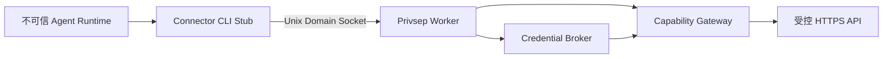

可按 `email_read`、`email_write`、`calendar`、`payments` 等业务拆出不同 systemd Worker，每个 Worker 绑定独立 cgroup、最小文件和网络权限，不能凭 CLI 参数访问其他 Connector 的 Token。Unix Socket 使用 `SO_PEERCRED` 或与运行平台等价的可信进程身份机制。Host Services 代码和配置不允许被主 Agent 的 Shell 随意修改。

### 10.3 凭据代理替身

```text
Agent/Tool         → surrogate_token_or_handle
Connector Worker   → request with surrogate
Capability Gateway → authenticate caller + approve concrete request
Credential Broker  → return real token ONLY to protected gateway
Egress Gateway     → replace surrogate JIT + send HTTPS
Provider           → response/receipt
```

需要注意边界：如果连接器的正常业务逻辑必须解析明文返回数据，仍需对返回 Agent 的结果做敏感字段过滤与数据分级，尤其是邮件中的 OTP、密码重置链接、Magic Link。Token 不可见 ≠ Connector 返回内容没有敏感数据。

### 10.4 Connector Schema 示例

```typescript
interface ConnectorCapability {
  connectorId: string;
  action: "read" | "create" | "update" | "delete" | "send";
  providerScope: string[];
  resourceSelectors: string[];    // folder/calendar/mailbox等
  dataClass: string;
  approvalPolicyId: string;
  version: string;
  executorServiceId: string;
  idempotencySupported: boolean;
}
```

已保存的 OAuth Access Token 可失效、Refresh Token 可被撤销、权限 Scope 可能变化；TaskWorker 每次恢复必须重新核验 Credential Capability，不能因旧 Task State 记着“已授权”就无条件继续。

### 10.5 需要区分 Browser 登录与 API Connector

| 维度 | 浏览器登录 | API OAuth Connector |
|---|---|---|
| 数据载体 | Cookie/Profile/网站 Session | Scope/Access Token |
| 交互 | Chromium 网页 | 结构化 Provider API |
| 安全登录 | 用户接管、密码、Passkey、2FA | OAuth 授权回调 |
| 操作权限 | 网站侧通常较广 | Scope 一般更明确 |
| 可信执行点 | Browser Broker + Egress | Privsep + Credential Broker |

优先选受支持的 API；网站自动化作为补充路径，不能把所有站点都假定可登录、可提交表单。

---

## 11. Sentinel-like 权限、安全策略与强制网络出口

### 11.1 权限模型是唯一可信执行门

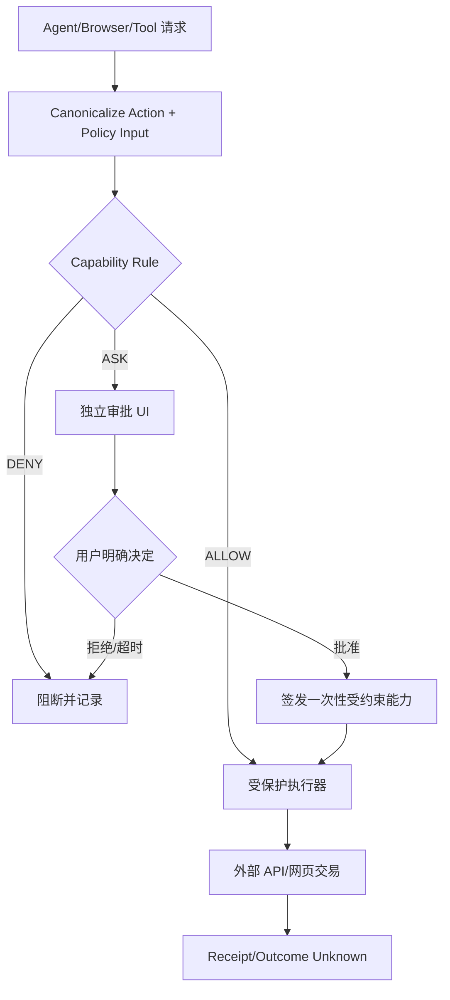

**Action Proposal 不应天然有执行权**。强制层应比 Agent Runtime 的 Linux 用户/进程拥有更高权限，不受 Agent 直接编辑。

### 11.2 Capability Token：绑定实际风险参数

```typescript
interface ActionCapability {
  capabilityId: string;
  ownerUserId: string;
  taskId: string;
  actionId: string;
  actionType: string;
  merchantOrDomain?: string;
  providerConnectionId?: string;
  canonicalArgumentsHash: string;
  maxAmountMinorUnits?: number;
  currency?: string;
  maxUses: 1;
  expiresAt: string;
  status: "GRANTED" | "CONSUMED" | "REVOKED";
}
```

提交前严格匹配商品 SKU、数量、金额、税/运费、商家账号、版本；任何变化必须重新 `PREPARED → APPROVAL`。一次性 Token 发给受保护执行器而非 LLM；消费操作原子记录，防止重放。

### 11.3 权限分三层

1. **Tool Capability**：允许 Gmail 读取，或提出“发送邮件”动作。
2. **Credential Capability**：哪一个受保护 Worker 能调用哪个 Provider Account/Scope。
3. **Network Capability**：具体 HTTP/IP/域名/路径/数据是否可以离开 VM。

任一层拒绝即整体拒绝。用户审批可按一次、Task、Session、有效期等定义，但高风险付款通常要求明确的具体交易批准。

### 11.4 Egress Proxy 与 SSRF 防护

所有 Agent Sandbox 流量必须经过控制网络命名空间和代理；限制出站 TCP/UDP、DNS 和 IPv6 旁路，识别连接进程身份；DNS 解析前后及最终 IP 都校验，禁止访问 cloud metadata、环回、私网/链路本地或宿主安全服务。经过 L4 判断不等于有能力审查 HTTPS Body；若需要 L7 审查，应通过受控 HTTPS Client、应用层 API 代理或允许合规解析的 TLS 代理。对不支持解密的外部连接执行严格的目的地与 Capability 限制，而不是假装检查过内容。

### 11.5 Tainted Egress 可分阶段实现

- V1：应用层来源标签（是否读取私人文件、用户数据）+ 默认禁止不可信自生成代码外发。
- V2：按 Task/Process 身份隔离出站网络，敏感数据相关进程全部走人工许可/限定域策略。
- V3：结合 eBPF cgroup 和 BPF LSM 对文件访问与进程 Fork/exec/IPC 传播污染状态（需要评估现有内核 Hook 能否覆盖，不能笼统宣称形式化信息流安全）。

Tainted Process 不是“凡访问隐私就绝不允许联网”，而是失去部分窄范围自动放行资格，按正常授权策略检查。

### 11.6 Prompt Injection 与模型安全

```text
Untrusted Source (Web/Mail/PDF/Tool Result)
  → Mark provenance and untrusted boundary
  → Independent classifier / heuristic check
  → Model with strong developer/system instructions
  → Tool Proposal
  → Deterministic Capability / Egress Enforcement
```

网页、邮件和 PDF 可包含恶意文本，但不应拥有修改 System Prompt、Goal 权限或私密数据外传授权的能力。安全检测失效时仍有强制边界，且审批内容不得由 Agent 再加工成误导性摘要；用于审批的关键字段由可信组件解析和展示。

### 11.7 安全威胁矩阵

| 威胁 | 攻击入口 | 核心缓解 |
|---|---|---|
| 网页 Prompt Injection | DOM/Accessibility/截图 | 数据可信度标记+分类器+强制 Capability |
| Tool 参数偷换 | 审批后修改请求 | Canonical Hash、Action Version、一次性 Token |
| Token 泄漏 | Agent 自生成代码 | Credential Broker/Surrogate/Host 隔离 |
| SSRF | URL/DNS 重绑定 | IP/端口/域名双检查、Net NS、Proxy |
| 越权读私人文件 | Shell/Browser | 路径、Capability、Namespace、最小权限 |
| 重复交易 | timeout/retry | Idempotency/Unknown/Reconciliation |
| 跨用户隔离失败 | 共用 Profile/Volume/DB | 每用户 VM/密钥、DB RLS、Provider ACL |
| 恶意生成工具 | Skills/依赖拉取 | 测试、签名/版本、沙箱、无直接 Secret 权限 |
| 动态 Artifact XSS | LLM 生成网页 | 隔离 Origin/CSP/Sandbox、无主 App Token |
| 数据污染长期 Memory | 不可信邮件 | Claim Provenance/Trust/用户可纠错 |

### 11.8 针对 OpenMuse 的差距

OpenMuse `ActionService` 对 Gmail/Calendar 的具体写入有 Hash/审批/未知状态机制，值得复用；但 E2B Desktop 可以直连互联网，现有 ActionService 不会自动审查其任意网页提交与文件上传。**不能仅靠 Prompt 让 Agent “不要擅自付款”来替代强制出口控制。**

---

## 12. Memory Service：Entries、Embeddings、Claims

### 12.1 基线与信任边界

Meta 官方确认长期记忆可编辑、用户 VM 持久文件、Postgres；[逆向] 具体 `memory.entries/embeddings/claims` 与 MiniLM/Jina/Pgvector 来自第三方运行环境研究；我们复原时采用概念相近但**自定义 Schema 和接口**，绝不把逆向中的部分字段当成完整源代码。

### 12.2 写入流水线

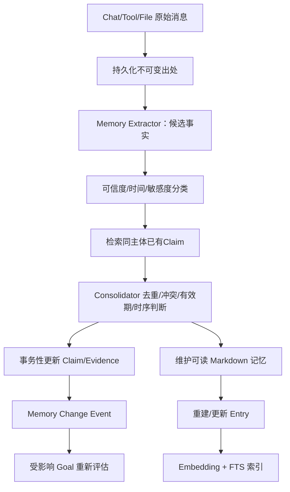

明确区分即时写入与后台整理。原始消息不应因 LLM 改写记忆而消失。一次消息二次处理应通过 `source_message_id + fact_key + version` 幂等约束避免双重 Claim。

### 12.3 推荐 PostgreSQL Schema（可用的工程骨架）

```sql
CREATE EXTENSION IF NOT EXISTS vector;
CREATE SCHEMA IF NOT EXISTS memory;

CREATE TABLE memory.entries (
  entry_id UUID PRIMARY KEY,
  owner_id UUID NOT NULL,
  path TEXT NOT NULL,
  document_revision TEXT NOT NULL,
  start_line INTEGER NOT NULL,
  end_line INTEGER NOT NULL,
  content TEXT NOT NULL,
  content_hash TEXT NOT NULL,
  source_type TEXT NOT NULL,
  trust_level TEXT NOT NULL,
  search_vector TSVECTOR GENERATED ALWAYS AS (
    to_tsvector('simple', content)
  ) STORED,
  created_at TIMESTAMPTZ DEFAULT now(),
  updated_at TIMESTAMPTZ DEFAULT now(),
  UNIQUE(owner_id, path, document_revision, start_line, end_line)
);

CREATE TABLE memory.embeddings (
  entry_id UUID NOT NULL REFERENCES memory.entries(entry_id) ON DELETE CASCADE,
  embedding_model TEXT NOT NULL,
  content_hash TEXT NOT NULL,
  vector VECTOR(384) NOT NULL,
  created_at TIMESTAMPTZ DEFAULT now(),
  PRIMARY KEY(entry_id, embedding_model)
);

CREATE TABLE memory.claims (
  claim_id UUID PRIMARY KEY,
  owner_id UUID NOT NULL,
  subject TEXT,
  predicate TEXT,
  object_value TEXT,
  fact_text TEXT NOT NULL,
  status TEXT NOT NULL CHECK (status IN
    ('active','superseded','retracted','disputed','expired')),
  trust_level TEXT NOT NULL,
  confidence NUMERIC(4,3) CHECK (confidence BETWEEN 0 AND 1),
  valid_from TIMESTAMPTZ,
  valid_until TIMESTAMPTZ,
  recorded_at TIMESTAMPTZ DEFAULT now(),
  supersedes_claim_id UUID REFERENCES memory.claims(claim_id),
  source_count INTEGER NOT NULL DEFAULT 0,
  attributes JSONB NOT NULL DEFAULT '{}'
);

CREATE TABLE memory.claim_evidence (
  evidence_id UUID PRIMARY KEY,
  claim_id UUID NOT NULL REFERENCES memory.claims(claim_id),
  entry_id UUID REFERENCES memory.entries(entry_id),
  source_message_id TEXT,
  source_file_hash TEXT,
  quote_text TEXT NOT NULL,
  evidence_kind TEXT NOT NULL,  -- explicit / observed / inferred
  created_at TIMESTAMPTZ DEFAULT now()
);

CREATE INDEX entries_fts_idx ON memory.entries USING GIN(search_vector);
CREATE INDEX embeddings_hnsw_idx ON memory.embeddings USING hnsw (vector vector_cosine_ops);
CREATE INDEX claims_owner_active_idx ON memory.claims(owner_id, status);
CREATE INDEX evidence_claim_idx ON memory.claim_evidence(claim_id);
```

**说明与局限**：索引 `tsvector('simple', ...)` 仅用于结构演示，不足以解决中文自然语言词项切分；需要专门中文分词器或外部多语言全文检索。若计划更换 384 维 MiniLM 为 768/1024 维模型，单表固定 `VECTOR(384)` 需迁移或模型分表。`Supersedes` 只应用于确实替代旧 Claim 的新事实；临时约束另建带有效期 Claim。真正的多用户需要 PostgreSQL Row-Level Security 等隔离策略，光有 `owner_id` 不等于安全隔离。

### 12.4 Memory 搜索接口

```typescript
interface MemorySearchRequest {
  ownerId: string;
  query: string;
  topK: number;
  categories?: string[];
  excludeTrustLevels?: string[];
  validAt?: string;
  requiredProvenance?: boolean;
}

interface MemoryHit {
  entryId: string;
  claimIds: string[];
  documentRef: string;         // file#revision#lines
  score: number;
  content: string;
  status: string;
  evidenceRefs: string[];
}
```

检索步骤：`Query Embed → Vector Top-N` 与 `Keyword/FTS Top-N` 并行 → 候选融合 → Reranker → 查有效 Claim/证据/时间/可见性 → 读取原文件→注入最小必要 Context。可以参考 Muse 逆向里 384d MiniLM、Jina Reranker/pgvector 的组合，也可针对中文引入多语言模型，必须重新评估效果。

### 12.5 记忆变化与 Goal 联动

```json
{
  "eventType": "MEMORY_CLAIM_SUPERSEDED",
  "ownerId": "user_01",
  "oldClaimId": "claim_trip_date_v1",
  "newClaimId": "claim_trip_date_v2",
  "affectedGoalIds": ["goal_trip_01"],
  "sourceMessageId": "msg_0025"
}
```

Event Bus 通知 Goal Manager；它只重评受影响的 Goal，不应对所有历史事件重新运行 LLM。Task 根据 Goal Plan Version 决定沿用或作废旧结果。

### 12.6 记忆维护与 Dream

分为：

- **Inline Extractor**：用户明确交代偏好时立即形成候选记忆。
- **Periodic Claim Audit**：核对来源、去重与 Supersession。
- **Consolidation**：更新 `MEMORY.md`/`world,experience,opinions` 等主题文件。
- **Reflection/Dream**：归纳沟通习惯/工作策略，但不能在没有明确用户授权的情况下自行提升可信权限或更改核心 System Policy。
- **Memory Explain**：对“你为什么这么认为”输出 Claim→Evidence→Message/File 证据链。
- **Forget**：删除相关文件段落、Claims、Evidence、Entry、Embedding、摘要与派生 Index；按保留政策处理原始外部资料和备份，阻止后台从残留材料重建已删除记忆。

### 12.7 事实可信度状态表

| 来源 | 可存信息 | 是否可直接提升为用户当前稳定偏好 |
|---|---|---|
| 用户明确声明 | “以后舒适度优先” | 是，可结合上下文/时间验证 |
| 用户真实行为 | 多次选择头戴式 | 可作为弱证据，不应仅据此断言永久偏好 |
| 第三方邮件 | 学校报名日期 | 可存带来源的外部事实，不授予权限 |
| 网页评论 | 耳机舒适度评价 | 外部证据，不是用户偏好 |
| Agent 推测 | “用户可能喜欢某品牌” | 必须标为推断，必要时求证 |

Memory 一旦能触发 Future Task，就必须更严：未经核实的网页内容不能直接创建长期自动发送、采购或上传个人数据的任务。

---

## 13. Model Routing、轻量分类与 Jev

### 13.1 模型角色分工

| 角色 | 任务 | 推荐部署 |
|---|---|---|
| Deterministic Rule | 明确 ID、价格阈值、事件去重 | 代码 |
| Task/Intent Router | 新任务/续任务/指代识别 | 小模型或分类模型 |
| Event Relevance | 判断事件影响哪个 Goal | 小模型/embedding 匹配 |
| Main Planner | 多步骤规划、自适应 Replan | 强推理 LLM |
| Browser Agent | 页面语义理解与动作选择 | 专用模型或通用 LLM |
| Memory Extractor | 事实/时间/属性提取 | 中小模型 + Schema |
| Reranker | 检索精排 | 专用排序模型 |
| Safety Classifier | 注入/隐私/行为风险 | 独立推理与规则服务 |

### 13.2 Jev 的合理定位

此前讨论过 Jev 类受限决策模型与使用 JSON Schema 约束 LLM 的差别。对于少量确定候选的路由/场景决策，可以使用分类/受限结构化选择，避免每次调用大生成模型；它仍需要 Context 与目标候选，不能凭静态“元语”自动理解所有运行时未知状态。

OpenMuse 中的 TypeSafe Jev 水族馆案例是**Jev 决策 + 脚本化代理流程**的可重复演示，不是将完整 Main Agent Loop 换成 Jev。选择 Jev 或小模型之前，要实测误路由、指代消解、Open Set、跨语言和长尾任务风险。JSON Schema 约束只保证输出合法结构，**不保证选择的 Task ID 正确**。

### 13.3 模型路由策略（建议）

```text
Rule Fast Path
  → Small Intent/Task Router
  → Confidence & Safety Gate
  → Main LLM (复杂/歧义/跨多个目标)
  → Tool/Sub-Agent
```

尽可能在低风险且信息充分时用小模型；在敏感账号、取消、付款等行为上，模型分类结果只能推动审批/澄清，不能直接授权。

---

## 14. Dynamic Skill Lifecycle、Artifacts、通知与用户监督

### 14.1 Skills/Tools 生成及注册

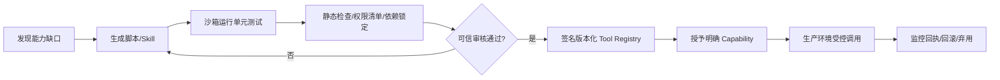

定义 Skill Manifest：`name/version/description/input_schema/output_schema/executable_hash/tool_dependencies/resource_limits/required_capabilities/approved_by/expiry`。Agent 能生成程序，但不得直接修改 Privsep、Authd、Sentinel 或高优先级 Policy。

### 14.2 Artifacts

- Structured Artifact：商品对比、待办、审批卡、旅行路线等标准 JSON → 官方 UI 组件渲染。
- Dynamic Artifact：生成 HTML/JS Dashboard/学习页面，必须独立 Origin、CSP、iframe Sandbox、受控数据 Capability，默认不得取得主 App Session Cookie/OAuth Token。

生成应用的执行环境不同于主 Agent 的 Shell；用户能编辑/分享的文件也须有类型验证、大小和生命周期约束。

### 14.3 通知系统

通知记录保存 Trigger、Goal/Task、证据摘要、紧急性、去重键、用户时区、打扰策略、是否需要审批。定时/事件触发不代表每一次都要给用户发消息；当任务完成、有阻塞或高价值进展时再通知。手机推送、App Activity、眼镜短提示需要不同长度/隐私等级。

### 14.4 监督 UI

必须支持查看：Goal/Task/Run、当前计划和下一次唤醒时间、Browser Session 当前操作者、审批待决列表、受保护 Connector 授权、记忆来源/修改/删除、完整可信 Action Receipt；如果代理无法确认外部操作成功，用户看到明确的“待核对”，不能显示虚假的“已完成”。

---

## 15. AI 眼镜 + 手机 Host + 云端 Agent 的分层协作

### 15.1 三端角色

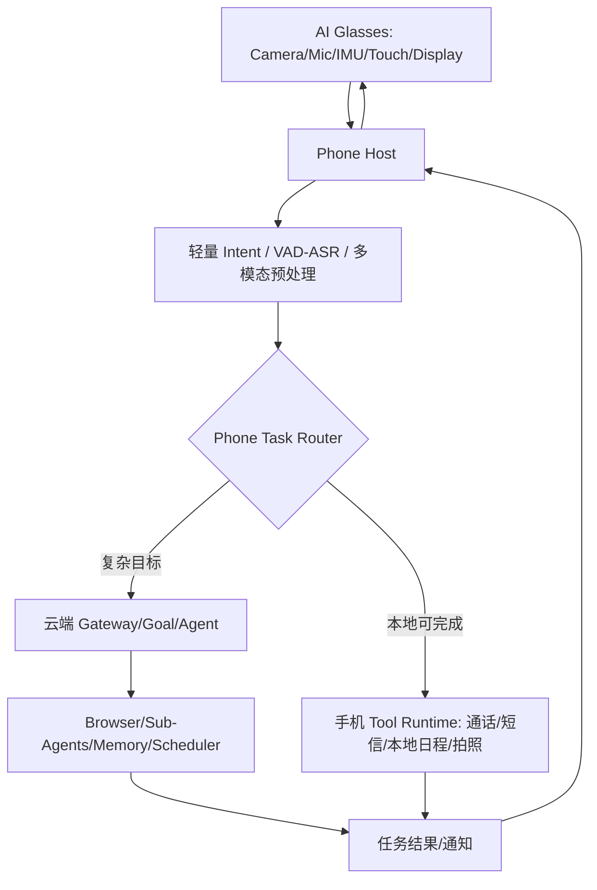

这是与此前眼镜架构研讨衔接的推荐方案：镜端尽量完成传感、语音/触摸输入、简单显示；手机执行权限敏感且可本地闭环的任务；云端处理复杂长期任务、网页和跨应用工作。若首代眼镜无眼动/复杂感知输入，则不应强行依赖不可用传感器；TOF、IMU 等事件由当前硬件能力决定。

### 15.2 Context Event Protocol

```typescript
interface DeviceContextEvent {
  eventId: string;
  ownerId: string;
  deviceId: string;
  source: "glasses" | "phone" | "web";
  timestamp: string;
  intent: string;
  confidence?: number;
  modalityRefs?: {
    imageRef?: string;
    transcriptRef?: string;
    imuSummaryRef?: string;
    locationRef?: string;
  };
  privacyClass: "local_only" | "redacted" | "cloud_allowed";
  relatedGoalIds?: string[];
  requestedCapabilities?: string[];
  responseDevice?: "glasses" | "phone" | "web";
}
```

**隐私默认**：持续视频不自动上传；先在手机端做触发过滤与必要裁剪，再发送短时信息/经过授权的图像；环境中第三方人物或敏感资料不自动形成长期记忆。

### 15.3 跨设备一致性

- Phone 断线后消息应落本地发送队列并携带 Idempotency Key。
- Cloud Task Registry 是长期 Task 状态权威来源；本地事件必须明确版本。
- 眼镜只显示必要摘要；付款和复杂审批以手机/可信 Web UI 为主。
- 手机本地 Memory 可存高敏内容，云端仅接收授权检索结果或经过脱敏的摘要。
- 采用相同 `task_id / event_id / user_id` 在设备之间关联，不直接复制完整聊天上下文。

---

## 16. Linux、Secure VM、Computer 生命周期与部署

### 16.1 初版不需要修改 Linux 内核源码

建议 Ubuntu Server 24.04 LTS 或受支持 Debian、较新 Linux（如 6.6+，仅工程建议）。验证 User/Network/Mount/PID Namespace、cgroup v2、seccomp、Capability 限制、BPF/LSM、KVM 能力（自行运营 VM 才需要）。

```bash
uname -r
systemd --version
cat /sys/fs/cgroup/cgroup.controllers
cat /sys/kernel/security/lsm
sudo bpftool feature probe kernel
```

Muse 官方展示 VM 内 Runtime Cell `systemd-nspawn` 与独立 systemd Host Services 的分离；复原时可以用现有 Linux 原语，不应首先研发新内核。精细 Tainted Egress 可能需要配置 BPF LSM、评估内核已有 Hook 的覆盖范围，也可能出现需要扩展内核安全 Hook 的技术需求。

### 16.2 生产级每用户计算空间

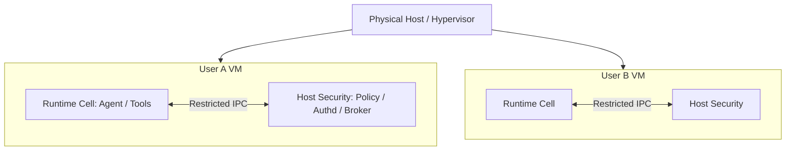

一用户一 VM 是 Meta Muse 已确认的逻辑；我们可以按成本分阶段选择 VM、MicroVM、独立容器，但不能将共享容器直接声称达到相同安全级别。生产环境必须有租户专属磁盘加密密钥、Credential Storage、Browser Profile、安全网络策略和强认证。

### 16.3 VM/Computer 资源状态

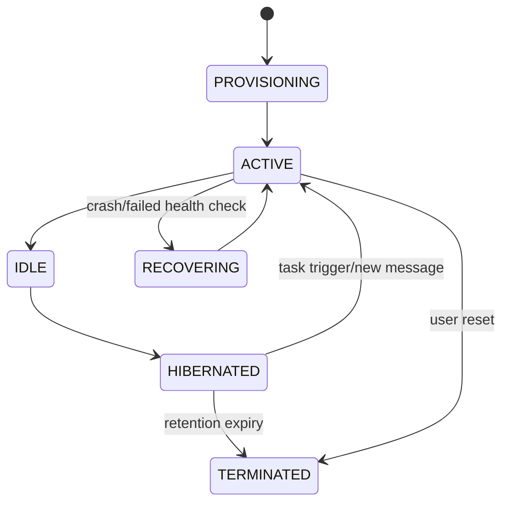

Scheduler/Task Registry 不应完全绑定正在运行的 VM；用户 App 关闭、VM hibernated 后 Future Task 仍需可唤醒 Worker。Worker 必须先写安全 Checkpoint，确认没有未完成的不可逆网络请求再休眠；Browser Cookie/Profile 进行加密持久化，活动流连接和端口在关机时回收。

### 16.4 资源配额与成本

| 指标 | 配额/策略 |
|---|---|
| 单用户活跃 Task/子 Agent | 上限并发 + 公平排队 |
| LLM Token | 每日/每月 User/Goal/Task 限额 |
| Browser | Session 数、Profile 数、空闲回收 |
| Compute | CPU/Memory/GPU（如需要）/Shell 时限 |
| Object Storage | 文件容量、版本、清理/下载策略 |
| Scheduler | 单 Goal Future Trigger 上限、最小监控间隔 |
| Notification | 频率、每日上限、紧急例外 |
| 外部 API | Rate Limit、Connector 重试和退避 |

对成本至少拆成：VM 占用、数据库/对象存储、模型 Token、浏览器计算、搜索/Connector 请求、带宽和日志。Agent 并非一直在 GPU 上运行；多数未来任务应 `WAITING`，仅在触发时恢复。

### 16.5 健康检查、备份与灾难恢复

每个 Worker/VM 有心跳与 Lease；Task State、Action Receipt、Memory File Revision、Event Log 需备份；Authd 凭据单独加密/备份并按政策可销毁；演练节点故障、同一任务被两 Worker 抢占、Region 失效、第三方 API 断流，以及从 Checkpoint 恢复但不重复外部写操作的情况。

---

## 17. 四套端到端时序与用户流程

### 17.1 购物：从创建 Task 到支付对账

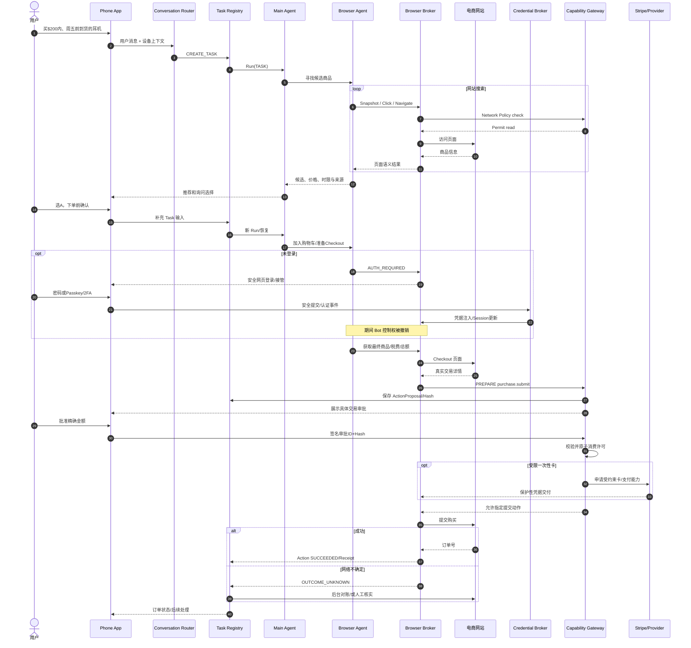

核心要求：准确金额的审批由可信服务绑定；付款 Token 不交给 Agent；任何结账阶段数据变化都导致旧 Approval 失效；购物被网站反机器人机制阻断不能强行绕过；支付网关不能仅凭“Agent 说用户已经同意”。

### 17.2 学校许可表（适合初版 OpenMuse 功能验证）

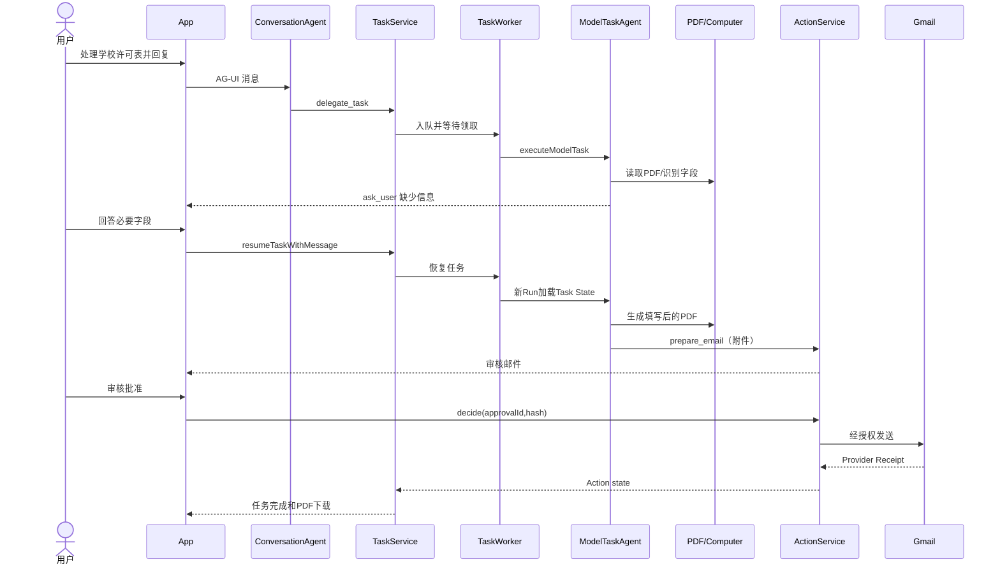

### 17.3 长期 Goal 自主任务：旅行变更

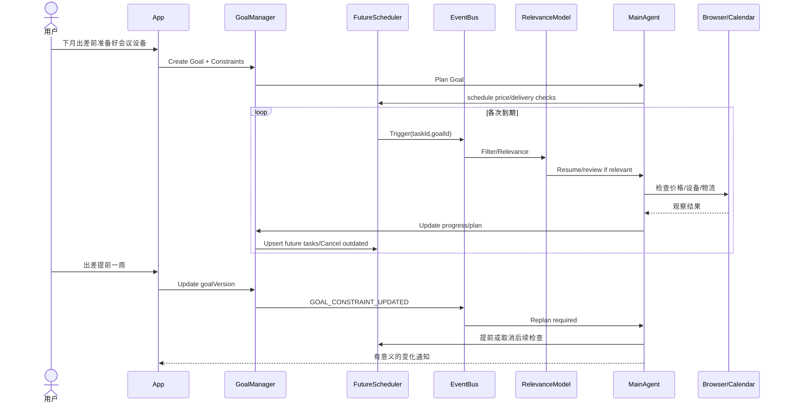

### 17.4 主聊天续接旧 Task

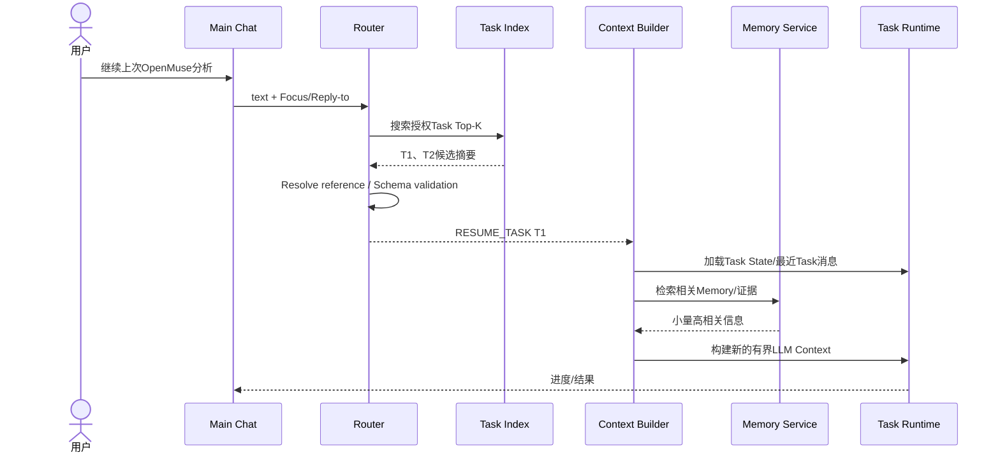

**每条用户消息原始记录只保存一份**，需要时关联主聊天与 Task Thread；AG-UI 使用 Stream Event 更新 UI，长任务结果写回 Task Artifact/Activity，避免前端仅凭历史消息推断任务是否成功。

---

## 18. OpenMuse 复用与重构的精确工程清单

### 18.1 建议保留的模块

| 文件/目录 | 可复用能力 | 增量任务 |
|---|---|---|
| `apps/mobile` | Expo iOS/Android/Web UI、Activity/Goals/审批卡 | 任务详情与 Focus、未来任务、记忆追溯、眼镜入口 |
| `apps/server/src/agent.ts` | Agent Backend 入口、AG-UI | 前置 Router/授权 Context，保留外部 Runtime Adapter |
| `apps/server/src/engine/conversation.ts` | ConversationAgent Tool Calling | 让新 Task/续旧 Task 路由更确定性 |
| `apps/server/src/engine/model.ts` | 后台 Model Task Loop | Context Builder、Run 合同、预算、恢复与事件写入 |
| `apps/server/src/engine/worker.ts` | Durable Task Worker/Lease | Fencing、Outbox、Reconciliation、Future Trigger |
| `apps/server/src/engine/service.ts` | Task、Goal、Monitor、Ideas | Goal Schema、Goal Evaluator/Planner/Task DAG |
| `apps/server/src/actions.ts` | ActionProposal/Hash/审批 | 独立审批服务、更多明确受控 Connector |
| `apps/worker/src/browser.ts` | Playwright/Chromium Session | Browser Broker、受限动作、控制权 Lease |
| `apps/server/src/computer-tools.ts` | Docker/E2B 执行后端 | 统一 Capability、避免 E2B 直连越权 |
| `apps/server/src/db.ts` | JSONB/CAS | 独立表迁移、Outbox/Claim/Task index |
| `packages/domain/src/agent.ts` | 共享业务类型 | 新 Goal/Task/Router/Action/Trigger Schema |
| `SECURITY.md`、`ROADMAP.md` | 已知边界、部署声明 | 版本锁定与持续安全验证 |

`AGENT_BACKEND=agui` 可使**交互式** Agent 外接其他 Runtime；它并不会自动替换内部 Durable Task 的 `executeModelTask`。新建 `AgentExecutor` 统一接口，把交互式和 TaskWorker 的不同 Backend 映射为可插拔驱动，保留同一个 Task State/Approval 语义。

### 18.2 建议新增的代码模块

```text
apps/server/src/
  routing/
    conversation-router.ts
    task-index.ts
    focus-store.ts
    route-dispatcher.ts
  context/
    context-builder.ts
    compaction.ts
    context-policy.ts
  goals/
    goal-manager.ts
    goal-evaluator.ts
    planner.ts
    replanner.ts
    future-task-registry.ts
  events/
    event-log.ts
    outbox.ts
    projection.ts
  runtime/
    agent-executor.ts
    subagent-registry.ts
    checkpoint.ts
    execution-budget.ts
  browser-agent/
    browser-loop.ts
    snapshot.ts
    browser-policy.ts
  memory/
    extract.ts
    consolidate.ts
    claim-store.ts
    embeddings.ts
    retrieve.ts
    explain.ts
    forget.ts
  approvals/
    capability-gateway.ts
    action-reconcile.ts
  audit/
    trace.ts
    receipt.ts
    evaluation.ts
```

在正式多用户阶段，`authd/privsep/egress/browser-broker` 不应再只是 `apps/server` 同进程目录，而应变成受保护独立服务或 VM Host Services，防止模型可修改代码与凭据共址。

### 18.3 仓库现状说明（锁定 commit 后复核）

此前源码调研观察到：`executeModelTask` 有约 16 Step/5 分钟限制；TaskWorker 轮询约 1s、并发 3、60s Lease/20s 续约；`records` JSONB 持久；Goal 简单、Ideas 以规则为主；Browser Worker 是执行服务而非自带 LLM Loop；`ActionService` 主要覆盖 Gmail/Calendar；`AgentMemory` 为简化字段结构。

这些都是“阅读时的版本快照”，并非稳定 API 或所有分支通用默认。开发团队必须用当前 commit 的源码和 Test 再验证，并为上游更新建立回归测试。尤其 OpenMuse README 对图形 Desktop 的定位与 SECURITY 中 E2B Desktop 选项存在版本/文档侧重点差异，不可将 E2B 当成默认安全能力。

### 18.4 启动与研究基线

```bash
git clone https://github.com/CopilotKit/OpenMuse.git openmuse
cd openmuse
pnpm install --frozen-lockfile
cp .env.example .env
npx copilotkit@latest login
npx copilotkit@latest project select
# 在 .env 中安全设置 CPK_INTELLIGENCE_API_KEY
pnpm dev
# 单独终端
pnpm dev:web
# 配置浏览器后
pnpm --dir apps/worker exec playwright install chromium
pnpm dev:browser
```

默认 Sample 模式先以虚构邮件/文件跑通审批状态与 Task 恢复，不要一开始连接真实银行卡。真实模型需 `AGENT_BACKEND=model`、`MODEL`、Provider API Key；真正 Google OAuth 需要 Client ID/Secret 与官方回调域名；分离 TaskWorker 需共享 PostgreSQL，而非多个进程同时访问同一 PGlite 数据文件。

### 18.5 CopilotKit Intelligence 依赖与替代策略

OpenMuse Rich Threads 依赖单独的 CopilotKit Intelligence 项目密钥和服务条款；MIT 仓库不包含所有依赖的部署权。需要在选择前评估：托管数据地区、成本、消息持久性、备份/删除、离线部署，以及是否自行实现 AG-UI Threads Persistence Adapter。OpenDots 亦有独立 Intelligence 配置与可选本地评估/许可自托管形态。不能只凭“开源仓库”认定全栈可无依赖私有化。

### 18.6 与 OpenClaw、Letta、Temporal 的关系

- OpenMuse 作为前端和 Durable Task 基础，不强迫选择其内置 Loop。
- 需要更丰富的个人工具生态时，OpenClaw 可作为可选执行服务参考。
- 需要记忆身份与自调度策略时，研究 Letta Code 的 MemFS/Wake/Monitor，但不要仅依赖 Prompt。
- 任务量增大、对长期工作流恢复要求更强时，可将 Task Scheduler/Workflow 演进到 Temporal；无需第一天引入所有框架。

---

## 19. 可观测性、可回放、评估和安全验收

### 19.1 分布式 Agent Trace

```text
Goal ID
 └── Task ID + Task Version
      └── Run ID + Model/Prompt Version
           ├── Context Manifest (only refs & hashes)
           ├── LLM Decision Summary (not raw hidden reasoning)
           ├── Sub-Agent Spawn / Join
           ├── Tool Action Proposal
           ├── Policy Decision + Approval ID
           ├── External Action Receipt/Outcome Unknown
           ├── Memory Claim Change
           └── Artifact / Notification
```

每一个 Run 的输入应可解释地还原：Model、Prompt Version、Task State Version、Context Builder 选择的 Message/Memory/Artifact 引用、Tool Schema 版本、审批记录。**不用保存模型未公开的隐含推理链，也不能把明文凭据、卡号、敏感邮件正文无差别写到 Trace。** 对“为什么 Agent 做出某个建议”提供可追溯的目标与证据摘要即可。

### 19.2 核心运行指标

| 指标 | 目的 | 例子 |
|---|---|---|
| Task Completion Rate | 实际完成目标 | 完成/失败/人工接管比例 |
| Long-run Recovery Rate | 崩溃后恢复 | 故障注入后重启能否继续 |
| Action Duplicate Rate | 外部重复副作用 | 重复邮件、订单、日历事项 |
| Outcome Unknown Resolution | 不确定结果对账 | 外部写入返回不明时查证成功率 |
| Task Routing Accuracy | 主聊天映射正确 | 错误 Task 归属率 |
| Context Leakage Rate | 上下文串扰 | 任务 A 看见任务 B 的私人文件次数 |
| Memory Precision/Freshness | 检索与更新质量 | Claim 有效性、来源可解释率 |
| Trigger Correctness | 自调度正确性 | 触发时间/取消/去重 |
| Unauthorized Egress | 越权数据出口 | 未获授权写入或敏感上传次数 |
| Browser Action Success | 网页任务效果 | 页面变化、验证码、人类接管比例 |
| Cost per Completed Goal | 成本与收益 | Token/VM/外部 API/重试 |
| Notification Value | 主动服务体验 | 用户打开/关闭/取消比例、重复打扰 |

### 19.3 可执行测试矩阵（必须覆盖）

| ID | 测试项 | 验收目标 |
|---|---|---|
| T01 | 普通问答无需 Task | 不意外创建 FutureTask |
| T02 | 输入明确新任务 | 产生独立 `task_id/thread_id` |
| T03 | “继续上一项”有唯一焦点 | 正确关联现有 Task |
| T04 | “上一个项目”候选冲突 | 澄清而非猜测 |
| T05 | 多操作一句话 | 拆成独立可审计命令 |
| T06 | 用户在任务详情点击“继续” | UI Task ID 优先且归属校验 |
| T07 | 非法 Task ID | 无法访问别人的 Task |
| T08 | Task Conversation 与主 Conversation | 仅按关联装配 Context |
| T09 | 超长聊天 1M+ Token 历史 | 仍构建有限 Context、不丢关键状态 |
| T10 | Memory 中事实被新声明替代 | 只返回当前有效 Claim、历史可查 |
| T11 | 修改 Markdown 行号 | Entry 引用含 Revision/Hash，拒绝漂移 |
| T12 | 中英文及精确型号检索 | Hybrid 检索获得正确来源 |
| T13 | 恶意网页构造伪用户偏好 | 不能升级为高信任记忆 |
| T14 | 用户要求 Forget | 清理 Claim/索引/摘要并防重建 |
| T15 | 创建 Cron FutureTask | 到期唤醒正确 Task，不重复创建 |
| T16 | Goal 完成 | 所有关联未执行 Trigger 停止 |
| T17 | 用户更改出差日期 | Plan Version 更新、旧触发调整 |
| T18 | Webhook 重复事件 | Event ID 去重，不重复唤醒 |
| T19 | Scheduler 关机重启 | 未来任务继续存在 |
| T20 | Worker 执行时崩溃 | Lease 到期后安全恢复 |
| T21 | 旧 Worker 仍运行 | Fencing 禁止覆盖新状态 |
| T22 | Worker 同时竞争同一个 Task | 单一有效执行权 |
| T23 | 发送邮件后网络超时 | OUTCOME_UNKNOWN，查证前不重发 |
| T24 | 购物支付完成但无成功页 | 不重付，进入对账 |
| T25 | 审批金额或商家改变 | 原 Approval 失效，重新批准 |
| T26 | 用户拒绝审批 | 无外部写入 |
| T27 | 用户撤销 Gmail Token | FutureTask 暂停，失效 Action 不执行 |
| T28 | Browser 输入密码 | Agent 看不到明文 |
| T29 | 人工接管 Browser | Bot 控制租约被撤销 |
| T30 | 人工交回后页面变化 | Agent 重新 Snapshot |
| T31 | Browser 遇验证码/Passkey | 暂停/交接，不规避安全措施 |
| T32 | Agent 尝试访问私网/Metadata | Egress 拦截 SSRF |
| T33 | Agent 自写 Python 上传私密文件 | 没批准就被网络/文件策略阻断 |
| T34 | Prompt Injection 修改权限 | 强制层拒绝，不信网页文字 |
| T35 | 邮件 OTP/密码重置链接 | 高风险字段被过滤或受保护 |
| T36 | 动态 Artifact 注入 JS | 无法访问主 App Token/敏感 Origin |
| T37 | 新生成 Tool 未审核 | 不得获得生产密钥或出网能力 |
| T38 | 眼镜发送隐私等级 local_only | 原始媒体不出手机 |
| T39 | 手机与 Web 同时修改 Goal | CAS/version 冲突可解决 |
| T40 | 用户停用所有服务 | 清理 Task、授权、Trigger 与空间按策略执行 |
| T41 | 多租户账号越权 | 严格隔离 DB/Secret/Profile/Storage |
| T42 | 通知去重和免打扰 | 未越过用户设定的阈值 |
| T43 | 模型服务不可用 | 不丢 Task，退避恢复、提示状态 |
| T44 | 发生费用/推理配额上限 | 停止或降级而不是无限重试 |
| T45 | 删除 Memory 后 Dream 维护 | 不从已忘记来源再次写入 |
| T46 | 两个 Sub-Agent 返回冲突事实 | 主 Agent 需证据合并或澄清 |
| T47 | 浏览器 Profile 过期 | 进入 AUTH_REQUIRED 而不假装仍登录 |
| T48 | App 在任务运行中关闭 | Worker 继续、状态持久，通知可重连 |

**上线硬门槛目标**：测试中的未授权外部写入零、重复付款零、跨租户凭据访问零。这里的“零”是验收目标，不代表可以形式化证明在所有真实环境中绝无风险；必须持续红队、漏洞披露、日志监测和安全回归。

### 19.4 对模型与 Prompt 的对照实验

测试 Letta、OpenClaw、OpenMuse 自主程度时应锁定相同模型、尽量相同 Prompt/Tool/Permission/Goal，记录 30 天任务：是否正确建 Trigger、是否取消、是否产生重复、是否利用 Memory、异常恢复和 Token/成本。**把 Prompt 行为策略与 Runtime 真实能力贡献分离。**

### 19.5 Replay 的三个级别

1. **审计 Replay**：只按 Event 和 Receipt 还原用户看到的进度与动作。
2. **Sandbox 模拟 Replay**：把模型请求、网页快照、工具结果当 fixture 重走算法，不触及真实外部服务。
3. **故障恢复 Replay**：从 Checkpoint 重建 Task 内状态，但危险 Action 只查已经存在的 Receipt，不自动重发。

---

## 20. 迭代里程碑、部署与持续运营

### 20.1 开发顺序与验收

| 里程碑 | 开发重点 | 交付物与验收 |
|---|---|---|
| M0 环境基线 | 锁定 OpenMuse Commit、架起 Sample/Model/Browser | 单机演示跑通，依赖与漏洞清单 |
| M1 Durable Task + Router | Focus、Task Retrieval、Context Builder、Run/Action/Event、租约/回执 | 多任务主聊天、任务恢复、重复/未知处理 |
| M2 Goal Autonomous | Goal Schema、Future Task Registry、Relevance、Replanner、Notification | 旅行或会议设备长期 Goal 自主安排和调整 |
| M3 Memory | Entries/Embeddings/Claims、来源、更新/遗忘、Hybrid Retrieval | 偏好跨任务有效、证据可追溯 |
| M4 Browser + 安全 | 专用 Browser Loop、Session Controller、Credential Broker、强制 Capability/Egress | 可控站点登录/表单，人工审查，攻击不越权 |
| M5 Skills/Artifacts | 生成工具发布、动态 Artifact 隔离、审计 | 可信生成/使用及隔离 UI |
| M6 跨设备 | Phone Agent/眼镜事件、多设备状态一致性 | 眼镜触发、手机审批、云端执行闭环 |
| M7 多租户生产 | 每用户 VM/密钥/配额/审计/灾备 | 负载/安全/恢复合格后小范围试点 |

**实施策略**：先测真链路，再扩大场景。M1 和安全底线不应为了更快演示自动购物而跳过。

### 20.2 依赖组件候选

| 层 | 初版建议 | 演进替代 |
|---|---|---|
| UI | OpenMuse Expo/React Native/Web | 可定制原生 Android Host |
| Stream Protocol | CopilotKit AG-UI | 保留标准适配层 |
| Agent Loop | OpenMuse TanStack AI | 可插拔 Letta/LangGraph/OpenClaw 接口 |
| Task Worker | OpenMuse Worker + PostgreSQL | Temporal/队列/独立运行服务 |
| Goals | 自建 GoalManager | Workflow DSL / Policy Rules |
| Browser | OpenMuse Playwright Worker | 专用 Browser Agent +受控 Broker |
| Computer | Docker（离线/受控） | 每用户 VM/MicroVM/E2B（须加强安全） |
| Memory | PostgreSQL+pgvector+FTS+Markdown | 灵活替换 Embedding/Reranker |
| Credentials | 独立 Credential Broker + KMS | Authd-like Host Service |
| Policy | 内部 Capability Gateway | Sentinel-like L4/L7 Egress 与 LSM |
| Notification | App Activity + Push Gateway | 多渠道、频率/策略控制 |

### 20.3 部署操作与密钥约束

- OpenMuse 自托管初版：Node 24、pnpm 11、CopilotKit Intelligence Key、模型 Provider Key；Browser Worker 另建服务，真实 Google OAuth需单独配置。
- `OPENMUSE_ACCESS_KEY` 在单 Owner 部署能保护入口，但不应直接视为多用户认证；生产需要用户身份/设备公钥/会话/租户授权。
- `TOKEN_ENCRYPTION_KEY` 属敏感 KMS 材料，只在服务端使用；必须考虑轮转、泄漏撤销和备份。
- `WORKER_TOKEN` 用于内部 Browser Worker 身份验证，必须随机/保密/轮转并限制网络可达性。
- E2B Desktop 的外发和公开端口风险在生产开启前必须单独审查，必要时禁止使用。
- CopilotKit Intelligence、模型服务、搜索 MCP、邮件服务等各自有数据、许可证和遥测条款，需明示用户并可控制启停。
- Provider Token、个人文件、图片、支付信息的日志应仅保存引用或脱敏摘要。

### 20.4 可用性目标（工程建议，而非供应商 SLA）

- 后台 Task 不能因 App 关闭而直接丢失。
- 用户主动取消后，不再调度后续 Tool Step；已进行中的 Provider 调用须标记是否可撤销。
- Task/Action 状态可被解释，客户端断线重连可按 `event_seq` 补拉。
- 外部写入若结果不明确，进入人工/自动对账状态，禁止默认重试。
- 每次 Goal 自己创造的 FutureTask 都可在 UI 列出、暂停、取消。
- Memory 的用户显式纠错与 Forget 操作优先于后台 Dream 推断。

---

## 21. 架构决策记录（ADR）与开放问题

### 21.1 已建议采纳的 ADR

| ADR | 决策 | 备选方案/理由 |
|---|---|---|
| ADR-01 | OpenMuse 作为产品底座，Agent Runtime 保持可插拔 | 避免被内部 Loop/Intelligence 完全绑定 |
| ADR-02 | Task、Run、Action、Goal、Conversation 使用独立 ID | 避免 Context、状态和授权混乱 |
| ADR-03 | Router 规则优先 + Task Retrieval + 小模型消歧 | 减少大模型成本和错路由 |
| ADR-04 | Context Builder 仅装配当前需要的相关片段 | 不让主聊天 Context 无限增长 |
| ADR-05 | Durable Task 使用 Lease/Fence/Outbox/Receipt | 断线后可恢复、写入可审计 |
| ADR-06 | Goal 通过 FutureTask Tool 创建后续工作 | LLM 不直接改 Scheduler DB |
| ADR-07 | Memory 使用 File + Entry/Embedding/Claim/Evidence | 可读、可搜索、可纠错、有出处 |
| ADR-08 | Browser Agent Loop 与 Browser Broker 分开 | 最小权限、可人工接管 |
| ADR-09 | 凭据/权限/网络强制层独立 | 防 Prompt Injection 或生成代码绕过 |
| ADR-10 | 动态 Artifact 运行在隔离 Origin | 防 XSS 与数据泄漏 |
| ADR-11 | 眼镜只承担必要感知/反馈，手机本地优先 | 控制延迟、功耗、隐私 |
| ADR-12 | 最初不改 Linux 内核 | 优先复用现有 Linux 原语，后续按安全需求定制 |

### 21.2 仍待研究/验证的关键问题

| 主题 | 问题 | 验证方法 |
|---|---|---|
| Meta Hatch | 子 Agent 生命周期、内部 IPC、压缩阈值 | 官方新论文/公开文档；不可猜测 |
| Meta Memory | Claim→Entry 真实外键和事务、Hybrid 融合参数 | 授权研究或新资料，逆向仅作线索 |
| Meta Sentinel | 具体 eBPF LSM Hook 是否需定制内核 | 内核原语 PoC、威胁模型 |
| OpenMuse Browser | 当前版本可自主操作哪些动作，E2B 是否启用 | 锁定 commit 的代码/测试 |
| OpenMuse Task | CAS/Fence/TTL 当前细节 | 压测、Crash Injection |
| OpenMuse Intelligence | 本地可替换的 Threads 实现和许可 | 文档/合同核查 |
| Goal 自主执行 | Planner 是否会滥建任务、忽略终止条件 | 30 天模拟事件测试 |
| Context Router | 长指代、多任务取消误路由 | 人工标注测试集 |
| Browser 登录 | Passkey、二步验证、风控兼容性 | 小样本允许的网站端到端验证 |
| Payment | Link 商家约束、金额变化和对账接口 | 支付服务契约 + 沙箱测试 |
| VM 成本 | 每用户 Cloud Computer 资源效率 | 并发与休眠恢复压测 |
| 隐私 | 非用户资料、训练/遥测/删除政策 | 法务与第三方服务数据条款 |

### 21.3 风险登记册

| ID | 风险 | 影响 | 预防/缓解 |
|---|---|---|---|
| R01 | 真实用户凭据泄露 | 极高 | Authd + 只授予受限 Capability + Redaction |
| R02 | 购物重复支付 | 极高 | Action ID + Outcome Unknown + Reconciliation |
| R03 | E2B/代码执行绕过审批 | 极高 | 强制网络出口/沙箱禁网/禁止高风险写入 |
| R04 | 用户数据跨租户泄漏 | 极高 | DB RLS、独立 Secret/Browser、VM 隔离 |
| R05 | Agent 误判聊天引用 | 高 | Focus/显式 ID/候选检索/澄清 |
| R06 | Goal 无限派生 FutureTask | 高 | 配额/去重/到期/预算/用户撤销 |
| R07 | 错误记忆长期污染决策 | 高 | Provenance、Claim 纠错、时间有效性 |
| R08 | 网站登录风控与 UI 变更 | 中-高 | 人工接管、快照校验、失败退避 |
| R09 | 依赖托管 Intelligence 锁定 | 中-高 | Adapter 抽象、合同核查、导出能力 |
| R10 | 持久 VM 成本超限 | 中-高 | Suspend/Trigger 唤醒、预算/配额 |
| R11 | Prompt/Tool Injection | 极高 | 独立分类器+强制 Policy/Host 隔离 |
| R12 | 日志保存过多私人信息 | 高 | 分级日志、TTL、最小存储和权限 |

---

## 22. 附录：协议清单、官方/源码入口、讨论覆盖核对

### 22.1 API Endpoint 建议合同（非 OpenMuse 已有 API）

| 方法 | 路径 | 权限/行为 |
|---|---|---|
| POST | `/v1/messages` | 接收原始消息、生成 RoutePlan |
| GET | `/v1/conversations/:id` | 分页获取主/任务消息与关联元数据 |
| POST | `/v1/tasks` | 创建 Task |
| POST | `/v1/tasks/:id/messages` | 追加任务级输入 |
| GET | `/v1/tasks/:id` | 任务状态/计划/回执 |
| POST | `/v1/tasks/:id/resume` | 恢复 WAITING Task |
| POST | `/v1/tasks/:id/cancel` | 取消/撤销未来触发 |
| POST | `/v1/goals` | 创建长期 Goal |
| PATCH | `/v1/goals/:id` | 版本化更新目标 |
| GET | `/v1/goals/:id/triggers` | 查看未来工作 |
| POST | `/v1/triggers` | 受限 Future Task Tool |
| PATCH | `/v1/triggers/:id` | 修改/暂停/取消 |
| POST | `/v1/actions/:id/approve` | 独立批准绑定的动作 Hash |
| POST | `/v1/actions/:id/reject` | 拒绝操作 |
| GET | `/v1/actions/:id/receipt` | 外部动作结果与证据 |
| POST | `/v1/browser/sessions` | 创建隔离 Browser Session |
| POST | `/v1/browser/sessions/:id/takeover` | 申请/转移控制租约 |
| POST | `/v1/browser/sessions/:id/release` | 人工交回控制 |
| POST | `/v1/memory/search` | 受控语义/全文检索 |
| GET | `/v1/memory/claims/:id/explain` | 追溯证据 |
| POST | `/v1/memory/forget` | 用户要求删除与派生清理 |
| GET | `/v1/activity/stream` | SSE/AG-UI 任务事件 |

所有接口都需服务端鉴权和所有权验证，`action_id/goal_id/task_id` 不可靠客户端自行声明。浏览器 Session API 不应直接暴露到公网；外部用户仅通过可信的 Gateway 和临时会话令牌访问受控接管界面。

### 22.2 OpenMuse 源码入口（当前 GitHub main，实施前锁定 commit）

- Repo：<https://github.com/CopilotKit/OpenMuse>
- `agent.ts`：<https://github.com/CopilotKit/OpenMuse/blob/main/apps/server/src/agent.ts>
- `conversation.ts`：<https://github.com/CopilotKit/OpenMuse/blob/main/apps/server/src/engine/conversation.ts>
- `model.ts`：<https://github.com/CopilotKit/OpenMuse/blob/main/apps/server/src/engine/model.ts>
- `worker.ts`：<https://github.com/CopilotKit/OpenMuse/blob/main/apps/server/src/engine/worker.ts>
- `service.ts`：<https://github.com/CopilotKit/OpenMuse/blob/main/apps/server/src/engine/service.ts>
- `db.ts`：<https://github.com/CopilotKit/OpenMuse/blob/main/apps/server/src/db.ts>
- `actions.ts`：<https://github.com/CopilotKit/OpenMuse/blob/main/apps/server/src/actions.ts>
- `browser.ts`：<https://github.com/CopilotKit/OpenMuse/blob/main/apps/worker/src/browser.ts>
- `computer-tools.ts`：<https://github.com/CopilotKit/OpenMuse/blob/main/apps/server/src/computer-tools.ts>
- Domain Types：<https://github.com/CopilotKit/OpenMuse/blob/main/packages/domain/src/agent.ts>
- Security：<https://github.com/CopilotKit/OpenMuse/blob/main/SECURITY.md>
- Roadmap：<https://github.com/CopilotKit/OpenMuse/blob/main/ROADMAP.md>
- Computer Docs：<https://github.com/CopilotKit/OpenMuse/blob/main/docs/COMPUTER.md>

### 22.3 Meta/OpenAI 参考资料

- Meta Muse 产品：<https://about.fb.com/news/2026/09/introducing-muse-personal-ai-agent>
- Meta Secure VM / Sentinel / Browser / Authd / Privsep：<https://research.meta.ai/blog/security-and-safety-for-ai-agents-our-approach-with-muse>
- Muse 产品与交互：<https://introducing.muse.ai/>
- Muse Spark Computer Use API：<https://dev.meta.ai/docs/computer-use>
- Muse 记忆第三方逆向：<https://rohanadwankar.github.io/posts/sandbox2.html>
- Muse Runtime 文件导出研究：<https://mouse.dev/blog/muse-runtime-export>
- Muse Code：<https://research.meta.ai/blog/introducing-muse-code-and-muse-spark-1-2>
- OpenAI dots：<https://openai.com/index/introducing-dots/>
- OpenAI dots 任务独立 Conversation：<https://help.openai.com/en/articles/20001530-getting-started-with-your-dot>
- OpenAI dots 安全设计：<https://openai.com/index/how-we-build-safety-security-and-privacy-into-dots/>
- OpenMuse 的相关开源对照：<https://github.com/CopilotKit/OpenDots>、<https://github.com/nano-muse/nanoMuse>、<https://github.com/diggerhq/opendots>、<https://github.com/openclaw/openclaw>、<https://github.com/letta-ai/letta-code>、<https://github.com/NousResearch/hermes-agent>、<https://github.com/browser-use/browser-use>、<https://github.com/Skyvern-AI/skyvern>、<https://github.com/agent0ai/agent-zero>、<https://github.com/kortix-ai/suna>、<https://github.com/langchain-ai/langgraph>、<https://temporal.io/>。

### 22.4 与此前全部技术问题的映射

| 讨论主题 | 本文位置 | 产品总结位置 |
|---|---|---|
| 单个主聊天、多任务 Session、Context Window 切分 | §3–5 | §13 |
| Conversation Router 具体识别、Focus、消歧 | §4 | §13.3 |
| Hatch、Main Agent、Sub-Agent Loop | §2、§6 | §6–8 |
| Browser Agent 独立 Loop、CDP/Accessibility | §9 | §8 |
| 登录、Cookie、Passkey、认证接管 | §9–10 | §5、§8 |
| 云端支付、安全审批与一次性卡 | §7、§11、§17 | §4–5、§10 |
| Authd、Privsep、Surrogate Credential | §10 | §10 |
| Sentinel、Tainted Egress、eBPF/LSM | §11、§16 | §10、§14 |
| User VM、Linux 是否改内核 | §16 | §14 |
| Goals、自主创建 Cron/Event Future Tasks | §8 | §12 |
| Prompt 与真实自主执行的区别 | §0、§8、§13 | §12.3 |
| Muse Memory 三张表、Claim、Hybrid Search、Dream | §12 | §11 |
| Jev 和小模型路由 | §13 | §16.9 |
| OpenMuse 源码、Worker、ActionService、配置 | §18 | §16 |
| 开源候选与 Letta/OpenClaw 对比 | §18、§22 | §15 |
| dots 与 Muse 的产品架构差别 | §1–5、§22 | §13 |
| 云端长期任务、通知、成本、权限、失败恢复 | §7–8、§11、§16、§19–20 | §17 |
| 眼镜/手机/云端多设备协作 | §15 | §3.5、§17 |
| 购物、学校许可表、旅行与续任务案例 | §17 | §3–5 |
| Memory/Goal/Task 之间的一致性 | §7–8、§12 | §11–12 |
| Sandbox、动态 Tool、Artifacts、安全日志 | §11、§14、§16、§19 | §9、§17 |
| Muse waiting list、region、官方案例、创作者 | 需求背景见配套产品总结 | §1.4、§3 |

### 22.5 实现边界与交付结论

本设计稿完整说明**应实现的机制与接口**，并不声称这些代码已经写入 OpenMuse 仓库；SQL/TypeScript/Mermaid 是设计样例，需按版本、依赖、法务和安全要求工程化。需要锁定基础仓库版本，以小样本场景和安全评估驱动实现，不直接依靠官方宣传或逆向材料宣称功能已生产可用。

**最终推荐核心架构**：

```text
OpenMuse UI / AG-UI / Durable Task Worker
    + Conversation & Task Router
    + Context Builder / Memory Claims
    + Goal Manager / Future Task Scheduler
    + Main Agent / Browser Sub-Agent / General Sub-Agents
    + Credential Broker / Capability Gateway / Egress Policy
    + Event Log / Action Receipts / Human Approval
    + Device Gateway / Phone Host / AI Glasses
    → 可持续、可监督、可恢复的 Personal Agent 平台
```

只有在**任务状态、权限强制执行、Memory 有效性、未来调度、失败恢复**上形成可靠闭环后，系统才真正接近 Muse/dots 这一类长期 Personal Agent，而不是一次性 LLM 工具调用演示。


---

# 23. 截至 2026-10-26：最新 Personal Agent 研究引发的架构增补

> **文档约定**：本节继续沿用 `[官方] / [代码] / [逆向] / [本方案] / [待核]`。新增的 Schema/协议/表名、验收要求、路由规则属于**本方案**，不是 Muse、dots、Duet 或 OpenMuse 的真实接口。保留 v1.0 §0–§22，不重复全量业务流程。可追溯来源见 §23.15。

## 23.1 增量要求与现有模块映射

| 2026-10 事实/风险 | 影响本设计章节 | 新增开发工作 |
|---|---|---|
| Muse Wonder 引入 Active Memory / Focus | §5 Context、§6 Agent、§12 Memory、§13 Models | 模型能力配置、主动检索策略、持续任务质量评估 |
| Muse Spark Open 816B open weights | §13 Models、§16 Infra、§20 Cost | Hosting/Quantization/Token Budget/License 检查，不强绑指定模型 |
| Claude Duet 公布外发隐私审查和一次性卡 | §10 Credentials、§11 Permission、§17 Payment | Outbound Content Guard、支付批准绑定实际商户金额、密钥单次通道 |
| dot 手机直接建 dot、Task 独立 Conversation | §4 Router、§5 Session、§14 UX | 多入口 Task ID/Conversation ID，端到端移动重连测试 |
| OpenMuse 可选 E2B；Roadmap 仍不含自动付款与完整 Goal Loop | §9 Browser、§11 Security、§18 Reuse | `ComputerProvider` 风险表、Egress 强制代理，避免把 E2B 当生产闭环 |
| OpenDots 细化 per-Dot OpenBot/Automatic Learning | §6 SubAgent、§14 Skills、§18 OSS | 经验与 Skill 的审核发布流水线、跨 Dot 数据权限 |
| Anthropic 10/22 关于合并 Sub-Agents 的建议 | §6 Agent、§13 Model、§19 Eval | Loop Topology A/B Evals + Progressive Disclosure |
| Anthropic 10/14 OTel Agent Tracing | §19 Observability | W3C Trace Context + OTLP/GenAI Semconv |

**版本钉住**：实施前记录 `base_repo=CopilotKit/OpenMuse`、`base_commit_sha`、Node/pnpm 版本、模型 `provider/model/version`、Schema Migration ID、Feature Flags。每轮升级可核对工具接口与重放测试，禁止“main 最新大概有”这类部署依据。

## 23.2 Model Layer：从固定模型转向 Capability Registry

[官方] Muse Wonder（10/12）提供更强的 Active Memory / Active Focus，Spark Open（10/15）允许开源权重本地/自托管，Glimmer（8/10）是单机高性能本地模型方向；Claude Duet 采用 Opus 5.5。**模型可替换**已经从备用设计变成核心要求。

**[本方案] 追加 `ModelCapability`**：

```typescript
export type DataResidency = "cloud-api" | "self-hosted" | "edge-pc";
export type InputModality = "text" | "image" | "audio" | "video";

export interface ModelCapability {
  modelKey: string;               // provider/model@revision
  inputs: InputModality[];
  outputs: ("text" | "structured" | "tool_call")[];
  contextTokensMax: number;
  supportsTools: boolean;
  supportsStrictSchema: boolean;
  supportsScreenshots: boolean;
  dataResidency: DataResidency;
  servingProfile: string;         // endpoint + runtime + quantization, versioned
  costPolicyRef: string;          // budget/quotas, not hard-coded price
  authzScope: string[];           // callable principals, no secrets
  safetyProfileRef: string;
  status: "tested" | "preview" | "disabled";
}
```

路由逻辑：

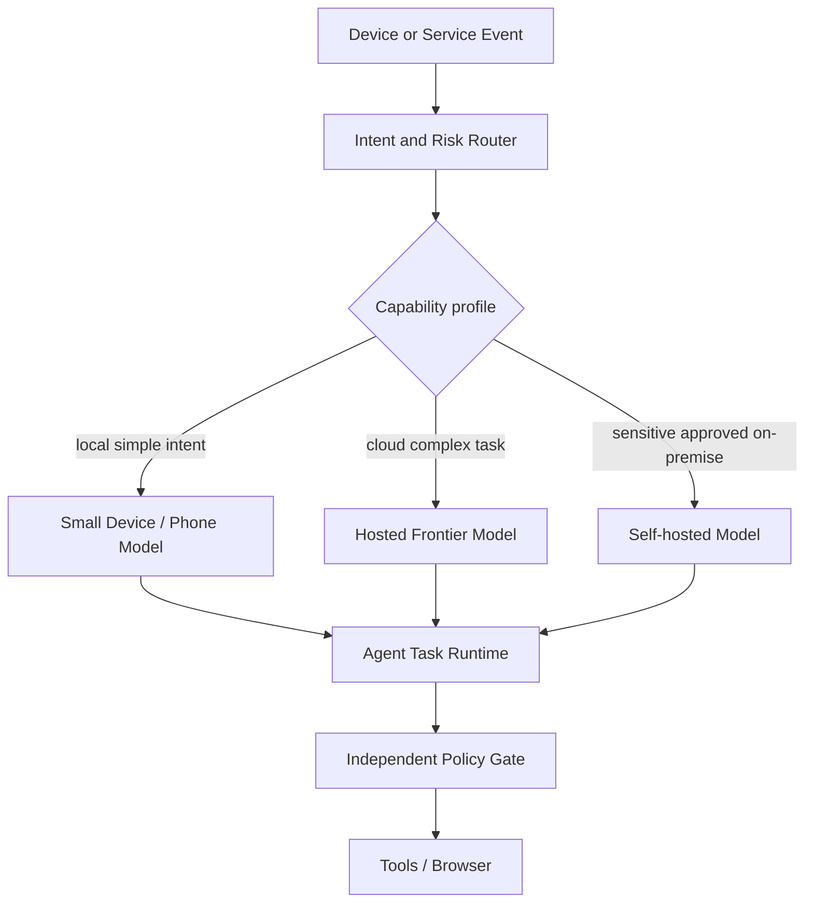

**硬件约束必须明确**：Muse Spark Open 为 816B 总/42B 激活、1M Context；官方 BF16 权重约 1.65 TB、NVFP4 约 537 GB，示例为 8×B300 或 4×B300，亦有多台 M5 Ultra Mac Studio 的 MLX 方案。部署实际显存还要计算 KV Cache、Batch 与模型外围。Glimmer 30B 量化可在约 24–32GB 级设备验证，**也不应直接归入 Android 眼镜 SoC 级可部署模型**。许可：Spark Open 为 Muse Model License，Glimmer Apache 2.0。上线必须由法务确认商业条款及依赖许可证。来源：[Spark Open 规格](https://dev.meta.ai/docs/muse-spark-open)、[构建指南](https://dev.meta.ai/resources/blog/build-with-muse-spark-open)、[Glimmer](https://research.meta.ai/blog/introducing-muse-glimmer-open-agentic-model)。

**禁止隐含依赖**：不应让 `TaskStore` 的序列化内容绑定某厂商专属 Tool Call 格式。设计 `ModelAdapter` 在运行前进行能力协商：`tool_schema/JSON schema/context_window/media support/version/safety profile`，并保存实际选用的 `modelRevision` 至 Run 元数据。

## 23.3 Active Memory：检索与“事实可信”分层

[官方] Meta 将 Active Memory 描述为跨对话携带重要背景，并按当前任务主动带回相关细节。**没有官方证据**可由此得出 `memory.claims`、`memory.entries` 或数据库关联键已更改。旧版 §12 的三层设计仍作为我们独立复现方案。

[本方案] 新增 `ContextEvidenceBundle`，避免“取到了关联文本，就当成事实且可授权操作”：

```typescript
interface MemoryEvidence {
  claimId: string | null;
  entryId: string;
  sourceId: string;
  trust: "user_explicit" | "verified_connector" | "agent_inferred" | "untrusted_web";
  validAt: string | null;
  sourceRevision: string;
  snippet: string;
  retrievalScores?: {lexical?: number; semantic?: number; rerank?: number};
}
interface ContextEvidenceBundle {
  taskId: string;
  contextRevision: string;
  selectedMemories: MemoryEvidence[];
  unresolvedContradictions: string[];
  tokenBudgetUsed: number;
}
```

**建议处理顺序**：

`Input & Goal → Task-specific Query → Hybrid Retriever → Claim Active/Time Filter → Provenance Gate → Context Builder → Model → New Events/Claim Candidates`。

请注意 `Provenance Gate` **不能把外部页面写入变成用户真实偏好**；`MemoryConsolidator` 只允许经可信度策略产生新的有效 Claim，用户直接纠错应优先，并保留 Supersession 证据链。`ContextBuilder` 保存检索清单与 Token 消耗，供 Replay/Debug；必要时允许模型二次调用记忆查找，但所有访问需按 User/Goal/Task 权限过滤。

**必要负例**：用户说“旅行结束后不再监控机票”，旧历史仍包含“持续监控机票”。相关度很高的旧记录不应覆盖新明确意图；事件应更新 Claim、取消 FutureTask，再由 Memory 回放核查。

## 23.4 Active Focus：给主 Agent 提升持续完成能力，但不取消 Durable Task

[官方] Meta 的 Active Focus 涵盖长任务遇阻时换路线、纠错、澄清及重要动作前确认。它属于模型/推理层表现，不能代替持久任务数据库、Scheduler、Policy Gate 和外部 Side Effect Reconciliation。

[本方案] 设计一个 `FocusController`（可以先实现为 Runtime 中的非独立逻辑模块）：

```text
Before each resumed run:
  load Goal version, Task checkpoint, Pending Approvals, Evidence
  verify permissions and schedule validity
  choose allowed next steps and budgets
During run:
  track blockers, retries, alternate plans, tool error classes
  persist checkpoint after every committed action boundary
On run exit:
  return COMPLETED or WAITING_* or FAILED/UNKNOWN
  if FutureTask planned: register durable trigger transactionally
  if External Action UNKNOWN: require reconciliation before retry
```

**Runtime 停止条件**必须硬编码，而不是全交给模型：最大步骤、总费用、Deadline、Cancel/Revoke、No-Progress Count、安全拦截、重试退避。Agent 可以提出更换执行方案，但不能通过调整自己的 Prompt 绕过硬性边界。

[本方案] 对 Focus 模型的测试：向同一 Task 注入页面变化、工具超时、部分失败、用户修改约束。衡量 `progress_delta / cost / latency / safety_violations / completion_after_interrupt / false_restart`，跨模型比较时使用相同工具权限。

## 23.5 Claude Duet 的新安全事实 → 新增 Outbound Content Guard

[官方] Claude Duet（10/21，安全文档 10/23）公开了：敏感动作需用户批准；行动前运行独立 Intent Check；发送消息前有独立敏感信息分类；密码通过客户端加密到独立浏览器机器，模型不读取密码/Token/Cookie；付款使用限定商家与金额的一次性卡。部分严重金融操作及他人账号访问即使用户同意也禁止。[安全白皮书](https://claude.com/resources/articles/claude-duet-safety-privacy-and-security)。

本方案建议将 §11 的权限决策扩展为**三项强制独立检查**：

1. `ActionIntentGate`：将执行内容与用户目标、当次任务、已批准参数绑定，防止 Prompt Injection 和参数替换；
2. `OutboundContentGuard`：处理准备发送到外部的文本/附件/表单字段，依据受保护的数据标记、来源、收件人和已授权分享范围做 DLP；
3. `Credential/EgressGate`：可信进程保存与注入凭据，受控浏览器/Proxy 限定网络出口；不允许 Agent 自己选择跳过。

示意决策：

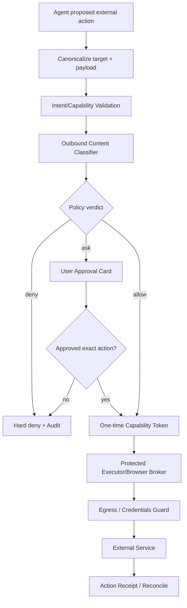

`ALLOW` 绝不应适用于本来必须逐笔批准的付款或私密内容发送。不要把模型声称“用户已经说同意”当正式批准；批准卡必须签名绑定 `merchant/recipients/payload_hash/amount/currency/expires_at/use_count/task_version`。Duet 提到审批疲劳；采用低风险读取批量授权、风险分级与明确撤销，而非放松支付底线。

**敏感外发分类建议**（供应商政策并不相同）：

| 类型 | 示例 | 我方默认设计 |
|---|---|---|
| `HARD_BLOCK` | 密码、完整卡号、私人密钥 | 强制拦截，不可仅靠用户同意继续 |
| `CONSENT_REQUIRED` | 健康、财务、私人通讯中非必要细节 | 明确收件人、目的、数据摘要，经用户授权 |
| `USER_INTENDED` | 用户明确要求发出的非敏感信息 | 验证对应范围、外部收件人权限 |
| `PUBLIC` | 公开网页事实及普通公开资料 | 检查动作能力、URL/IP 和网站政策 |

以上分档是**本项目建议**，不能混同 Meta Sentinel 原始政策或 Anthropic 完整内部规则。个人数据发送仍需遵守适用法律与账户/地区规定。

## 23.6 浏览器登录与支付新时序：采用双通道安全协议

```mermaid
sequenceDiagram
    autonumber
    actor U as User
    participant APP as Phone App
    participant H as Main Agent
    participant B as Browser Sub-Agent
    participant BR as Browser Broker
    participant CR as Credential Broker
    participant POL as Policy + DLP Gate
    participant SITE as Merchant Website
    participant PAY as Payment Wallet

    U->>APP: 下达购买目标
    APP->>H: Create Task with constraints
    H->>B: Shop/research scoped task
    B->>BR: Browser actions/snapshots
    BR->>SITE: Browse product pages
    SITE-->>BR: Cart and login state
    opt Login is needed
        BR-->>APP: Trusted secure login request
        U->>APP: 输入凭据/通过二次验证
        APP->>CR: 加密/单次凭据传递
        CR->>BR: Protected browser login injection
        Note over B,BR: Bot control suspended during login
        BR->>SITE: Authenticate (credentials hidden from LLM)
    end
    B->>BR: Prepare checkout
    BR-->>POL: Exact action + cart/amount/destination
    POL->>POL: Intent check + Outbound DLP
    POL-->>APP: Signed purchase approval card
    U->>APP: 确认限定商家/金额的交易
    APP->>POL: Approval proof
    POL->>PAY: Authorized one-time card request
    PAY-->>BR: Restricted payment capability
    POL-->>BR: Permit exact action once
    BR->>SITE: Submit checkout once
    SITE-->>BR: Order receipt or unknown status
    BR-->>H: Verified result / outcome_unknown
    H-->>APP: Result, receipt, or reconciliation request
```

*逻辑级时序、非 Meta/Anthropic 内部 RPC；主 Agent 不读取凭据或一次性卡号，具体实现应使支付能力在受保护 Browser Broker 内使用。*

此处新增对账要求：网络断开或 3DS、风控挑战后处于 `OUTCOME_UNKNOWN` 时，应按订单号/商家交易查询 API 核对，不自动再次点“购买”。浏览器控制切换通过租约独占，用户接管与密码注入时 Agent 失去写操作权；恢复时必须重新 Snapshot 页面、验证 Task 版本和价格/库存。

## 23.7 Main Loop vs Sub-Agent：从“架构愿景”转为“可复验选择”

[官方工程经验] Anthropic 10/22 指出，多专业 Sub-Agent 可能造成上下文传递损失、额外延迟与 Fragmented Prompt；在一些企业场景“单 Loop + 渐进披露 Skills/Tools”的质量、成本和时延更好。仍建议在**并行工作、独立上下文、隔离权限、独立验证**场景保留 Sub-Agent。[原文](https://claude.com/resources/articles/building-agents-when-to-fold-subagents-into-your-main-agent-loop)。

**[本方案] 采用一条固定 Control Plane + 可动态调节的数据平面**：

| 任务类型 | 默认执行拓扑 | 何时启用 Sub-Agent |
|---|---|---|
| 普通问答、简短检索、查任务状态 | Main Agent + Tool | 默认不拆 |
| 单网站表单浏览 | Main Loop + Broker（简单） | 页面长、反复试错或需独立浏览器权限时分 Browser Agent |
| 价格/评论多站并行调研 | Main + N 个 Task Worker | 不同源可独立验证时并行 |
| 编写复杂代码 | Main Loop + Skills / Computer | 任务独立可并行或需专业隔离时拆 Coding Worker |
| 订单提交 | Agent Prepare + **确定性 Action Executor** | 永远不能通过“再多一个付款 Agent”代替 Trusted Gate |
| Goal Replanning | Main + Deterministic Trigger Store | 复杂 Goal 可委托研究，但 Final Plan Commit 集中处理 |

**评价矩阵**：保持用户目标、模型、权限、网络和 Case Fixture 相同，将 A/B/C 三种拓扑运行至少多次；统计任务完成率、风险操作拦截率、Token、延迟（p50/p95）、人机交互次数、上下文丢失率、重试次数、最终人工修复工作量。决策阈值来自 Evals，不在本设计中虚构固定最优值。

## 23.8 对 OpenMuse 最新源码/文档的精确适配边界

截至 10/26 的公开官方文档仍将 OpenMuse 描述为 Alpha、单 Owner、SQL-Lease 后台任务、受管理的 Gmail/Calendar 审批；Roadmap 保留 Adaptive Long-term Plans、Agent-operated Interactive Websites、自动 Reservations / Payments、每人独立 VM 和多用户认证等未来项。[ROADMAP](https://github.com/CopilotKit/OpenMuse/blob/main/ROADMAP.md)。

**E2B 的正确理解**：`docs/COMPUTER.md` 确认可选 `COMPUTER_PROVIDER=e2b-desktop`，并向 Agent 暴露 `use_desktop` 截图、鼠标、键盘；同文件说明它允许公网通信、公开监听端口，**外发网页/终端流量并未强制通过 ActionService 审查**。因此不能由 E2B 的 GUI 能力直接推出“可以安全完成自动下单”。[Computer 文档](https://github.com/CopilotKit/OpenMuse/blob/main/docs/COMPUTER.md)。

**OpenBot Integration**：Roadmap 在 10/26 检视仍将 OpenBot user/session bridge、routines、computer backend 的真实联通列为 Integration Acceptance Next；可使用其服务接口做扩展，但上线前必须取得运行验收证据。即使发现提交/PR，也必须核对 `merged_sha` 和部署分支，而不能把 PR 标题当功能实现。[OpenMuse PR](https://github.com/CopilotKit/OpenMuse/pulls)、[OpenBot](https://github.com/CopilotKit/OpenBot)。

**本轮实际改造建议文件**（新增文件路径为本方案，不是仓库已有）：

```text
apps/server/src/
  model-capabilities.ts       # NEW: 能力/许可证/算力/数据驻留
  context-evidence.ts         # NEW: Active Memory + provenance
  focus-controller.ts         # NEW: 工作推进与 hard budget
  security/
    outbound-content-guard.ts # NEW: 外发私密信息审查
    action-policy.ts          # NEW: 意图+权限裁决
    capability-receipt.ts     # NEW: 审批绑定与幂等执行
  tracing/
    agent-trace.ts            # NEW: OpenTelemetry GenAI spans
  engine/
    conversation.ts          # EXISTING: Chat Agent入口
    model.ts                 # EXISTING: Task Agent Loop
    service.ts               # EXISTING: Goals/Tasks/Monitors
    worker.ts                # EXISTING: SQL lease/checkpoint
  actions.ts                 # EXISTING: Reviewed Connector Writes

apps/worker/                  # EXISTING: Browser Worker
# Future: dedicated trusted browser broker / separate credential process
```

**优先兼容**：保留 OpenMuse 当前 `AGENT_BACKEND=agui` 外部 Agent 接入方式与 React Native UI，但后台 `executeModelTask` 的可替换性需额外开发 Task Executor Adapter。避免仅替换 Chat Agent 后错误认为长期后台任务也切换了 Runtime。

## 23.9 OpenDots / OpenBot / nanoMuse 作为互补基础设施

[代码/文档] OpenDots README 已有 per-Dot Computer（OpenBot）、MCP/Composio、可编辑 Spaces/Pages、WebRTC 通话、原 Conversation 中的后台定时 Run，并公布 Automatic Learning 的 Per-Dot Learning 容器与 Skill 交付接口。但明确声明很多连接需要真实服务验收，Cloud Schedules、Learning 输出的 Skills 发布和多 Dot 自动委派并未全部作为成品保证；项目也是单 Owner 起点。若借鉴其学习机制，务必将“Agent 建议新 Skill”与“审核/签名后发布可执行工具”分开。[OpenDots](https://github.com/CopilotKit/OpenDots)。

[代码/文档] nanoMuse 10/9 起进入 1.0.x 并持续修复手机/桌面/Relay 协议与权限边界，是设备协作与去中心化 Gateway 的参考，但 GPL-3.0-or-later 对二次分发具有不同合规义务。建议研究其 Android ↔ PC ↔ Relay 的会话消息格式、设备权限、重连及错误事件，而不是直接把其安全能力等同于 Muse VM + Sentinel。[nanoMuse](https://github.com/nano-muse/nanoMuse)。

[本方案] 引入 `SkillPublication` 实体：

```typescript
interface SkillPublication {
  skillId: string;
  sourceRunId: string;
  version: string;
  codeHash: string;
  requestedCapabilities: string[];
  humanOrPolicyReviewId: string | null;
  evalSuiteRevision: string;
  status: "draft" | "tested" | "review_required" | "active" | "revoked";
}
```

Agents 只能写 Draft/请求测试，发布 Active 必须来自权限可信的 Registry 过程。新增 Memory/Reflection 内容属于“非可信事实”，不能直接被用作发布高权限 Skills 的批准依据。

## 23.10 统一可观察性：采用 OTel + Agent Event Log

[官方] 10/14 Anthropic 宣布在其 Managed Agents、Messages API/SDK 中开放 OpenTelemetry Export，基于 GenAI 语义约定，记录模型调用、工具调用、耗时、Token 与关联 ID。我们可以复用**标准可观测接口思想**，但不能因此宣称 Muse/dots 公开的内部系统也采用同一实现。[OTel 公告](https://claude.com/resources/articles/agent-observability-on-the-claude-platform)。

建议采用这样的 Span/事件体系：

```text
trace_id (a user request / future trigger)
  span: gateway.receive
  span: router.classify / candidate_retrieve
  span: task.resolve
  span: context.retrieve / memory.claim_validation
  span: llm.model_call (model_revision, token_usage)
  span: subagent.spawn / tool.call
  span: browser.observe / browser.act
  span: security.intent_gate / security.outbound_dlp
  span: approval.await / approval.decide
  span: action.execute / reconcile
  span: state.checkpoint
  span: notifier.publish
```

必须关联以下持久标识：`dot_id/user_id, conversation_id, goal_id, task_id, run_id, action_id, event_seq, span_id, capability_id`。注意**Trace 不等于 Event Log**：前者用于诊断性能及因果链路，后者用于恢复确定性状态、强制政策审计。日志中密码、Token、完整支付数据必须脱敏或不采集；敏感个人数据原则上存引用而非正文。

添加 Trace-to-Eval 管道：`匿名化异常 Trace → 数据集 Case → 固定 Mock / Record&Replay → Regression → 发布门禁`。比较不同 LLM、不同 Loop Topology，避免只根据最终自然语言回答打分。

## 23.11 端到端新增测试矩阵（追加至 §19）

| ID | 场景 | 必须验证 |
|---|---|---|
| UT-2026-01 | 更强模型换入旧 Task | Task 不丢、Tool Schema 不错、Safety Gate 不降级 |
| UT-2026-02 | 100 万 Token 宣称 vs 实际任务成本 | 不因为大窗口而默认注入完整历史，Context Builder 可控 |
| UT-2026-03 | 用户更新旅行时间 | 旧 Claim Superseded、Goal 版本更新、Future Task 调整 |
| UT-2026-04 | 恶意网页要求写永久记忆 | 记忆来源仍为 Untrusted，不可升级为 User Preference |
| UT-2026-05 | 用户要求查询旧任务 | 任务 ID 精确解析，不把全部历史塞进模型 |
| UT-2026-06 | 手机端创建并管理 Scheduled Task | 跨设备一致性、任务详情对话隔离 |
| UT-2026-07 | Agent 准备向第三方外发银行账户信息 | Outbound Guard 拦截，不出现真实数据泄漏 |
| UT-2026-08 | 外发邮件有多个收件人 | 分别验证收件人、敏感信息与用户批准绑定 |
| UT-2026-09 | 用户批准后内容被改动 | Payload Hash 不一致，审批失效 |
| UT-2026-10 | 用户批准交易后断网 | 进入 OUTCOME_UNKNOWN，不重复提交购买 |
| UT-2026-11 | 浏览器要求 MFA/Passkey | Agent 停止操作，用户安全接管后再恢复 |
| UT-2026-12 | 禁止外部交易类操作 | 强制拒绝，不受 Prompt “用户同意”影响 |
| UT-2026-13 | E2B Computer 外发请求 | 未接入 Egress Gate 前拒绝真实凭据/敏感写工具 |
| UT-2026-14 | OpenBot 适配未配置 | 明确 Not Configured，不伪造成功 |
| UT-2026-15 | 生成的新 Skill 试图扩大 Scope | 进入 Review，不能自动发布 Active |
| UT-2026-16 | Sub-Agent 多路并发回合 | Task Version/Fencing 生效、结果不会互相覆盖 |
| UT-2026-17 | Single Loop vs N Sub Agents | 同一用例多次测试，比较成功率、时延、成本及 Handoff 丢失 |
| UT-2026-18 | 任务因模型失败重试 | 不重复执行文件写入、邮件或外部交易 |
| UT-2026-19 | Privacy/DLP 分类器误报 | 可查看原因、走批准/拒绝逻辑，硬阻断数据永不外发 |
| UT-2026-20 | Agent Trace 跨模型与执行服务 | trace_id/task_id/action_id 可追踪，敏感信息不出现在 Trace |
| UT-2026-21 | 撤销账号授权后仍有待执行 Future Task | 旧 Capability 即刻失效，后台不再使用 Token |
| UT-2026-22 | 定时任务达到配额 | 停止无上限自复制，保存原因并按通知策略处理 |
| UT-2026-23 | 人工接管 Browser 后页面变更 | Bot 恢复前重新观察、验证价格及交易参数 |
| UT-2026-24 | 一条网页同时包含公开事实和个人敏感信息 | 结构化来源和外发标签不会因同文档而混淆 |

建议指标而非宣称实测值：未授权外部写入、跨用户凭据泄露、重复支付在发布验收环境中都必须为 0；其他失败率与 p95 latency / token cost / false notification 需在基线测定后定义 SLO。针对新模型必须执行安全回归，不能仅做回答质量测试。

## 23.12 修订后的实施里程碑和先后依赖

```mermaid
flowchart TD
    A[M0 锁定OpenMuse版本与验收基线] --> B[M1 Task/Action事件幂等与Trace]
    B --> C[M2 Conversation Router + Context/Memory Provenance]
    C --> D[M3 Goal/Future Task Adaptive Loop]
    B --> E[M4 Credential + Intent + Outbound DLP + Browser Gate]
    E --> F[M5 浏览器真实帐号/购物模拟与对账]
    D --> G[M6 主动服务/通知策略]
    C --> H[M7 Model Router + Active Focus/Memory Eval]
    H --> I[M8 单Loop/子Agent拓扑AB测试]
    F --> J[M9 多租户与三端接入]
    G --> J
    I --> J
```

**工作包级优先顺序建议**：

| 阶段 | 核心交付 | 完成门槛 |
|---|---|---|
| M0 | 固定 OpenMuse SHA、开发模型清单、工具数据源、Privacy Inventory | README/ROADMAP/SECURITY 与部署版本匹配 |
| M1 | Durable Task、Action Receipt、Outbox、OTel | Crash/Retry/Unknown Outcome 不造成重复外部行为 |
| M2 | Conversation Router、Context Evidence、Memory Claim Store | 跨任务 Focus 不串扰、记忆来源可解释 |
| M3 | Goal Self-Scheduler、Triggers、Limits | 自主创建/更新/删除未来任务可验证 |
| M4–M5 | Browser Agent + Broker + Security/DLP + 账号交接 | 账号密码不可见模型，所有敏感操作强制审批 |
| M6 | 可节制的主动 Brief 与通知 | Noise Budget、误报与无关通知可控 |
| M7–M8 | 新模型能力适配与多 Loop 拓扑基准 | 质量/安全不倒退，成本/时延受控 |
| M9 | 多租户、设备网关、眼镜事件 | 多用户隔离、跨端恢复、权限回收通过 |

与原 v1.0 §20 的迭代思路兼容，只是加入了**安全、模型和可观测性**的正式发布门禁。

## 23.13 更新的 ADR（追加至 §21）

- `ADR-023-01` **模型与执行解耦**：模型推理层只生成行为建议和结构化 Tool Call，不拥有持久状态或高风险动作的执行授权；每次 Run 固定 modelRevision。状态：采纳。
- `ADR-023-02` **Active Memory 不等于 Memory Database**：建立双轨元数据 `MemoryClaim/ContextEvidence` 与 Runtime 可重放的 SourceRef。状态：采纳。
- `ADR-023-03` **Active Focus 不替代 Durable Workflow**：硬停止条件、事件日志、对账与预算在确定性层实现。状态：采纳。
- `ADR-023-04` **Outbound Content Guard 单独于 Action Approval**：防止“用户有权限发邮件”被误解释为“可以外传邮件里任何信息”。状态：采纳。
- `ADR-023-05` **Browser 凭据路径与模型隔离**：安全 UI→Credential Broker→可信 Browser，主 Agent 不可读取密钥/Cookie。状态：采纳。
- `ADR-023-06` **仅由 Eval 决定 Sub-Agent 分拆**：优先使用主循环 + 渐进披露 Skills，Browser/Research 子 Agent 在确有收益时保留。状态：实验性采纳。
- `ADR-023-07` **OpenMuse 仍按 Alpha/单 Owner 看待**：E2B 是可选执行后端，不是具有强制出口审查的生产平台。状态：风险接受仅限非敏感测试。
- `ADR-023-08` **OpenDots Learning Skill 必须审核才能发布**：学习内容为无权自动提升的候选能力。状态：采纳。
- `ADR-023-09` **OTel 用于观察，不取代事件账本**：敏感内容最小化、Trace 和 Action Receipt 分开存放。状态：采纳。

## 23.14 仍待核查的架构问题

- Wonder 的 Active Memory 调用是否依赖模型内部检索工具、预填上下文或特殊训练范式？与旧 Claim Bank 是否共享 Schema？未公开。
- Muse Spark Open 的商业发行许可证对本项目规模、模型再分发、服务提供有哪些限制？需逐条法律审核。
- Duet 的一次性凭据加密、浏览器令牌与网络审查的实际 RPC 和密钥生命周期如何实现？仅公开设计要点。
- OpenMuse 10/25–26 相关 PR 是否合并？本轮不将未核实 SHA 的提交当作 main 的已交付功能。
- OpenDots Learning 容器何时可脱离外部 CopilotKit Intelligence 部署？需要真实私有化/商业许可核验。
- 手机 Host 与眼镜设备如何协商用户在“语音同意”和手机界面“正式交易审批”之间的权限等级？应独立设计；不复用 ASR 文本作为支付证明。

## 23.15 本轮参考资料（全部可点击，复查日期 2026-10-26）

| 来源 | 日期 | 主要依据 |
|---|---|---|
| [Meta Muse Wonder](https://research.meta.ai/blog/muse-wonder) | 10/12 | Active Memory/Focus、Model API/Muse Code、消费版未来滚动 |
| [Meta Muse Spark Open](https://research.meta.ai/blog/muse-spark-open) | 10/15 | 参数、用途、硬件、开放权重 |
| [Meta 模型部署文档](https://dev.meta.ai/docs/muse-spark-open) | 10 月 | BF16/NVFP4 具体规模、Runtime、License |
| [Meta Build with Spark Open](https://dev.meta.ai/resources/blog/build-with-muse-spark-open) | 10/15 | vLLM/SGLang/MLX 参数、Tool Call Parser、设备 |
| [Meta Muse Glimmer](https://research.meta.ai/blog/introducing-muse-glimmer-open-agentic-model) | 8/10 | 30B 本地模型的硬件对照 |
| [Claude Duet](https://claude.com/resources/articles/claude-duet) | 10/21 | 研究预览、晨报、任务与访问限制 |
| [Claude Duet Security](https://claude.com/resources/articles/claude-duet-safety-privacy-and-security) | 10/23 | 独立审查、凭据与双层 DLP、购买审批 |
| [Fold Subagents into Main Loop](https://claude.com/resources/articles/building-agents-when-to-fold-subagents-into-your-main-agent-loop) | 10/22 | 渐进 Skills、Agent 拆分/合并的评估方法 |
| [Claude Agent Observability](https://claude.com/resources/articles/agent-observability-on-the-claude-platform) | 10/14 | OpenTelemetry GenAI Trace |
| [OpenAI dot Help](https://help.openai.com/en/articles/20001530-getting-started-with-your-dot) | 10/26 核查 | 移动建 dot、Task 独立会话、云本地电脑、Scheduled |
| [OpenAI dot Safety FAQ](https://help.openai.com/en/articles/20001529-dots-privacy-security-and-safety-faqs) | 10/26 核查 | Auto-review、权限、连接的服务 |
| [OpenMuse README](https://github.com/CopilotKit/OpenMuse) | 10/26 核查 | Alpha 产品及基础能力 |
| [OpenMuse ROADMAP](https://github.com/CopilotKit/OpenMuse/blob/main/ROADMAP.md) | 10/26 核查 | 后续待补功能 |
| [OpenMuse COMPUTER](https://github.com/CopilotKit/OpenMuse/blob/main/docs/COMPUTER.md) | 10/26 核查 | Docker/E2B 的细节、出网风险 |
| [OpenMuse SECURITY](https://github.com/CopilotKit/OpenMuse/blob/main/SECURITY.md) | 10/26 核查 | 单 Owner、安全边界 |
| [OpenDots](https://github.com/CopilotKit/OpenDots) | 10/26 核查 | OpenBot、Learning、原会话定时 Run |
| [OpenBot](https://github.com/CopilotKit/OpenBot) | 10/26 核查 | 独立 Computer 服务候选 |
| [nanoMuse](https://github.com/nano-muse/nanoMuse) | 10/26 核查 | 跨设备、Relay、稳定版主张 |

## 23.16 总结：更新后推荐的可实施核心

```text
Glass / Phone Host / Web / Messages
  ├─ Session & Conversation Router / Focus
  └─ Device Context/Event Gateway
     ↓
Goal / Task Control Plane
  ├─ Task Registry + Event/Outbox + Scheduler
  ├─ Context Builder + Claim/Entry/Embedding + Evidence
  ├─ Model Capability Router + Active-Focus-like Eval
  └─ Main Agent Loop + (Conditional) Sub-Agents
     ↓
Trusted Execution Plane (independent)
  ├─ Intent/Capability Gate + Outbound DLP Gate
  ├─ Secure Credential Broker + Connector Workers
  ├─ Browser Broker + Human Takeover Controller
  └─ Controlled Egress + External Action Receipts
     ↓
Cloud VM/Docker + Browser + Third-party APIs
     ↓
Telemetry / OTel / Security Audit / E2E Evals
```

**验收态度**：真正复现 Muse 类长期 Agent，应该能够在模型切换、用户长期目标变化、网页失败、用户不在线、权限撤销和 Worker 重启下持续可靠运行；并应当让 Browser/Code 自生成内容始终处于不可自行扩大权限的执行域。这套控制平面与可信执行边界的确定性，比使用哪个旗舰模型、堆多少个 Sub-Agent 更决定系统的可用性与安全性。

---


## 2026-10-31 增量修订：DeepSeek Super-Agent 对 Dot / Muse 复现的架构影响

> **修订类型**：经项目调研触发的非破坏性架构修订；保留本文件此前全部正文。此前与本章冲突的 Dot Control Plane 建议，以本章为准。**Codex Core → 桌面 Codex → 桌面 Dot → 手机/眼镜入口 → 正式登录及商业化（最后）**的路线不变。

### A. 结论与不变项

1. **不替换 Codex Core**：既有 Agent Loop、Thread、Turn、Tools、Sandbox、Compaction、Memory 和 App Server 仍是首选执行基础。DeepSeek Harness 作为隔离验证的可插拔替代 Executor，而不是生产主线强制依赖。
2. **升级 Dot Control Plane**：将原来的 `Conversation Router + Task Registry + Scheduler` 扩展为 `Source → Immutable Trigger → Evaluation/Admission → Mandate → Ticket → Assignment → Executor`，并加入 `Thread Subscription Registry`。
3. **保持两层不同的“Thread”**：`source_thread_ref` 指 GitHub Issue、PR、邮件线程或 Dot 主聊天的外部关联；`codex_thread_id` 指 Codex Agent 的执行上下文。两者绝不能混用。
4. **长任务不等于常驻 LLM**：Ticket 可 WAITING，相关事件命中 Subscription 才重新创建 Assignment；Codex Turn 的自动续接只负责一次执行窗口内的进展。
5. **安全边界不退化**：Mandate 记录来源、理由、范围和策略版本，实际写操作仍由 Permission Gateway 独立审批；密码、OAuth、付款、网络出口的强制限制不能只依赖 Prompt 或 Ticket 元数据。
6. **开发先后顺序不变**：桌面 Codex M1/M2 不引入此复杂度为阻塞依赖；M3 的单主聊天、M4 的主动任务优先集成，之后才扩展跨设备入口。

### B. 领域术语及旧模型映射

| 新概念 | 职责 | 旧模块的处理方式 | 边界 |
|---|---|---|---|
| Source | 事件源配置、身份和回调 | 扩充 Gateway/Connector | 不能默认为可信用户授权 |
| Trigger | 不可变的外部事件事实 | 统一 Message/Event 表，追加入库 | `(source_id, source_event_id)` 幂等 |
| Source Thread | 外部消息串/Issue/PR 关联 | Task Alias + Message Links | 不是 Codex Thread |
| Eval / Admission | 判断忽略/新建/关联/澄清 | 升级 Conversation Router | 本身不执行高风险工具 |
| Mandate | 任务可做之事的来源与范围 | 从 `autonomyPolicy` 独立出来 | 不替代实时 Policy Decision |
| Ticket | 长期稳定待办/工作目标 | 映射原 `Task`，迁移时保留 ID | 一个 Ticket 多个 Assignment |
| Assignment | 某次派工、租约和执行身份 | 分离原 `Run` 和 Agent 归属 | 过期租约必须 Fencing |
| Subscription | Ticket 对未来事件的确定性订阅 | 新增注册表 | 命中不自动扩大授权 |
| Executor Session | 实际 Agent 执行上下文 | Codex Thread + Turn/Run | 可替换、可恢复、可迁移 |

```mermaid
flowchart TD
  UI["Dot 唯一主聊天"] --> GW["Unified Source Gateway"]
  EXT["GitHub / 邮件 / 日历 / Timer / 眼镜"] --> GW
  GW --> LOG[("Immutable Trigger Log")]
  LOG --> SUB["Subscription Matcher"]
  SUB -->|命中| T[("Existing Ticket")]
  LOG --> EVAL["Eval / Admission + Conversation Router"]
  EVAL -->|新建或归属| T
  EVAL -->|无关| SKIP["记录忽略原因"]
  T --> M["Mandate / Policy Snapshot"]
  T --> AS["Assignment + Lease + Fencing"]
  AS --> EX["Executor Router"]
  EX --> CX["Codex Core / App Server"]
  EX -.-> DSH["DSH Harness 实验适配器"]
  CX --> SEC["Independent Permission Gateway"]
  DSH --> SEC
  SEC --> TOOLS["Browser / Computer / Connectors"]
  TOOLS --> LOG
```

### C. 必须遵守的业务不变量

- **ID 不变量**：`message_id`（原始输入）、`trigger_id`（规范化事件）、`ticket_id`（原 Task）、`assignment_id`（派工）、`codex_thread_id`（执行上下文）各自唯一且不互相替代；一条用户消息只保存一份原文，通过关联表可以影响多个 Ticket。
- **幂等**：外部 Source 的重复回调不应产生第二个 Trigger 或第二次不可逆外部写入；索引 `UNIQUE(source_id,source_event_id)` 并配合 Action Receipt 和外部 Idempotency Key（如支持）。
- **并发**：同一个 Ticket 的可写 Assignment 需要乐观版本、Lease、Fencing Token；过期 Worker 不能继续提交 Checkpoint。外部已发送但结果不明确的 Action 进入 `OUTCOME_UNKNOWN`，禁止盲目重试。
- **安全**：只能从显式可审计来源建立 Mandate，推断/长期授权需限制在低风险行动；审批凭据绑定 Action 参数哈希、任务版本、一次性使用/到期时间、操作身份和目标商家或服务。
- **Event Subscription**：准确匹配来源及远端线程后，优先直接路由到已订阅 Ticket；只有未命中时才进入语义检索和轻量 Eval。多目标匹配可路由多 Ticket，但不得静默共享私有上下文。
- **撤销**：用户取消 Goal/Task 或撤销权限时，Subscription、Future Trigger、未开始 Assignment 和未消费授权同时失效；已经外发的行为记录结果，不宣称能够撤回。
- **保留 Task Context**：Codex Thread 可 Compaction 或 Rollover，但 Ticket State、Evidence、授权范围、待补问和事件订阅不应被清空。

### D. 核心接口合同（TypeScript 示例：本项目新设计）

```typescript
type Admission =
  | { kind: 'ignore'; reasonCode: string }
  | { kind: 'create'; goalId?: string; mandateRequest: MandateRequest }
  | { kind: 'route'; ticketIds: string[] }
  | { kind: 'clarify'; candidateTicketIds: string[]; question: string };

interface IncomingTrigger {
  triggerId: string; sourceId: string; sourceEventId: string;
  sourceThreadRef?: string; actorRef?: string;
  occurredAt: string; receivedAt: string;
  payloadRef: string; payloadSha256: string;
}
interface MandateRequest {
  originTriggerId: string; policyVersion: string;
  grantedBy: 'user'|'system-policy';
  allowedCapabilities: string[];
  expiresAt?: string;
}
interface TicketAssignment {
  ticketId: string; assignmentId: string;
  executor: 'codex'|'dsh-experimental';
  executionThreadId?: string;
  ticketVersion: number; leaseToken: string;
  leaseExpiresAt: string;
}
interface ThreadSubscription {
  subscriptionId: string; ticketId: string;
  sourceId: string; sourceThreadRef: string;
  eventTypes: string[]; active: boolean;
}
```

### E. 建议的数据库迁移（SQLite 原型；非官方 Schema）

```sql
CREATE TABLE IF NOT EXISTS agent_triggers (
  trigger_id TEXT PRIMARY KEY,
  source_id TEXT NOT NULL,
  source_event_id TEXT NOT NULL,
  source_thread_ref TEXT,
  occurred_at TEXT NOT NULL,
  payload_ref TEXT NOT NULL,
  payload_sha256 TEXT NOT NULL,
  UNIQUE(source_id,source_event_id)
);
CREATE TABLE IF NOT EXISTS agent_mandates (
  mandate_id TEXT PRIMARY KEY,
  ticket_id TEXT NOT NULL,
  origin_trigger_id TEXT NOT NULL,
  policy_version TEXT NOT NULL,
  capabilities_json TEXT NOT NULL,
  granted_by TEXT NOT NULL,
  revoked_at TEXT,
  expires_at TEXT
);
CREATE TABLE IF NOT EXISTS agent_subscriptions (
  subscription_id TEXT PRIMARY KEY,
  ticket_id TEXT NOT NULL,
  source_id TEXT NOT NULL,
  source_thread_ref TEXT NOT NULL,
  event_types_json TEXT NOT NULL,
  active INTEGER NOT NULL DEFAULT 1,
  UNIQUE(ticket_id,source_id,source_thread_ref)
);
CREATE TABLE IF NOT EXISTS agent_assignments (
  assignment_id TEXT PRIMARY KEY,
  ticket_id TEXT NOT NULL,
  executor_kind TEXT NOT NULL,
  codex_thread_id TEXT,
  ticket_version INTEGER NOT NULL,
  lease_token TEXT NOT NULL,
  lease_until TEXT NOT NULL,
  state TEXT NOT NULL,
  updated_at TEXT NOT NULL
);
```

> 迁移原则：**保留原 `tasks` 表与 Task ID**，先加 `ticket_id = task_id` 兼容视图和 Adapter，再将新的 Admission、Subscription、Assignment 逐阶段切流。新表设计与旧版 `task_runs` 可能存在语义重叠，必须在代码中选定唯一事实源，禁止双向写入导致状态分叉。

### F. Dot 前台单对话与 GitHub 后台事件的两个样例

```mermaid
sequenceDiagram
  autonumber
  actor User as 用户
  participant UI as Dot Chat
  participant GW as Event Gateway
  participant SM as Subscription Matcher
  participant EV as Eval Router
  participant DB as Ticket Store
  participant W as Assignment Worker
  participant CX as Codex App Server
  User->>UI: “继续之前的 Android Bug”
  UI->>GW: message + messageId
  GW->>SM: normalize trigger
  SM-->>GW: 无明确订阅
  GW->>EV: candidates + focus + history
  EV-->>DB: route to existing Ticket
  DB->>W: 创建 Assignment/Lease
  W->>CX: thread/resume 或 thread/start; turn/start
  CX-->>W: events + result
  W->>DB: versioned checkpoint
  DB-->>UI: linked progress + taskId
```

```mermaid
sequenceDiagram
  autonumber
  participant GH as GitHub Webhook
  participant GW as Event Gateway
  participant SM as Subscription Registry
  participant T as Ticket Store
  participant W as Worker
  participant CX as Codex Core
  GH->>GW: PR review comment (eventId)
  GW->>GW: 幂等保存 Trigger
  GW->>SM: match(PR thread/eventType)
  SM-->>T: 匹配已订阅 Ticket
  T->>W: create new Assignment
  W->>CX: 恢复关联 Codex Thread
  CX-->>W: PR 修改/测试结果
  W->>T: 保存结果并更新 Subscription
```

### G. 与 OpenMuse / DSH 的开源实现取舍

- **DSH 概念复用，不是强依赖**：优先抽取 Trigger、Admission/Eval、Mandate、Ticket/Assignment、Subscription 的行为与接口，不直接搬运研究原型的单仓库身份假设或无逐步审批的 Shell 权限模型。
- **OpenMuse 定位调整**：OpenMuse 可继续用作 UX、TaskWorker/ActionService 对照参考；**目前主实施基线仍是 `Codex Core + 自研 Desktop Host + Dot Control Plane`**，不应出现两个相互竞争的主运行时。
- **多引擎策略**：先将 Executor Router 接口稳定化、完成 Codex Adapter；DSH Adapter 只在独立实验分支中测试，不参与前期 M1/M2 验收。
- **完整个人 Memory、Browser/Computer Use、Authd-like Credential Broker、Sentinel-like Permission Gateway** 仍需按照既有独立文档实现。DSH Super-Agent 的研究原型不证明这些能力具备生产安全。

### H. 增量开发任务与验收

| ID | 阶段 | 任务 | 验收 |
|---|---|---|---|
| DSH-01 | M2-Spike（非阻塞） | 锁定 DeepSeek 两仓库 Commit 和 License | 可重现 checkout、构建、测试结果 |
| DSH-02 | M2-Spike | 复现 Issue→Ticket→Executor→PR→Review | 事件与任务一一可追踪 |
| DSH-03 | M2-Spike | 对照 Codex Executor、统计耗时与失败 | 形成证据矩阵，不凭印象切换 |
| DOT-AD-01 | M3 | Trigger 规范化、去重、审计 | 重复 webhook 仅一个业务 Trigger |
| DOT-AD-02 | M3 | Source Thread Subscription | PR 新评论确定性关联原 Ticket |
| DOT-AD-03 | M3 | Eval 与 Conversation Router 分离 | `create/route/ignore/clarify` 有日志 |
| DOT-AD-04 | M3 | Task/Ticket 与 Assignment 解耦 | 崩溃恢复 + 无双重活动写租约 |
| DOT-AD-05 | M3 | Mandate 版本与撤销 | 超范围动作被 Gateway 拒绝 |
| DOT-AD-06 | M4 | Goal→Subscription/Future Trigger 关联 | Goal 完成后自动终止关联订阅 |
| DOT-AD-07 | M4 | 多事件合并、主动通知限流 | 无重复通知与循环任务创建 |
| DOT-AD-08 | M5 | Device Source 复用 | 手机/眼镜事件有明确来源及授权 |

**非阻塞原则**：以上设计不应阻止 Codex Desktop 的第一阶段功能验证，也不能将正式 OAuth、多用户账号和计费提前到 M1/M2。**但本地沙箱与敏感操作的有效审批始终是底线。**


### I. 此文档的历史架构定位与升级说明

本文件保留 2026-10-11 和 2026-10-26 以 OpenMuse 为候选底座的全部评估，方便研究比较；**现行工程主线已调整为 Codex Core + Desktop Host + Dot Control Plane**。OpenMuse 的 TaskWorker/ActionService 可用于对照，不作为与 Codex 并列的必需运行时。

新增的 Source/Trigger/Eval/Mandate/Ticket/Assignment/Subscription 是 Dot 自研 Control Plane 的设计语言，针对 Muse 的长期自治场景扩展；不意味着 Meta Muse 官方实际采用了 DeepSeek 领域模型。多用户 SaaS、跨域登录、真实付款依旧需要独立可信执行层和专项测试。


### 参考来源与证据等级（截至 2026-10-31）

- [代码/项目声明] [DeepSeek Harness](https://github.com/deepseek-ai/deepseek-harness) — Developer Preview；版本和运行接口需锁定 Commit 后逐项实测。
- [代码/研究原型] [DSH Super-Agent Prototype](https://github.com/deepseek-ai/dsh-superagent-prototype) — Research Prototype，聚焦 GitHub/飞书软件工程事件，并非成熟的通用个人助手。
- [架构] [Domain Model](https://github.com/deepseek-ai/dsh-superagent-prototype/blob/main/docs/001-domain.md)、[Authorization](https://github.com/deepseek-ai/dsh-superagent-prototype/blob/main/docs/002-authorization.md)、[Execution](https://github.com/deepseek-ai/dsh-superagent-prototype/blob/main/docs/003-execution.md)、[Architecture](https://github.com/deepseek-ai/dsh-superagent-prototype/blob/main/docs/007-architecture.md)。文档路径可能随版本变化，应以锁定的源 Commit 为准。
- [当前主线] [OpenAI Codex 开源仓库](https://github.com/openai/codex)，[App Server 协议](https://github.com/openai/codex/blob/main/codex-rs/app-server-protocol/src/protocol/common.rs)。

**证据限制**：开源项目宣称实现的功能不等于已在本项目完成部署或安全验收；本修订所有 `personal-dot/*` 类型、Event/Subscription/Mandate 表和迁移脚本均为本项目新设计。严禁将 Mandate 当成支付、网络出口或凭据使用的最终授权凭证。
