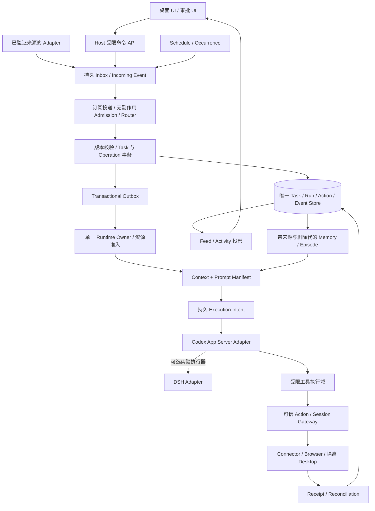

# Personal Agent 技术架构深度评审

评审日期：2026-11-02（America/Vancouver）  
评审基线：`c67fbf8c6805b4586ad2288caecd3fcc96eb7cc1`  
范围：`docs/design` 中现有五份文档，共 10,606 行；仓库尚无应用实现。  
交付性质：设计评审及修订建议；本报告不自动替换原设计或形成已批准的 ADR。

本报告引用的是上述提交的评审基线，文末 A–E 链接固定到该提交。当前设计入口位于 [总体架构与开发规划](../design/00_总体架构与开发规划.md)；评审反例脚本从 Git 基线读取输入，不用于检查当前合同是否仍存在相同问题。

## 1. 评审结论

**建议：有条件通过总体架构方向评审，暂不冻结为可直接全面实施的技术基线。**

可开始锁版、协议客户端、受限 Electron 窗口和隔离测试仓库中的 M0/M1 验证。涉及真实登录态、任意桌面输入、跨时间自治和个人敏感记忆的能力，需要先关闭下述对应问题。这里的 P0 是“在开启对应能力之前必须解决”的设计阻塞项，不表示已有应用被证明存在漏洞，也不要求暂停所有前期开发。

应保留的核心选择：

- `Desktop Host / Dot Control Plane / Codex Executor` 分层；继续通过 App Server 集成，现有证据不足以支持先 Fork Core。
- `Goal / Task / Run / Thread / Turn / Action` 生命周期分离；主聊天是产品入口，任务数据库是业务事实源。
- `Compaction / Episode / Checkpoint / Personal Memory` 分开；检索结果需要来源、时效及权限过滤。
- 用持久等待、Outbox、幂等记录和对账实现长期工作；保留 `OUTCOME_UNKNOWN`。
- DeepSeek Super-Agent 提供事件准入与任务组织参考，实验执行器维持可选；OpenMuse 继续作为研究与工作流对照。

当前主要问题是：**已写出的原则尚未收敛成一套一致、可执行、可验证的合同。** 五份文件保留了不同阶段的 Schema、WBS 和进程拓扑，部分安全与恢复要求仍停留在骨架旁的“后续补齐”说明。继续增加模型、角色或 Agent 数量不能关闭这些问题。

## 2. 来源、方法和证据边界

### 2.1 文档索引

后文使用 A–E 与原始行号定位，行号对应上述提交。

| 代号 | 文档 | 评审定位 |
|---|---|---|
| A | [Codex Core 总体方案与开发路线][A] | 当前主路线；覆盖桌面、任务、存储、集成、WBS |
| B | [单主聊天与多任务上下文设计][B] | Router、Focus、Episode、Context、任务合同 |
| C | [动态 Prompt 与 Computer Use 设计][C] | Prompt、MCP、GUI、审批与接管 |
| D | [复原的技术架构设计文档][D] | 历史参考；可信执行、DLP、恢复等约束需显式继承 |
| E | [Muse 类产品和技术研究][E] | 产品需求与研究线索，不直接作为实现合同 |

五份文件各自的 SHA-256、行数和检查结果保存于 [检查证据](evidence/2026-11-02-checks.json)。

### 2.2 实际执行的核验

1. 检查仓库、文档、现有配置与 Git 状态；没有应用代码、包清单、迁移文件或已实现的测试套件。
2. 本机 `codex-cli 0.163.0` 的 `generate-ts` 在普通模式和 `--experimental` 模式均成功；对照关键 DTO 与请求方法。
3. 用 SQLite `3.53.1` 独立执行两份核心 SQL 示例，并检查组合、状态约束、运行记录及外键行为。
4. 按文档字面规则模拟流式事件去重，验证多个合法增量是否会丢失。
5. 通过只读 Git 请求核对上游分支，下载固定提交下的协议说明与 DSH 领域/授权/执行/架构文档。

| 上游 | 本次观察到的提交/版本 | 核验结果与限制 |
|---|---|---|
| 本机 Codex | CLI `0.163.0` | 已生成两种协议输出；未启动真实模型任务、未验证 GUI 或模型账户可用性 |
| `openai/codex` | `3026a8e54e0f48c4d8074cd700f35b0697abc329`，`main` | 读取 App Server README；这不是本机二进制的已验证源码 SHA |
| `deepseek-ai/dsh-superagent-prototype` | `6337fc823ce20251c8de8085948165c81aaa701e`，`main` | README 和 `docs/001/002/003/007` 可读；未构建或运行 |
| `deepseek-ai/deepseek-harness` | `ce7073d51254c26cd63b22a60835b8f948deb447`，`master` | 已核对 HEAD 和默认分支；未构建、未做适配验证 |

本轮尝试读取 Codex 当前提交下的 `app-server-protocol/src/protocol/v2.rs` 时返回 404，因此字段级协议核验采用本机锁定二进制的生成类型。该路径是本轮核验尝试，不作为原文错误的证据；404 也不证明相关协议功能不存在。

本轮不重新背书 E/D 中所有厂商产品、模型规格、发布日期、商业许可和逆向研究事实；它们不应成为项目必须依赖的运行条件。上游文档声明、生成类型、已运行的服务行为、生产就绪程度是四种不同证据。

### 2.3 优先级

| 级别 | 含义 |
|---|---|
| P0 | 对应高权限能力开启前必须闭环的安全/执行边界 |
| P1 | 对应里程碑实施或验收前必须收敛的合同、正确性或恢复问题 |
| P2 | 应明确设计和验收要求，避免后续资源、运营或数据可靠性问题 |

## 3. 发现清单

| ID | 级别 | 发现 | 关闭时点 |
|---|---|---|---|
| AR-01 | P0 | MCP/GUI 的逻辑审批尚未映射为完整的实际执行隔离 | 真实账号、私人数据或桌面控制开放前 |
| AR-02 | P0 | 接管、撤销与动作派发缺少共同的执行端原子协议 | GUI 输入与敏感动作开放前 |
| AR-03 | P1 | Task/Run/Assignment、状态和 Schema 尚无唯一合同 | Task Store 首次实现前 |
| AR-04 | P1 | Item 三元组被误用作所有流事件的去重键 | M1 流式 UI |
| AR-05 | P1 | 丢失 Thread/Turn 接收响应时的恢复协议不完整 | M1 恢复、M2 自动化 |
| AR-06 | P1 | Electron Main 与后台服务的执行所有权未选定 | M2 后台运行 |
| AR-07 | P1 | 能力协商、动态指令与工具权限缺少版本化适配合同 | M0/M1 Adapter；角色能力开启前 |
| AR-08 | P1 | 删除和记忆隔离未覆盖既有执行历史及运行时派生记忆 | M3 个人记忆 |
| AR-09 | P1 | Source/Subscription 尚未定义可信准入与投递合同 | GitHub/设备等外部源接入前 |
| AR-10 | P1 | 定时计划与不可变事件混用 Trigger，补偿和失效规则未定 | M2 Scheduler、M3 自治 |
| AR-11 | P1 | 里程碑、工作包 ID 和“以新增章为准”存在冲突 | 发布实施计划前 |
| AR-12 | P1 | Multi-Action 的决策幂等尚未落到逐操作执行账本 | M3 多动作写入 |
| AR-13 | P1 | Completion Evaluator 缺少可信、版本化的验证合同 | M1 真正任务完成、M3 Goal 自动完成 |
| AR-14 | P2 | 预算声明没有形成跨并发执行的资源准入合同 | M2 并发、M3 长期任务 |
| AR-15 | P2 | DB、Artifact 与备份缺少共同的持久化和恢复合同 | 历史持久化及用户数据保留前 |

### AR-01：安全网关需要实际控制全部执行通道

**证据**：[A §3.3、§15.4][A]；[C L653、§14.2、§19.3][C]；[D §11.1–11.5][D]。C 允许首期 Driver 运行在当前本地用户会话；将 `navigate` 归入观察层。D 已明确提出网络命名空间、可信进程身份和完整出口控制，当前 Codex 路线没有给出这些约束的具体承接配置。

**触发与影响**：Agent 拥有通用 Shell、X11 输入或真实登录态浏览器时，直接访问 Driver Socket、浏览器 DevTools、同账号文件或同一站点的其他页面，可能绕过类型化操作提案。带 Cookie 的 URL 导航也可能产生服务端写入；HTTP GET、导航和“搜索框输入”都不能仅按工具名称证明只读。域名白名单无法区分同一服务的读取、发送与删除。

**修订建议**：先画出低权限工具进程、Host、Policy、Browser、凭据存储、Unix Socket、文件和网络的实际权限图，给出 UID/挂载/环境变量/出口规则；普通 Coding Sandbox 与受管 Connector 分域。MVP 的 Browser 限无真实账号的专用 Profile 和测试站点，Desktop 限隔离测试会话。敏感写入由可信 Connector 或人工接管完成。网站语义无法可靠识别时应拒绝自动执行，不能用模型风险评分补上强制边界。

**验收**：在 Agent 已被提示注入诱导的条件下，直接 Socket、绝对路径程序、Shell 网络请求、浏览器跳转和文件上传均不能扩大既定范围；真实凭据和策略存储不可从工具执行域读写。未完成这些条件只阻塞相关能力，不阻塞隔离 M0。

### AR-02：数据库 Fencing 不等于输入动作已经被撤销

**证据**：[C §18.1、§23.3，L1278–1319][C]；[D L720][D]。示例先读取 Session/revision，经过异步 `authorize()` 和 `markDispatched()`，才调用 `driver.perform()`；C 的注释已承认缺少真正 Fencing、撤销协调和回执原子消费。

**触发与影响**：校验完成后、实际输入前用户接管，旧请求仍可能点击；两次请求也可能并发消费同一回执。只阻止旧 Worker 写 Checkpoint，不能阻止它发出键盘或网络动作。一次性消费与远端提交无法靠一个本地数据库事务获得 Exactly-Once。

**修订建议**：每个 Session 由一个受保护的执行队列拥有。执行端在派发边界核对 `assignmentFence/controlEpoch/taskVersion/policyEpoch`，并原子预占 Action 与授权回执。接管先提升 Epoch、丢弃未派发队列、取消可取消输入，等待执行端确认后再向 UI 确认 HUMAN 控制；已经派发的动作独立记录，不能称为已撤回。不要持有 SQLite 写事务等待整个网络操作。

**验收**：在授权后、派发前以及 OS/Provider 已接收后三个位置注入接管/撤销；接管确认之后不再产生旧 Epoch 的新输入，已派发结果正确记录为成功、失败或未知。同一回执竞争消费只有一次成功；恢复时不因回执已消耗而重新发送。

### AR-03：先统一领域合同，再写存储层

**证据**：[A §9.4、增量 §E][A]；[B L104、§13.3][B]。A 使用 `current_run_id / fencing_token / sequence / idempotency_key`；B 使用 `active_run_id / lease_epoch`，`task_events` 没有 `sequence`；新增 `agent_assignments` 又保存另一套执行与租约状态。正文要求 `RESUMING`，B 的状态 CHECK 没有它。

**实测**：E01/E02 两份 SQL 独立初始化成功；E03 将 B 示例放在 A 后执行报 `no such column: dot_id`；E04 `resuming` 状态被拒绝；E05 B 的表约束允许同 Task/Trigger 两条 running 记录；E06 增量表允许引用不存在 Task 的 Assignment。E05/E06 证明数据库约束没有提供保证，不证明未来服务层一定出错。文档已提示不可直接重复建表，故 E03 说明的是“还缺一份正式合同”，而非发现了已部署迁移故障。

**修订建议**：建立唯一领域 Schema 与状态转换表；明确业务完成、派工等待、执行失败分别属于哪个实体。对本项目初版，可让 `Ticket` 是 `Task` 的领域别名、`Assignment` 是 `Run` 的接口别名，持久化只留一套；若需要区分长期执行绑定与单次尝试，再写明一对多关系和唯一写入者。一个 Task 的活动写执行权要在 Task 级或独立资源锁上递增，不能只给每个新 Run 从零创建局部 Fence。

仓库尚无历史数据库，首版应直接收敛初始化 Schema；没有必要先实现为历史研究示例服务的兼容视图和双写迁移。未来真实发行升级才需要维护正式版本迁移。

**验收**：状态枚举、DTO、数据库、事件消费者共享合同；有效状态均可落库，非法转换均被拒绝；同 Task 的冲突写派工、跨任务引用和过期 Fence 被阻断；`Task→Run→Thread/Turn` 查询唯一可解释。

### AR-04：区分 Item 身份与流事件身份

**证据**：[A L559][A] 要求按 `(threadId, turnId, itemId)` 去重。本机生成的 `AgentMessageDeltaNotification` 只有这三个 ID 与 `delta`；同一 Item 的所有文本分片共享三元组。

**实测**：E08 输入同 Item 的三段 `a / a / b`，按该规则保留后仅为 `a`，正确文本为 `aab`。用内容哈希去重同样会误删第二个合法 `a`。

**修订建议**：三元组用于定位 Item 投影。连接内增量按接收顺序追加；最终 `item/completed` 的完整内容用于校准。为本地原始帧分配连接 Epoch 与接收序号，但不宣称该序号能证明跨连接的上游投递唯一性。断线后优先读取权威 Item/Turn 快照重建，不把不带服务端事件 ID 的流片段当可任意拼接的 Exactly-Once 日志。

**验收**：相同文本的合法多次分片、完成先于 UI 消费、丢失尾部 Delta、重连历史回填都能得到完全一致的最终内容；Item 生命周期事件不能互相误去重。

### AR-05：补齐 Submit 与 Accept 之间的崩溃窗口

**证据**：[A §5.3、§9.8][A]；[B §16.2][B] 均提出超时后查询、使用 Operation/Run ID 对账，但没有定义服务端如何找到“已经创建、ID 尚未回写”的 Thread/Turn。

**触发与影响**：数据库已有 Run，`thread/start` 或 `turn/start` 已被接受，但客户端在收到/保存 ID 前崩溃。客户端 JSON-RPC 请求 ID、本地 Outbox Key 不自动成为上游业务幂等键。盲重试可创建孤儿 Thread 或重复执行；只查已知 Thread 也可能没有足够信息确认是哪一轮。类型中的 `clientUserMessageId` 存在，不代表它具备已验证的强幂等语义。

**修订建议**：持久化 `ExecutionIntent`，至少包含 operation、目标 Thread、Thread 绑定代、输入哈希、策略版本、提交状态和响应映射。同一 Thread 串行提交，先绑定 Thread 再开始 Turn。把“提交前 / 可能已提交 / 已确认 / 正在对账”与 Task 状态分开。逐项验证锁定版本的查询、消息关联和幂等支持；无法证明未接受时保留 UNKNOWN 并要求核查，不能宣称自动恢复完成。未开始 Turn 的孤儿 Thread 可以单独处理，不能把重复创建执行上下文等同于重复外部写操作。

**验收**：在写入 Intent、发送请求、服务器接受、收到响应、绑定落库的每个边界强制崩溃；恢复过程不重复有副作用的 Turn。无法确定的情况明确可见、有停止和人工处理路径。

### AR-06：为 App Server、数据库与后台执行选定唯一 Owner

**证据**：[A §5.5][A] 由单一 Main Process 拥有 App Server；[A §3.1、§9.1][A] 又预留独立 Background Service。B §2.1 允许先全部运行在 Main，之后再拆。两种模式各自合理，但切换和互斥合同尚未给出。

**触发与影响**：第二个 App 实例或后台服务与 GUI 同时启动，可能各开 App Server、领取相同任务或出现两套待审批请求。UI 退出时谁续租、谁持有服务端请求 ID、升级时谁停止旧进程都没有确定答案。

**修订建议**：M1 明确仅 Main 拥有执行，完全退出即停止并下次恢复。M2 若启用常驻执行，应由后台 Runtime 独占 Task DB 写协调、Scheduler 与 App Server，GUI 变成其客户端；不要让两者同时作为执行主控。定义单实例锁、进程 Epoch、本地认证 IPC、升级排空、审批 UI 缺席时的等待策略，以及打开 GUI 后的恢复订阅。IPC 不应向任意本地调用者开放原始 `command/exec` 或整个 RPC 转发能力。

**验收**：双启动、Renderer 崩溃、Main 崩溃、服务重启、注销、系统休眠和版本升级分别有唯一执行 Owner；关闭 UI 的审批不会默认放行；旧连接的 Request ID 不能向新进程误回包。

### AR-07：把“按实际能力适配”细化成可执行矩阵

**证据**：[A §2.2、§5.7][A]；[C §9、§22.4][C]。目前缺少锁定文件和方法/字段能力矩阵；多个章节笼统使用 capability detection。

**本机协议核验 E09**：`thread/start` 与 `thread/resume` 有 `developerInstructions`；普通 `turn/start` 没有同名字段；`dynamicTools` 只出现在实验版 ThreadStart 输出中。`InitializeCapabilities` 是客户端声明，`InitializeResponse` 没有通用的 `supportedMethods` 清单。生成类型可以证明字段形状，不能证明运行时或某模型支持。

**修订建议**：维护“二进制版本/哈希→生成协议哈希→必要 RPC/字段→稳定/实验→非破坏性探测→降级行为”的矩阵。明确 Role 指令何时经 Thread 初始化/恢复传入，Turn 级 Task 数据如何传入；不能把每轮刷新上下文写成任意热替换系统指令。MCP 工具和内置 Shell 的实际权限必须在执行层限制，Prompt 中列出 allowed tools 不构成屏蔽其他工具的证据。Dynamic Tools 与 MCP 不应当作同一种稳定接口使用。

**验收**：指定旧版本和未知版本能拒绝不支持的能力并保留基础聊天；Role 的只读约束在实际工具层成立；能力探测不通过发起真实写动作完成；同一份锁版产物能重复生成。

### AR-08：Personal Memory 独立建表不足以实现隔离和遗忘

**证据**：[A §13.1、§13.4][A]；[B §11.4、§9.5][B]。文档明确不应将隐私写进 Codex Memory，同时允许 Codex 自有 Memory 保持上游行为；遗忘主要描述 Claim、索引、Episode 与摘要的清理。

**触发与影响**：私人 Claim 已被注入 Codex Thread，随后用户删除 Claim。旧 Thread 历史、Core Compaction、Prompt 快照、执行日志或运行时后续记忆抽取仍可能保存它；恢复旧 Thread 可以重新暴露旧偏好或敏感内容。逻辑分库和一条“不要写入”的指令无法保证这些派生副本消失。

**修订建议**：建立来源到派生对象的依赖图和 `privacy_epoch / tombstone`，覆盖 Context、Checkpoint、Episode、Artifact、PromptManifest、执行历史与缓存；在新读取和异步生成回写时核对删除代。为 Dot 选择经实测支持的历史/记忆隔离配置；不假定一个未验证的开关存在。若不能安全清理运行时派生内容，隔离运行时数据域、使相关 Thread 失去恢复资格，并从清洁 Checkpoint 换代。区分“产品检索不再使用”“本地物理清理”“上游推理服务保留策略”的承诺。

**验收**：删除与正在进行的 Extract/Consolidate 并发、恢复旧 Thread、从备份恢复后，都不能使被遗忘来源重新进入新 Run。不能做到物理清理的副本必须如实列明，不能承诺已从模型供应商删除。

### AR-09：Subscription 匹配是投递关系，不是身份或行动许可

**证据**：[A 增量 §D、§F][A] 中 `IncomingTrigger` 仅有 `actorRef/sourceId/sourceThreadRef` 等引用；匹配订阅后直接创建 Assignment。B L1800 已写“不扩大授权”，但 Source 验签、Actor 绑定、消息消费和自动回声抑制没有接口合同。

**触发与影响**：伪造 Source 字段、PR 中的低信任评论、Bot 回声、同 Thread 的事件重投或一条事件命中多个 Ticket，可能引起未授权唤醒、重复工作和成本扩散。事件属于一个线程，不说明它是用户新指令。

**修订建议**：Source Adapter 在可信入口绑定连接身份与接收范围，验签/校验投递来源并保存不可变原始载荷；权限主体由可信连接派生，不从消息正文接受。订阅增加 `context_only / wake / actionable` 等明确用途，分别校验当前 Mandate 和策略代。以 `(trigger_id, task_id, delivery_kind)` 持久记录投递、确认和重试；丢弃本 Agent 自发回声，对关联 Thread 的 fan-out 施加配额。GitHub Webhook 只是一种实现，本地阶段也可选带游标的轮询，不强行引入公网入口。

**验收**：错误签名、篡改来源、Bot 回声、Context-only 评论、重复通知与多 Ticket 命中均有确定结果；Context-only 不能提升权限或自动恢复已取消任务；未确认投递可恢复。

### AR-10：将 Schedule、Occurrence 和 Incoming Event 分开

**证据**：[A §9.7、§12.3、增量 §B][A]；[B §2.2、§12、§13.3][B]。原 `FutureTrigger` 可更新、暂停、取消；新增 Trigger 被定义为不可变外部事实。同名 `trigger_id` 同时用于计划和事件，B 的 FutureTrigger 表也没有独立的触发实例账本。

**触发与影响**：休眠数天后 Cron 补跑、DST 重复时刻、用户改期与旧事件并发时，无法仅凭一个 Trigger ID 判断是哪次执行、是否需要补偿，以及一次变更应使哪些待派发项失效。

**修订建议**：`Schedule` 保存可修改计划与时区，`ScheduleOccurrence` 保存确定的 UTC 计划实例和计划版本，`IncomingTrigger` 保存实际收到的不可变事件。以 `(schedule_id, scheduled_at_utc, schedule_version)` 定义幂等语义，并明确版本变更后旧实例的取消方式。制定 `skip / coalesce / bounded_catch_up`、并发重叠、DST fold/gap、截止期限和 WAITING_HOST 的规则；以当前 Goal/Task/Policy 有效性作为派发前条件。发生计划取消时不要修改已经存在的事件事实，而是记录 disposition。

**验收**：使用可控时钟覆盖 DST 两方向切换、休眠恢复、改期后旧事件到达、慢任务跨下一周期、同 Tick 重放和 Goal 结束；不会补跑无限历史或恢复已失效任务。

### AR-11：统一 WBS，不能依赖读者自行解释冲突

**证据**：[A L1451][A] 明确 M0/M1 不开发独立 Browser Agent；[C L51、§25.1][C] 把 Browser MVP 放进 M1。A §18 中 M3 已包含长期自治，M4 是设备，增量章 L2381 又写 M4 长期主动执行、M5 设备和产品化。新增表把 Goal 订阅清理推至 M4、Device Source 推至 M5。A/C 的 `PR-001` 等 ID 指向不同工作包，C/B 还引用不存在的 v1.0 文件名。

**触发与影响**：编码 Agent 或不同开发者会按不同依赖顺序实施，把可选 Browser/DSH Spike 变成桌面聊天的前置条件，或推迟本应随 Goal 生命周期完成的订阅清理。

**修订建议**：以 A §18 的 M0–M5 为唯一阶段 ID，子工作包使用 `DESK- / DOT- / CU- / DSH-` 命名空间。Browser Role/Prompt 实验可在隔离分支开展，但不成为 M1 Gate。所有长期 Goal 在 M3 内完成订阅与 Schedule 清理；设备 M4；正式账号和多租户 M5。D/E 首部应显式标为参考资料，历史 WBS 不再是执行入口。原文可保留，但加索引和明确的 Superseded 指向。

**验收**：从每个能力的工作包均能追溯唯一阶段、依赖、Owner、验收；没有重复 ID、失效文件引用或“本章覆盖全文但旧 WBS 优先”的循环优先级。

### AR-12：一条路由决策不等于多个动作都已执行

**证据**：[B §13.6、§14.3、§15.2][B]：一个 Message 只有一个 Router Decision，已存在 Decision 时返回旧结果；`RouteOperation` 虽有 ID，但 Schema 没有定义其执行状态和持久化前置版本。

**触发与影响**：“暂停 A、修改 B、查询 C”执行到第一项后崩溃。仅返回旧 RoutePlan 会让后两项永久遗漏；整体再执行又可能重复第一项的副作用。`dependsOnOperationIds` 存在也不等于依赖完成已被可靠记录。

**修订建议**：增加逐 Operation 的执行账本，或明确现有事件账本中的等价模型，保存状态、输入哈希、目标版本、依赖和结果引用。纯同库变更可选择一个短事务原子提交；跨服务与需审批步骤采用可恢复的逐项执行，不宣称整组原子。Decision 去重负责避免重复规划，Operation 去重负责避免重复执行，两者分别验证。

**验收**：在每项完成边界崩溃、独立项等待审批、CAS 冲突和部分失败后，UI 能准确显示“已完成/待执行/待确认/失败”，恢复只执行尚可执行的步骤。

### AR-13：任务完成必须由可核对的验证合同判定

**证据**：[A §14.4][A] 将“测试退出码为 0、文件存在、JSON 可解析”列为确定性验收。方向正确，但这不足以证明指定测试实际运行，也没有定义验证命令、环境和验收文件的可信来源。

**触发与影响**：零测试、全部 Skip、执行了错误 Target、运行了缓存结果，或 Agent 修改验证脚本令其直接退出 0，都可能被误判为 Task 成功。Semantic Evaluator 自评分也不能独立确认外部写入或目标实现。

**修订建议**：创建版本化 `VerificationSpec`，固定基线提交、必要 Target、命令参数、允许修改范围、预期测试发现/结果规则和当前执行证据。验证环境与结果收集由可信 Host 管理；测试变更是否允许由任务合同决定。研究报告使用覆盖清单、可访问来源和必要的人工评审；外部写入依赖 Provider Receipt。Goal 完成还需检查待处理 Action/未知结果与子任务。

**验收**：零测试、全跳过、错误测试目标、陈旧结果、验证器被修改和模型自报成功分别不能越过验收；正确目标真实运行且证据匹配才形成 Completion Receipt。

### AR-14：预算需要准入、预留和结算，不能只有配置字段

**证据**：[A §12.2、§14.1、§17.4][A] 声明每日费用与并发上限；[D L2276][D] 提出硬停止。当前合同没有定义多个 Run、子 Agent、Browser 与重试共享预算的原子规则。

**修订建议**：建立每 Owner/Goal 的预算账本、并发令牌和派发前预留；结束后按可取得的 Usage 结算，未知用量保守保留。把“阻止开始新的步骤”与“已经发生的模型费用无法撤回”分开。美元估值、订阅额度、Token 限制和进程资源限制分别展示，不能承诺精确零超支。为 Scheduler 设置事件速率、最小间隔、最大活跃计划及失败熔断。

**验收**：两个同时派发的 Run 不能各自花掉同一份完整预算；失联、重试、子代理和任务取消不会泄漏并发令牌或恢复已耗尽预算。

### AR-15：Artifact 与数据库需要共同恢复点

**证据**：[B §7.4、§13.1][B] 用 URI/Hash 引用磁盘文件；[A §19.6][A] 要求备份和原子迁移，但尚未规定文件提交与 DB 引用之间的顺序，以及 WAL、运行时历史和截图的恢复集合。

**修订建议**：文件写临时路径、校验、原子发布，再提交数据库可见引用；孤儿文件异步 GC。定义支持的 SQLite 一致性备份方法，不能简单在运行中复制主 `.db` 文件而遗漏 WAL。备份清单包含 Schema 版本、Artifact 哈希、外部运行时引用和删除墓碑；恢复后旧授权/租约不重新生效，未知外部动作先对账。明确对象及截图保留期、磁盘配额和 ENOSPC 行为。

**验收**：在文件发布与 DB 提交各边界断电，恢复后不存在可见的损坏 Artifact；备份恢复能发现缺失对象，并且不会复活已取消执行或被遗忘来源。

## 4. 建议收敛的架构

### 4.1 逻辑结构



图中 STORE 是唯一业务权威；Codex 自有历史仍由 Codex 管理，不并入或直接修改。Action、Operation 与 ExecutionIntent 分别处理外部动作、用户命令执行进度和向上游 Runtime 提交的不确定性。它们可作为同一个模块化本地服务中的表与组件，不要求微服务化。

### 4.2 建议冻结的对象所有权

| 对象 | 唯一写入者/事实源 | 不应承担的角色 |
|---|---|---|
| Goal / Task / Task Version | Domain Service + 事务库 | 不由 Prompt、UI 缓存或 Codex Thread 充当权威 |
| Run（初版可对应 Assignment） | Runtime 的原子 Claim/Lease 协议 | 不与 Task 共用一套含糊终态 |
| Thread / Turn / Item | 锁版 Codex Runtime | 不当作完整 Goal、Schedule 或 Action DB |
| RouteDecision | 无副作用 Router + Dispatcher 持久化 | 不因推断而签发权限 |
| Operation | Dispatcher/Command Ledger | 不因 Decision 已存在就默认全部完成 |
| ExecutionIntent | Adapter 提交与对账层 | 不把本地请求 ID 当远端 Exactly-Once 保证 |
| Mandate / Policy / Approval | 可信 Policy/Approval 服务 | 不存成可被模型编辑的长期授权文字 |
| Action / Receipt | 可信执行器 + 对账服务 | 不根据自然语言或页面重试认定成功 |
| Schedule / Occurrence | Scheduler | 不复用不可变 Incoming Event 作为可修改计划 |
| Claim / Episode | 带来源验证、删除代和版本校验的服务 | 不成为授权来源或精确业务状态的替代品 |

不要同时引入完整 Event Sourcing、Temporal、Kafka、多租户 VM 和多个主 Agent Runtime。SQLite 的事务状态表、持久事件与 Outbox 足以验证单用户路线；事件日志是否能重建全部状态，需要另行定义，不能只因存在 `task_events` 就作此承诺。

## 5. DeepSeek 路线专项判断

本轮上游核验支持现有设计的基本判断，但需要更精确的复用边界：

- [DSH README 固定提交][DSH-README] 明确是单 GitHub 仓库的 proactive coding agent、可选飞书、研究原型；其公开实现也不等同于内部版本或文章全部设想。
- [领域模型][DSH-DOMAIN] 将 Ticket 的业务生命周期与 Executor Session 分开；这是值得吸收的原则。其 Assignment 不是天然等同于本项目“一次唤醒”的 Run，需要本项目自行定义映射。
- [执行设计][DSH-EXEC] 明确以操作者 OS 用户、无逐步审批运行命令，并承认命令包装与目录不是安全边界；合并要求部分由 Prompt 承担。不能继承到 Personal Dot 的真实账号与桌面安全域。
- [授权设计][DSH-AUTH] 中 Policy 变化并不立即撤销所有活跃 Mandate；本项目要求的敏感能力即时撤销更严格，应单独实现 Policy Epoch 与执行端校验，不能假设 DSH 现成满足。

建议把 DSH Spike 限为：固定版本与许可、无真实私人数据的单仓库 Fixture、`Issue→Task→Run→PR→Review` 事件链，比较恢复、耗时、成本与人工介入。未取得证据前保持 Codex 为主执行器，不把 DSH 放入 M0/M1 关键路径。也不因使用 DeepSeek 模型，就将整个领域控制平面命名为已经实现的 Super-Agent。

## 6. 修订顺序与交付门槛

先进行一次范围明确的设计收敛，再开展功能堆叠。以下是建议工作包，不表示已获批准改写原始五份文件。

| 顺序 | 工作包 | 交付物 | 主要关闭项 |
|---|---|---|---|
| 1 | ARCH-01：主索引与术语/WBS | 五文状态、优先级、唯一 M0–M5 与 ID 命名空间 | AR-11 |
| 2 | ARCH-02：领域与状态合同 | 正式 DTO/状态转换/初始化 Schema/事件 Envelope；Run 与 Assignment 决策 | AR-03、AR-12 |
| 3 | ARCH-03：协议与恢复 Spike | 版本锁、生成协议、能力矩阵、流式 Reducer、提交崩溃窗口实验 | AR-04、AR-05、AR-07 |
| 4 | ARCH-04：执行所有权与安全 ADR | Main/Daemon 两阶段方案、进程权限图、Session 派发与撤销协议 | AR-01、AR-02、AR-06 |
| 5 | ARCH-05：长期任务合同 | Source/Subscription、Schedule/Occurrence、Misfire、预算与通知反馈规则 | AR-09、AR-10、AR-14 |
| 6 | ARCH-06：证据与数据生命周期 | VerificationSpec、Artifact 提交/备份、Memory 删除与 Runtime 数据隔离 | AR-08、AR-13、AR-15 |

关键门槛：

- **M0**：锁定 Codex 二进制/协议，完成非破坏性真实握手与请求；明确不支持的接口与模式。协议生成成功不是 M0 全部通过。
- **M1**：真实受限代码任务、完整流式结果、审批拒绝、中断、历史恢复、丢响应处理；不强制 Browser/DSH/Prompt CMS。
- **M2**：唯一 Runtime Owner、工作区冲突控制、Task Store、持久 Scheduler、崩溃对账；应用退出语义明确。
- **M3**：单主聊天、可核对 Goal、来源化记忆与遗忘、订阅、长期等待/恢复、计划取消和逐步验证；之后再增加复杂检索。
- **M4/M5**：设备入口仍需本地可信配对和防重放，即使正式产品账号系统后置；多租户、商业化与真实敏感操作按各自验收单独开放。

## 7. 必须新增的故障注入与反例

这些是建议验收用例，不是本轮已执行的应用测试。

| Case | 注入位置/条件 | 必须观察到的结果 |
|---|---|---|
| V01 | 同 Item 连续输出相同文本 Delta | 完整保留；重连后与权威完整 Item 一致 |
| V02 | Thread/Turn 被接受后、ID 落库前崩溃 | 不盲重提；能关联则对账，不能则明确 UNKNOWN |
| V03 | 两个 Worker/GUI 实例并发领取同 Task | 单一有效写执行权；旧 Epoch 无法派发新动作 |
| V04 | authorize 后立刻 Takeover | 确认接管后无旧队列输入；在途操作不假装撤回 |
| V05 | 同 Approval 两次并发请求 | 只有一个原子预占，未知结果不得重新消耗/提交 |
| V06 | 用 Shell/Socket/浏览器 URL 绕过提案 | 实际执行边界阻断，而不是仅模型口头拒绝 |
| V07 | Source 伪造身份、Bot 回声与重复投递 | 不形成新授权，不无限唤醒或循环通知 |
| V08 | DST、休眠、改期与旧事件重投 | 执行确定的 Misfire/Occurrence 规则，次数有界 |
| V09 | 多动作完成第一项后断电 | 各操作结果可查，其余可安全续接 |
| V10 | Forget 与 Consolidation 并发，随后恢复旧 Thread | 删除代生效，私密内容不被派生流程复活 |
| V11 | 验证器返回 0 但未发现任何测试 | 不生成任务完成收据 |
| V12 | Artifact 已发布但 DB 未提交，或反向边界断电 | 引用一致或可回收/修复，不展示损坏对象 |
| V13 | 两个并发 Run 争用最后一份预算 | 预算/并发准入原子，不双重支出 |
| V14 | Worker 失联后恢复旧备份 | 旧授权与租约不复活，未知外部动作先对账 |

Router 准确率等统计指标应保留分层样本、样本数、错误类别、版本、时间与成本。100 个样本达到 95% 或负例中出现零越权，不代表真实世界的错误率已得到充分上界证明；文档已经提醒这一点，应延续到验收报告。

## 8. 本轮结果与下一步

本轮已完成文档间合同核对、关键上游说明核验、协议类型生成、SQL 示例执行及流规则反例。结果是两份 SQL 独立初始化成功，同时复现了设计合同不一致与流去重反例；不是应用测试“通过/失败”的统计。

本轮新增本报告与可复现检查证据，原始五份设计文档未修改。尚未实现新架构、修复应用、接入 DeepSeek、运行真实 Agent/Browser/Desktop E2E，也未提交或推送本轮评审文件。

建议下一项工作是完成 ARCH-01/02，把五份研究型文档收敛成唯一实施基线；随后用 ARCH-03 的实测结果决定 Adapter 细节。现有证据不支持因架构问题直接更换 Codex、重写核心循环或全面切换 DeepSeek。

### 附录：复现本轮静态检查

在相同文档基线与 Codex `0.163.0` 下执行；生成物仅放临时目录，不覆盖项目文件：

```bash
review_tmp=$(mktemp -d /tmp/personal-agent-review.XXXXXX)
codex --version
codex app-server generate-ts --out "$review_tmp/stable"
codex app-server generate-ts --experimental --out "$review_tmp/experimental"
python3 docs/reviews/evidence/verify_design_2026_11_02.py --protocol-dir "$review_tmp"
```

[检查脚本](evidence/verify_design_2026_11_02.py) 只读取设计与生成类型，在内存 SQLite 中运行示例，并将 JSON 输出到标准输出。E03/E04 等结果是预期揭示的差异，不是用失败退出码冒充完整应用测试。若文档或 Codex 版本已改变，应重新评审检查预期，不能为了保持原结果而回退正确修订。

## 设计修订跟踪

当前设计采用一份总体规划与七份按阶段划分的技术专题，不在 `docs/design` 保留旧版和追加覆盖章节。验证只规划覆盖范围、验收与证据要求；具体用例在真实开发时与实现并行细化。以下是设计合同的处理状态，**不代表应用实现或运行时安全验收已经完成**。

| 评审项 | 当前设计位置 | 处理结果 |
|---|---|---|
| AR-01 | [可信执行 §2–3](../design/05_M2_M3_可信执行与ComputerUse.md) | 明确实际权限图、内置工具与受管 Gateway 的区别；真实账号/桌面能力逐项验收后开放 |
| AR-02 | [可信执行 §2.3–2.4](../design/05_M2_M3_可信执行与ComputerUse.md) | 原子预占、执行端复查、接管屏障与在途结果分开定义 |
| AR-03 | [Runtime §2](../design/02_M2_工作台与持久执行.md)、共用 SQL/DTO | Task/Run 唯一权威，统一状态/ID/Fence/事件序号与核心外键 |
| AR-04 | [Codex 接入 §2.2](../design/01_M0_M1_Codex接入与桌面交互.md) | Delta 顺序追加，Item 完成/历史快照校准，连接帧与业务事件分开 |
| AR-05 | [Runtime §4](../design/02_M2_工作台与持久执行.md) | ExecutionIntent 先记发送状态，接受丢失后对账或 Unknown，不靠 RPC ID 假定幂等 |
| AR-06 | [Runtime §3](../design/02_M2_工作台与持久执行.md) | Main/Daemon 两种模式各有唯一 Owner，切换、审批和 Runtime Epoch 明确 |
| AR-07 | [Codex 接入 §2](../design/01_M0_M1_Codex接入与桌面交互.md)、[Context/Prompt §3](../design/03_M3_单主聊天_上下文与个人记忆.md) | Schema 证据与运行结果分开；动态指令和工具路径明确 |
| AR-08 | [Memory §4](../design/03_M3_单主聊天_上下文与个人记忆.md) | 删除代、派生关系、Thread 失效、异步回写与备份删除日志合同 |
| AR-09 | [Source/Subscription §2](../design/04_M2_M3_事件调度与长期自治.md) | 可信 Source、三种订阅用途与逐 Task Delivery 账本 |
| AR-10 | [Goal/Schedule §3](../design/04_M2_M3_事件调度与长期自治.md) | Schedule/Occurrence/IncomingTrigger 分离，DST/Misfire/重叠/取消规则 |
| AR-11 | [总体规划 §3、§5–6](../design/00_总体架构与开发规划.md) | 唯一 M0–M5 与全局唯一工作包 ID；Browser/DSH 不阻塞 M1 |
| AR-12 | [路由 §2.3](../design/03_M3_单主聊天_上下文与个人记忆.md) | 规划与逐 Operation 执行幂等分离，依赖和部分完成可恢复 |
| AR-13 | [完成验证 §4](../design/01_M0_M1_Codex接入与桌面交互.md) | VerificationSpec、当前执行证据与真实 Completion Receipt |
| AR-14 | [预算与通知 §4](../design/04_M2_M3_事件调度与长期自治.md) | 事务预留、并发准入、未知用量与实际超额费用记录 |
| AR-15 | [数据恢复 §7](../design/02_M2_工作台与持久执行.md) | Artifact 发布与引用顺序、一致性备份、删除日志和恢复隔离 |

当前合同校验器以内存 SQLite 检查约束及正文/类型一致性；这些检查不运行应用，也不能证明跨进程撤销、模型效果或真实 Browser/Desktop 的安全。审计基线反例脚本仍固定读取本报告的 Git 提交，避免把已修订的文档当作原反例输入。

[A]: https://github.com/HarveyLiuFly/personal_agent/blob/c67fbf8c6805b4586ad2288caecd3fcc96eb7cc1/docs/design/Codex_Core_桌面Codex_Personal_Dot_技术方案与开发路线_v1.1.md
[B]: https://github.com/HarveyLiuFly/personal_agent/blob/c67fbf8c6805b4586ad2288caecd3fcc96eb7cc1/docs/design/Dot_单一主对话与多任务上下文管理_子系统技术设计_v1.1.md
[C]: https://github.com/HarveyLiuFly/personal_agent/blob/c67fbf8c6805b4586ad2288caecd3fcc96eb7cc1/docs/design/Codex_Dot_动态SystemPrompt与ComputerUse完整集成_子系统技术设计_v1.1.md
[D]: https://github.com/HarveyLiuFly/personal_agent/blob/c67fbf8c6805b4586ad2288caecd3fcc96eb7cc1/docs/design/复原的技术架构设计文档.md
[E]: <https://github.com/HarveyLiuFly/personal_agent/blob/c67fbf8c6805b4586ad2288caecd3fcc96eb7cc1/docs/design/muse类personal%20agent产品和技术总结.md>
[DSH-README]: https://github.com/deepseek-ai/dsh-superagent-prototype/blob/6337fc823ce20251c8de8085948165c81aaa701e/README.md
[DSH-DOMAIN]: https://github.com/deepseek-ai/dsh-superagent-prototype/blob/6337fc823ce20251c8de8085948165c81aaa701e/docs/001-domain.md
[DSH-AUTH]: https://github.com/deepseek-ai/dsh-superagent-prototype/blob/6337fc823ce20251c8de8085948165c81aaa701e/docs/002-authorization.md
[DSH-EXEC]: https://github.com/deepseek-ai/dsh-superagent-prototype/blob/6337fc823ce20251c8de8085948165c81aaa701e/docs/003-execution.md
